# Covel

**A modular, agentic AI RPG. Compose mechanics as plugins and ship settings as portable world packs.**

**English** · [简体中文](./README.zh-CN.md)

[](./docs/CHANGELOG.md#0053---2026-10-28)
[](./LICENSE)
[](./docs/CHANGELOG.md)
[](https://deepwiki.com/ackness/covel)

[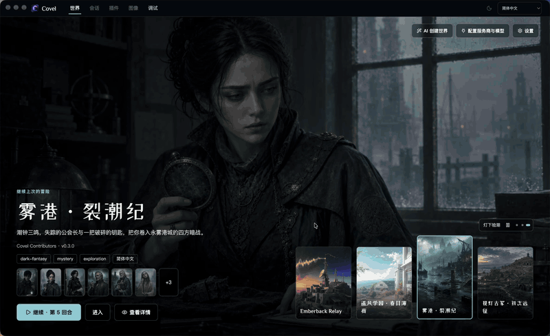](https://covel.cc/)

**[▶ Watch the full demo at covel.cc](https://covel.cc/)** · **[🎮 Play in your browser at demo.covel.cc](https://demo.covel.cc/)** · **[📖 Documentation](https://covel.cc/docs/en/)**

Covel is an AI RPG framework and playable studio where NPC relationships, lore, quests, inventory, memory, stage direction, and media can evolve between turns. Its architecture has three clear layers: the **kernel provides primitives and orchestration**, **plugins provide behavior**, and **world packs provide settings, resources, and a default plugin composition**.

> **Source version: v0.0.53**, early access. APIs, world data, and plugin manifests may change between versions. Current binaries target macOS Apple Silicon and Windows x64 and are unsigned; macOS builds are not notarized. Each release attaches a `SHA256SUMS.txt` to check a download against. v0.0.53 runs the desktop backend on the bundled Electron runtime and requires macOS 13.5 or later; source and Docker deployments need Node 26.12.1. Read the [breaking changes](./docs/CHANGELOG.md#breaking-changes-in-v0053) and [upgrade notes](./docs/CHANGELOG.md#upgrade-notes-for-v0053) before upgrading. Upgrades from v0.0.51 or earlier also follow the v0.0.52 [breaking changes](./docs/CHANGELOG.md#breaking-changes-in-v0052) and [upgrade notes](./docs/CHANGELOG.md#upgrade-notes-for-v0052): **v0.0.52 and later refuse to start on an SQLite or PostgreSQL database created by v0.0.51 or earlier; recreate it** (sessions are not migrated; browser-private saves are not affected). Older upgrades also follow the [v0.0.51 upgrade notes](./docs/CHANGELOG.md#upgrade-notes-for-v0051), the [v0.0.50 breaking changes](./docs/CHANGELOG.md#breaking-changes-in-v0050) and [upgrade notes](./docs/CHANGELOG.md#upgrade-notes-for-v0050), the [v0.0.49 upgrade notes](./docs/CHANGELOG.md#upgrade-notes-for-v0049) and the [v0.0.48 breaking-change notes](./docs/CHANGELOG.md#breaking-changes-and-upgrade-notes-for-v0048); versions before v0.0.42 also require the [v0.0.42 upgrade guide](./docs/en/internals/upgrade-0.0.42.md). Back up affected storage before upgrading; development data is not automatically migrated.

## Highlights

- 🎭 **Stage mode** — a full-screen visual novel: scene backdrops, character sprites, typewriter dialog, and choice overlays. Backdrops come from the world pack's scene art; a location without one shows the world image. Community illustration plugins add separate prompt-and-gallery workflows; see [image generation](./docs/reference/image-generation.md).
- ⚙️ **Composable plugin runtimes** — combine LLM agents, deterministic functions, UI panels, data schemas, events, and lifecycle hooks in one capability-driven pipeline.
- 🎲 **RPG mechanics built in** — pre-rolled dice checks with visible receipts, an auto-tracked quest log, a player-managed inventory, and per-NPC affinity meters. All optional plugins; worlds can seed quests, gear, and starting affinity.
- 🧩 **Plugins stay replaceable** — the kernel resolves versioned contracts and declared output visibility; framework code does not branch on concrete plugin IDs.
- 🎲 **Optional point-buy rules** — `tabletop-rules` uses the same typed forms, validators and deterministic tools available to third-party ZIP packages. Narration perspective is configurable in both narrative plugins; prose streams as it is written, and the reviewed text replaces it on completion.
- 🌍 **Portable world packs** — bundle lore, character schemas, cast, rules, memory blocks, quests, items, portraits, scenes, and plugin defaults behind one `WorldData` import protocol.
- 🔄 **One shared WorldIR** — a post-turn fact projection lets quests, inventory, affinity, the codex, and relationship plugins reuse the same evidence instead of independently re-reading the story.
- 🕯️ **Hidden story events** — worlds ship events that stay out of prompts, tools, and public APIs until their dimension, world-time, or chained conditions hold; an optional planner plants follow-up events during play.
- 🔌 **Bring your own model** — OpenAI / Anthropic / DeepSeek / Qwen model slots. Local-first: SQLite on disk; Web mode stores API keys in browser localStorage, while desktop mode saves them as plaintext in `~/.covel/keys.env`.

## Two ways to play

|                                 Stage mode (visual novel)                                  |                                      Story mode (text)                                       |
| :----------------------------------------------------------------------------------------: | :------------------------------------------------------------------------------------------: |
|                   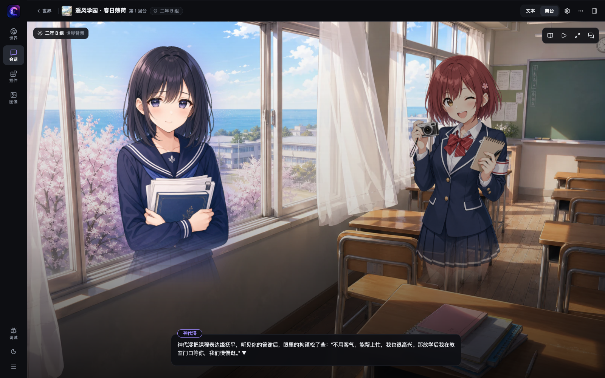                    |                     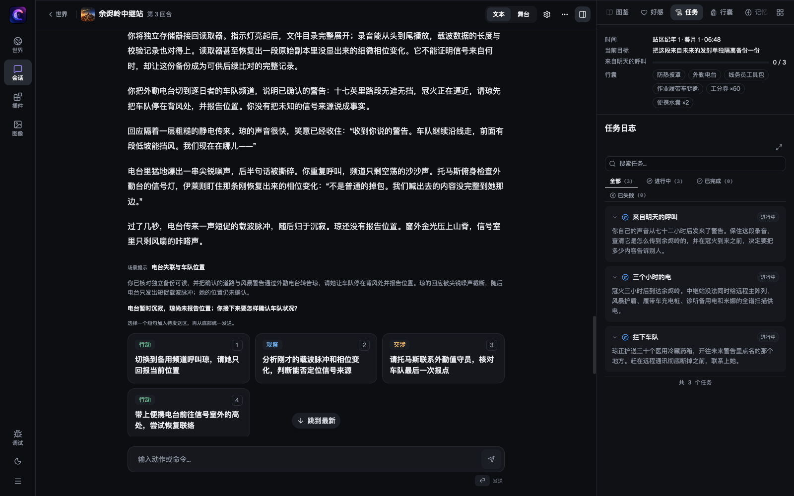                     |
| Backdrops, sprites, and typewriter dialog; scene art resolves and generates as you explore | Classic narrated turns with suggested actions, inline forms, and the per-turn agent timeline |

Worlds declare their default (`defaultViewMode: stage`); you can switch any time in-session.

## Three looks, one setting

|                          Panel                           |                            Book                            |                               Stage                                |
| :------------------------------------------------------: | :--------------------------------------------------------: | :----------------------------------------------------------------: |
| 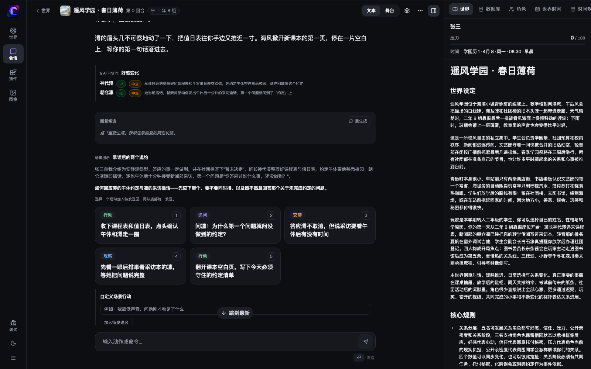 |   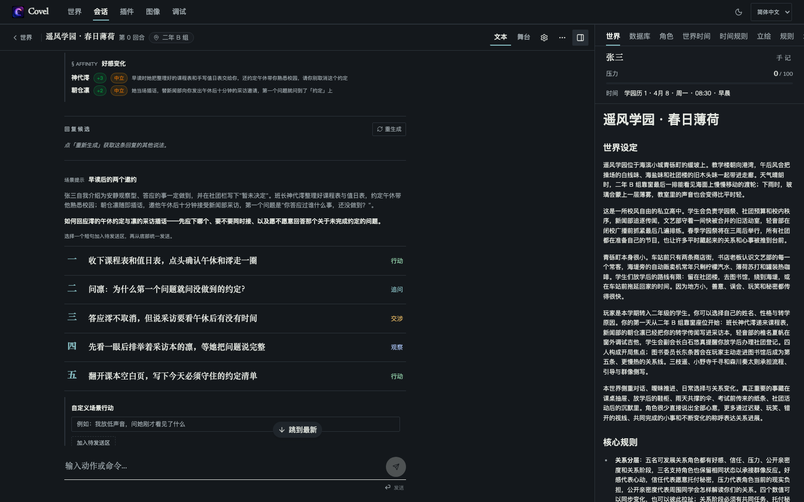   |      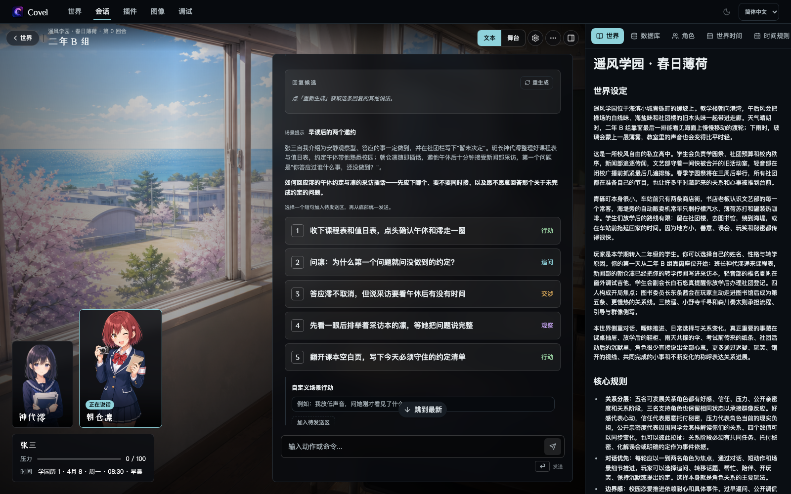      |
| App-like: icon rail, tagged option cards, a status strip | Reading-first: serif prose, numbered options, margin notes | Scene-first: full-bleed art, the cast on stage, key-capped options |

A style scheme changes structure as well as colour — where navigation sits, how options are drawn, what the session does with world art. Pick one in **Settings → Appearance**; the earlier themes live on as colourways of a fourth, Classic. Schemes are theme packages, so you can save your own or import someone else's ([guide](./docs/recipes/themes.md)). Plugin UI follows whichever scheme is active without knowing about it.

## How the pieces fit together

| Layer              | Owns                                     | Typical contents                                                                              |
| ------------------ | ---------------------------------------- | --------------------------------------------------------------------------------------------- |
| **Kernel**         | Stable primitives and orchestration      | scheduling, context assembly, tools, proposals, validation, persistence, rendering            |
| **Plugin package** | Reusable gameplay behavior               | agent/function runtimes, UI, schemas, tools, events, projections, lifecycle hooks             |
| **World pack**     | Portable setting and product composition | lore, characters, rules, plugin policy/settings, memory blocks, world data, portraits, scenes |

The boundary matters: a world can select a different narrator or omit quests without changing the kernel; a plugin can work in many worlds without knowing their IDs; and a world author can add genre-specific data without forking a plugin.

## Plugins are capability packages

A plugin is not necessarily one autonomous agent. It may contain one runtime, several cooperating runtimes, no LLM at all, or only a UI/data contract.

| Form                      | What it does                                                               | Bundled examples                                          |
| ------------------------- | -------------------------------------------------------------------------- | --------------------------------------------------------- |
| **Agent runtime**         | Uses a model for narration or structured extraction                        | `narrator`, `codex`, `world-ir`                           |
| **Function runtime**      | Runs deterministic, zero-token game logic                                  | `pregame`, `inventory/ledger`, `scene-stage/cast`         |
| **Mixed package**         | Pairs deterministic functions with an agent in one package                 | `npc-graph`, `world-time`                                 |
| **Lifecycle hooks**       | Applies cross-cutting policy around scheduling, models, tools, and commits | `narrator` (draft review), `char-creator` (profile guard) |
| **UI and data contracts** | Declares panels, memory blocks, schemas, or world-data targets             | `memory`, `character-blueprint`                           |

Root `PLUGIN.md` declares the versioned contracts a package `requires` and shared `contributes` such as tools, events, UI, and settings. The loader works out the rest: the ID is the directory name, the package provides each runtime's `io.output.contract`, and a runtime with a `function` block is a function while one without is an agent. The smallest plugin is a single `PLUGIN.md` with a description, a stage, and a prompt. A single executable runtime goes under its explicit `runtime` field. A multi-runtime package instead places execution manifests under `runtimes/*/RUNTIME.md`:

```text
plugins/npc-graph/
├── PLUGIN.md                         # package identity, contracts, contributions
└── runtimes/
    ├── rag-retriever/RUNTIME.md      # deterministic pre-turn retrieval
    └── extractor/RUNTIME.md          # post-turn relationship agent
```

The two layouts cannot be mixed. Packages containing only entry code, hooks, UI, or data declarations need no runtime. Runtimes declare visibility in `io.visibility` and can publish an output contract through `io.output.contract`; an agent uses its own manifest body as model instructions. Runtime results separate business `output`, explicit `effects`, and `completion`, so an ordinary data field cannot accidentally trigger a write or end setup. See the [plugin contract reference](./docs/reference/plugins.md) for the authoring format and result boundaries.

The kernel connects these pieces through contracts, typed extension points, and public UI slots. Narrators, image providers, stage directors, and rules systems can be replaced without framework branches for a particular plugin ID.

Author and validate extensions as independent community packages, including installation, approval,
restart and removal. See [plugin testing](./docs/plugins/testing.md) and the
[player-flow checks](./docs/internals/e2e-testing.md#发版前的玩家流程验收). Framework releases share one version;
plugins and world packs may use their own versions.

## World packs make a setting playable

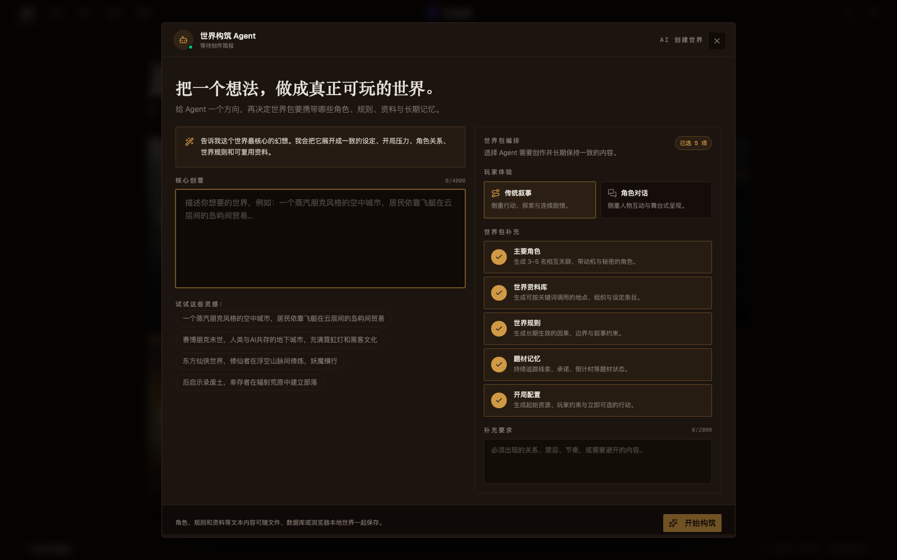

A world pack is the portable content layer. `world.yaml` describes identity, locales, presentation, character attributes and the desired plugin composition. `WORLD.md` provides canonical lore. `data/world.data.yaml` maps typed sources into world metadata, characters, lorebook entries, media indexes, or plugin-owned namespaces.

```text
worlds/my-world/
├── world.yaml                        # identity, pluginPolicy, pluginSettings
├── WORLD.md                          # canonical setting and opening premise
├── data/
│   ├── world.data.yaml               # ordered source → schema → target imports
│   ├── dimensions.yaml
│   └── rules/
├── characters/characters.json         # characters, with roleplay notes
└── media/
    ├── portraits/
    ├── scenes/
    └── presence and scene indexes
```

`pluginPolicy` picks a built-in pack with `preset` and adds the plugins the world also wants with `plus`; versioned contracts resolve their dependencies, and the player can still change the selection before the game starts. `requires` lists contracts the world cannot run without, such as `action-check@1`: any installed plugin that provides the contract satisfies it, and the game cannot start while none does. `pluginSettings` supplies world defaults below player overrides. WorldData imports to `memory.blocks@1` add genre-specific memory definitions such as clues, suspects, signal logs, or countdowns without modifying the memory plugin.

`WorldData` is the shared import protocol, not a second world format. Its sources can be YAML, JSON, Markdown, text, or media and can target canonical characters/lorebook data or a plugin namespace that explicitly accepts world data. The in-app AI builder produces the same standard package: it can generate the manifest, lore, dimensions, main cast, lorebook, and rules from a structured creative brief. File-backed packs can include full media; browser/store-backed generated worlds retain a portable text fallback while media remains file- or asset-backed.

## Internationalization across UI, plugins, and worlds

Covel ships with `zh-CN`, `en-US`, and `ru-RU` UI catalogs. The interface language selects labels. A session has one content language, fixed when the session is created, and it is always a language the world has an edition in. Each authored file is written in one language; a translation is a file beside it that holds only the translated text:

```text
apps/web/src/i18n/locales/ja-JP.json       # application UI catalog
plugins/my-plugin/locales/ja.yaml          # a plugin's labels, UI text and messages
worlds/my-world/world.ja.yaml              # world name, summary, attribute names
worlds/my-world/WORLD.ja.md                # localized setting document
worlds/my-world/characters/characters.ja.json
worlds/my-world/data/rules/core.ja.yaml
```

A world pack declares its own language with `defaultLocale`; each `world.<locale>.yaml` or `WORLD.<locale>.md` adds an edition. A text that an edition does not translate falls back to the world's own language, so a partial translation remains playable, and `pnpm validate:world` lists what is missing. The four built-in worlds ship Chinese and English editions; **Emberback Relay** is written in English (`defaultLocale: en-US`) and the other three in Chinese. A world without the player's language can be translated in the app or with `pnpm i18n translate`.

Players, world authors, and plugin authors can follow the [i18n guide](./docs/reference/i18n.md) to add another language. Complete JSON catalogs in `apps/web/src/i18n/locales/` are discovered automatically at build time and appear in Web language selectors without manual registration. Rebuild to include a new catalog; Electron-native messages use English when that language is not bundled. Content support adds locale files as needed: `locales/<lang>.yaml` in a plugin, and `world.<lang>.yaml`, `WORLD.<lang>.md` and source files such as `data/rules/core.<lang>.yaml` in a world. Plugin prompts stay English, with an optional Chinese variant; the model writes in the session language. Only natural-language content is translated—stable IDs, contracts, tools, paths, and scheduling remain canonical. Run `pnpm check:i18n` to validate the result.

## Debug every turn end to end

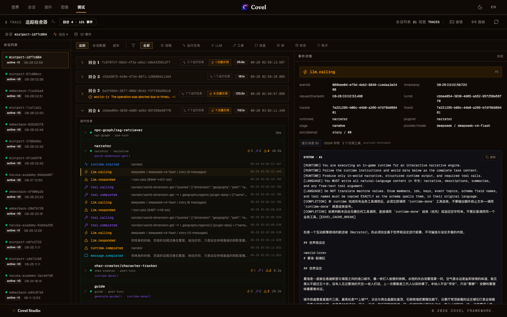

The built-in Trace Inspector groups execution by session and turn, then exposes each runtime and every flow, LLM, tool, message, block, state, and hook event. Expand a runtime to see its call sequence, token counts, timings, tool arguments, and results; open an event to inspect request metadata, prompt messages, available tool definitions, and the raw payload. Separate Session Data and Cost views make the same workspace useful for gameplay QA, plugin authoring, and provider-cost analysis.

## Every roll leaves a receipt

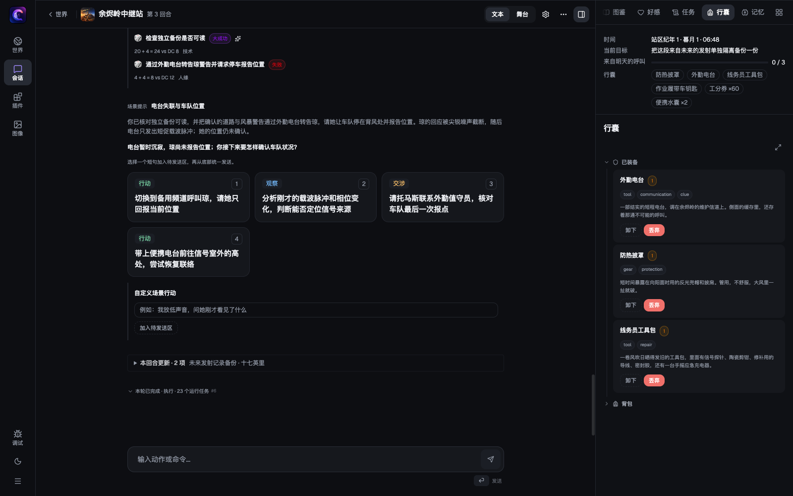

A risky action resolves against dice rolled **before** the narrator writes, so the outcome cannot be retconned to fit the prose — and the arithmetic posts inline: `19 + 2 = 21 vs DC 16`. Quest progress, gear changes, and affinity shifts land in the turn the same way, then accumulate into their own panels. Dice, quests, inventory, and affinity are four separate plugins; a world seeds the opening quests, starting gear, and initial affinity, or ships without any of them.

## What persists between turns

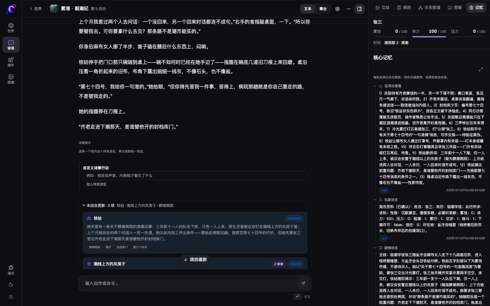

Open a side panel mid-play and you are reading the state carried forward from the world pack and this session: core memory (running plot, current scene, player state), the NPC relationship graph, the world codex, and the on-stage cast. World authors can seed characters, rules, quests, items, affinity, and media; plugins keep that state evolving as you play, then feed the relevant parts back into later turns.

## Quick start

### Play in the browser

Open **[demo.covel.cc](https://demo.covel.cc/)**, the official public trial, and bring your own API key. Your saves and keys stay in your browser; the server keeps only the temporary copies it needs in memory and never writes your keys to disk, a database or its logs. A notice at the top links to the exact open-source commit the trial runs, deployed automatically from this repository.

It is a trial on a free instance: it sleeps after 15 minutes without visitors (the next visit takes about a minute), generated images are lost when it restarts, and saves cannot be exported yet, so keep important progress in the desktop app. Use a separate key with a spending limit. What lives where and who could see your key: [Play on a public trial](./docs/en/start/hosted-trial.md). Run your own: [Deploy a trial on Render](./docs/en/start/deploy-render.md).

### Play

Download the **macOS Apple Silicon (macOS 13.5+)** or **Windows x64** build from [Releases](https://github.com/ackness/covel/releases). The guide appears on your first visit to world selection: choose your interface language, then add a connection and model in **Configure Providers & Models**, test connectivity, check assignments in **Model Roles**, then choose a world, confirm its play pack, and start. Existing model settings can be reused.

You can skip the guide to browse worlds, but configure a model before generating a story. Reopen **Getting started guide** from world selection at any time. Complete any character creation or opening choices before entering actions to advance the story.

Your data lives in `~/.covel/` (config, keys, SQLite, custom worlds, logs). If `config.toml` redirects `data_root`, that separate directory also holds data. See the [desktop config guide](./docs/en/reference/desktop-config.md) and [`docs/CHANGELOG.md`](./docs/CHANGELOG.md) before upgrading.

### Get plugins and worlds

- **[Plugin directory](https://github.com/covel-ai/covel-plugins)** — official image-generation and TTS plugins, the Jev demo, authoring examples, and a separate community list.
- **[World directory](https://github.com/covel-ai/covel-worlds)** — official world examples and a separate community list of playable settings.

Both directories open in English and link to Chinese and other available translations. In **Settings → Install & manage**, paste a repository or package-directory GitHub URL, preview the plugins and worlds found there, tick what to install, and confirm the risks once. The selection installs as a unit, plugins first, so a world arrives together with the plugins it needs; a [collection](./docs/ship/collections.md) manifest lets an author list such a set, including packages in other repositories. Downloads use your configured proxy. Plugins require a backend restart and session authorization; newly installed worlds are available immediately.

Use **Check for updates** beside an installed package to review changes. Confirmed updates take effect after backend restart; local edits block replacement. See the [plugin installation guide](./docs/reference/plugin-installation.md) and [world installation guide](./docs/reference/world-installation.md).

### Run from source

```bash
pnpm install --frozen-lockfile
cp .env.example .env              # server and storage settings
cp llm.toml.example llm.toml        # model IDs and endpoints
cp .env.llm.example .env.llm        # provider API keys
pnpm dev                            # web :5173 + server :3001 (SQLite)
```

Open <http://localhost:5173> — debug tooling lives at `/debug`. For personal use, you can configure a connection, endpoint, model, and key entirely in Settings; `.env.llm` is optional. UI selections override the project `llm.toml` without modifying it. Browser settings and keys stay in this browser; Electron uses personal files under `~/.covel`. SQLite and PostgreSQL store instance-owned sessions. The default Docker profile is a personal instance bound to loopback, not a public multi-player service. Docker setup, in-memory browser checkpoints, and precedence: [env registry](./docs/reference/env-registry.md).

## Worlds in the box

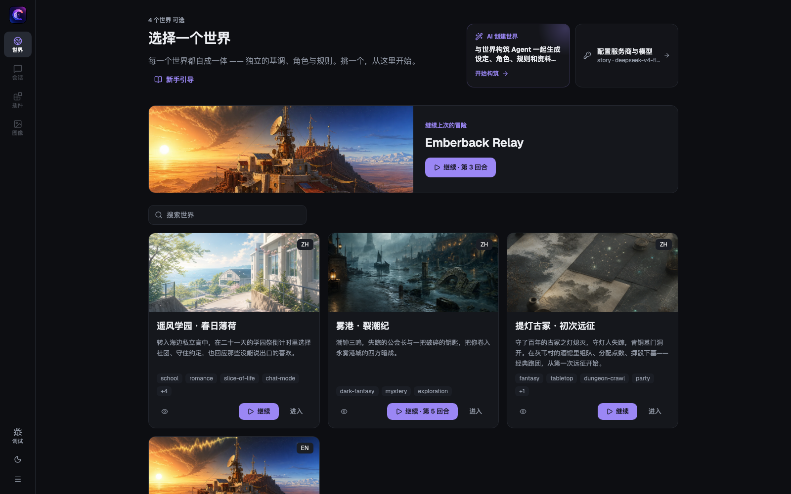

- **Mistport: The Riftide Chronicle** (雾港・裂潮纪) — the traditional-story demo: a dark-fantasy investigation. Its custom plugin pack, bilingual lore, investigation memory, cast blueprints, rules, and portraits show how a world can specialize the framework without forking it.
- **Harukaze Academy** (遥风学园) — the stage-mode demo: a school ensemble romance. Dialogue policy, character relationships, memory blocks, transparent sprites, and day/night scene registries turn the same kernel into a visual novel.
- **Emberback Relay** — written in English (`en-US` is the default) to show how one world can carry several languages, with a Chinese edition. It is a science-fiction frontier mystery in traditional-story mode. A lonely relay on a tidally locked world receives a distress call in your own voice from seventy-two hours ahead. It also has seeded quests, inventory, affinity, rules, character blueprints, portraits, and five check attributes.
- **Lantern Barrow: The First Delve** (提灯古冢・初次远征) — the tabletop-mode demo: a bilingual classic dungeon crawl. Point-buy character creation, d20 attribute checks, quests, inventory, companion affinity, and live delve-map, alarm, lantern, and renown panels; it requires the `action-check@1` contract instead of naming a dice plugin.

## Create your own

Use **AI Create World** in the world picker to turn a creative brief into a validated, playable world pack. Choose traditional narration or character dialogue, then include the cast, lorebook, rules, genre memory, and opening configuration you need.

Repository authors can also use the bundled helpers:

- **`/create-world`** — generate and validate `world.yaml`, `WORLD.md`, and WorldData files. Desktop packs go in `<data_root>/worlds/` (default `~/.covel/data/worlds/`); source runs use `COVEL_USER_WORLDS_DIR`, defaulting to `$COVEL_HOME/worlds/` (otherwise `~/.covel/worlds/`).
- **`/create-plugin`** — scaffold the right combination of runtime manifests, handlers, schemas, tools, UI, and tests for a capability package.

Share your work by submitting a directory-entry PR to [covel-plugins](https://github.com/covel-ai/covel-plugins) or [covel-worlds](https://github.com/covel-ai/covel-worlds). Packages can stay in your own repository; follow the contribution guide in the matching directory.

## Develop

- [Plugin authoring guide](./docs/plugins/essentials.md) — start here; bundled plugins under [`plugins/`](./plugins/) are working references
- [Design principles](./docs/internals/design-principles.md) — what belongs in the kernel and what belongs in a plugin
- [Architecture & turn pipeline](./docs/internals/flow.md) — how a turn flows through trigger → schedule → runtimes → commit
- [World data](./docs/reference/world-data.md) and [collections](./docs/ship/collections.md) — author a world pack and ship it with its plugins
- Reference: [plugin contract](./docs/reference/plugins.md) · [extension points](./docs/reference/extension-points.md) · [tools](./docs/reference/tools.md) · [HTTP API](./docs/reference/api.md) · [full doc index](./docs/README.md)

pnpm workspaces + Turborepo · ESM-only · TypeScript strict · React 19 + Hono + Drizzle. Repo layout and package list → [`AGENTS.md`](./AGENTS.md#monorepo-structure).

## Roadmap

- Linux / Intel Mac builds (macOS arm64 and Windows x64 already ship)
- Web catalog for the plugin and world directories
- Plugin marketplace inside the desktop app

## Contributing & license

Issues and PRs welcome — please read [`docs/CONTRIBUTING.en.md`](./docs/CONTRIBUTING.en.md) and the [Code of Conduct](./CODE_OF_CONDUCT.md) first. Releases are tag-driven: pushing `v*` builds and publishes the macOS and Windows installers via [GitHub Actions](./.github/workflows/release.yml).

[MIT](./LICENSE) © 2026 Covel Contributors

## Star History

<a href="https://www.star-history.com/?repos=ackness%2Fcovel&type=date&legend=top-left">
 <picture>
   <source media="(prefers-color-scheme: dark)" srcset="https://api.star-history.com/chart?repos=ackness/covel&type=date&theme=dark&legend=top-left" />
   <source media="(prefers-color-scheme: light)" srcset="https://api.star-history.com/chart?repos=ackness/covel&type=date&legend=top-left" />
   
 </picture>
</a>
