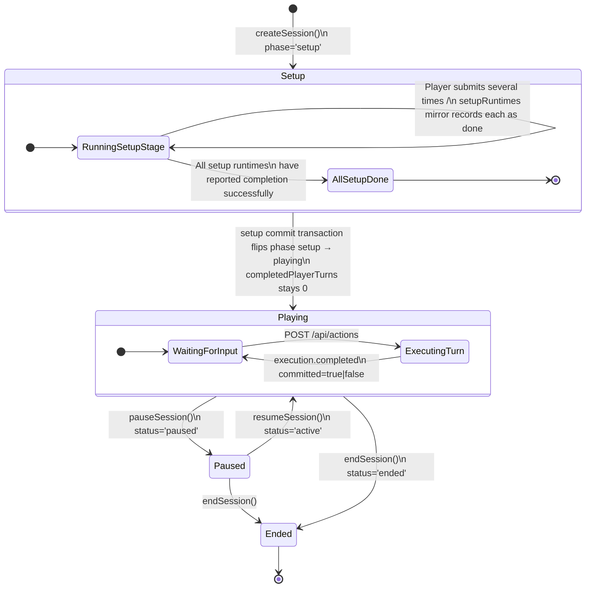
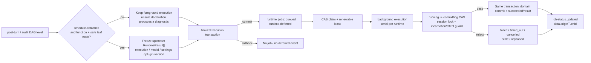
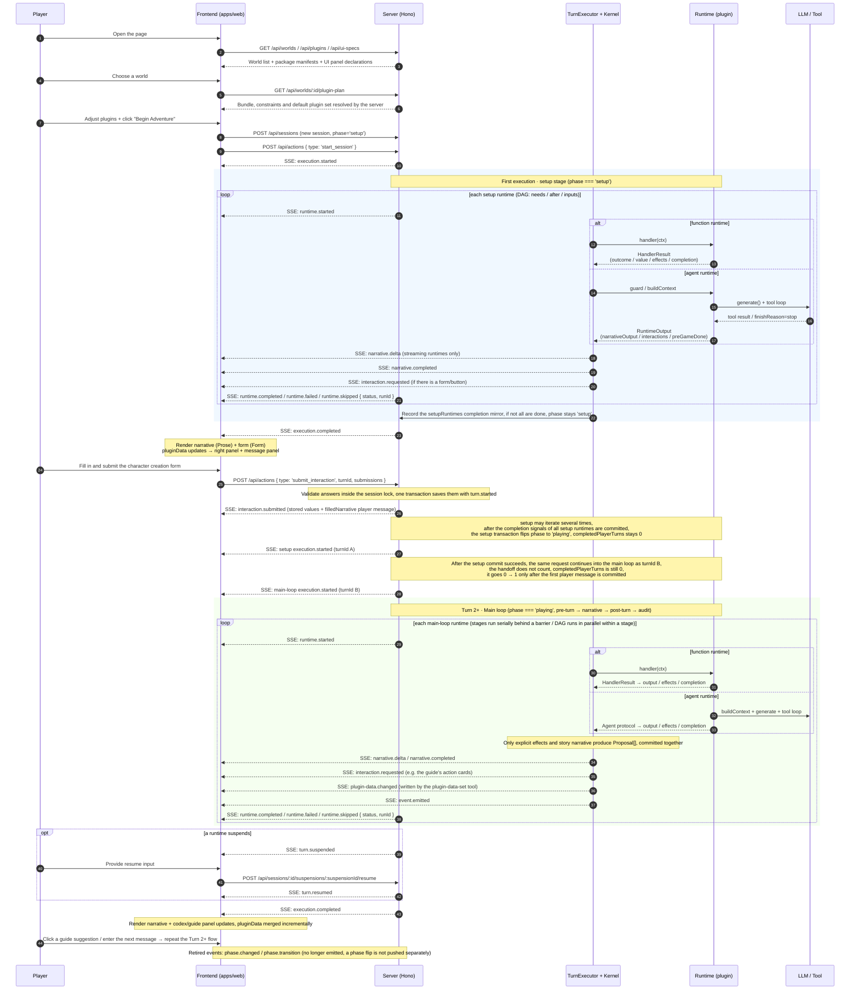

# Turn pipeline: architecture and execution flow

This page explains how Covel turns one line from the player into a passage of story. It covers the steps a turn goes through from start to finish, where the data is written, and how the screen is updated. Read it first if you want to change the framework itself, or if you want to find out which layer a problem is in. If you only build worlds or write plugins, you do not need it.

The first part walks through the flow without technical terms. The sections after it give the details. The full field contracts are in the [reference](../reference/index.md). This page only explains how the parts connect.

## First look: after the player presses send

Learn these four terms first. They are used all the way through this page:

- **Plugin**: a folder that holds the gameplay. The part that tells the story, the part that keeps notes, and the part that rolls dice are all plugins.
- **Runtime**: a piece of a plugin that can run. It is either a prompt written for the model (`agent`) or a JS function (`function`). A plugin can have zero, one, or several runtimes.
- **Kernel**: the part of the framework that does the scheduling. It decides which runtimes run in this turn, in what order, what each one can see, and how the results are saved. It does not know any specific gameplay.
- **Proposal**: one item that a runtime wants to save, for example "append this passage of story text" or "set this character's health to 12". A runtime can only propose. The kernel checks the proposals and then writes them all together.

The player types "I go explore the swamp" and presses send. Then these things happen:

1. **The frontend sends a request.** The browser sends the sentence to `POST /api/actions`. The connection stays open. The server keeps sending events down it one at a time (this is called SSE), and the frontend updates the screen a little with each event.
2. **The server queues the request.** A session does only one thing at a time. Before the server locks the session, it waits for any background work from the previous turn to finish, if that work declared that the next turn must read its result.
3. **The plugins for this turn are fixed.** The version of each plugin and the tools it provides are fixed when the turn starts, and they stay the same until the turn ends. If a plugin is hot-reloaded in the middle of a turn, the change takes effect only in the next turn.
4. **The kernel picks the runtimes for this turn.** Each runtime declares when it runs: every turn, every few turns, when an event happens, or only when it is called by name. The kernel picks runtimes by these declarations.
5. **The runtimes run in four stages, one after another.** `pre-turn` (prepare the material), `narrative` (write the story text), `post-turn` (sort out what happened in this turn), and `audit` (check). A stage must finish completely before the next one starts. Inside one stage, runtimes that do not depend on each other run at the same time.
6. **A runtime runs.** The kernel first checks that everything the runtime needs is there. Then it prepares what the runtime can see: the world setting, the earlier conversation, the results of upstream runtimes, and the player's sentence. An `agent` gives all of this to the model. The model can call tools until it gives a final result. A `function` simply runs its function.
7. **Results become proposals.** Story text, forms, state changes, and the plugin's own data all become proposals first. At this point, nothing has been written to the database yet.
8. **One write.** The kernel checks all the proposals and writes them in one database transaction. The player's input, the conversation log, and the session's turn count are written in the same transaction. Either everything is written, or nothing is.
9. **The frontend is told.** After a successful write, the server sends events: the story text, any form to fill in, and the panel data that changed. The frontend uses them to update the message area and the right-hand panel.
10. **Wrap-up.** The last event is `execution.completed`. Its `committed` field says whether this turn was really saved. Slow wrap-up work, such as tidying up memory, can move to the background, so the player does not have to wait for it.

The start is a little different. A new session starts in the "setup" phase (`setup`). Only the runtimes for setup run during this phase, for example the one that generates the character form. When all the setup is done, the session enters the "playing" phase (`playing`) and starts the four-stage turns described above.

The sections below expand on each step.

## 1. The whole system

There are three parts: the frontend (`apps/web`), the server (`apps/server`, built on Hono), and storage (`DataStore`). Plugins and world packs are files that the server loads when it starts.

```
┌─────────────────────────────────────────────────────────────────────────────┐
│                              Covel Architecture                             │
│                                                                             │
│  ┌──────────────┐    SSE/HTTP     ┌──────────────────────────────────────┐  │
│  │ Frontend     │◄──────────────► │            Server (Hono)             │  │
│  │ (apps/web)   │                 │  ┌────────────────────────────────┐  │  │
│  │              │                 │  │         Turn Executor          │  │  │
│  │ json-render  │                 │  │  ┌──────────────────────────┐  │  │  │
│  │ catalog      │                 │  │  │     Stage Scheduler      │  │  │  │
│  │ pluginData   │                 │  │  │ setup→pre-turn→narrative │  │  │  │
│  │ SSE client   │                 │  │  │  →post-turn→audit + DAG  │  │  │  │
│  └──────────────┘                 │  │  └────────────┬─────────────┘  │  │  │
│                                   │  │               │                │  │  │
│  ┌──────────────┐                 │  │       ┌───────────────┐        │  │  │
│  │ Plugins      │                 │  │       │  LLM Gateway  │        │  │  │
│  │ PLUGIN.md    │──loads─────────►│  │       └───────┬───────┘        │  │  │
│  │ tools/*.js   │                 │  │               │                │  │  │
│  │ ui/*.json    │                 │  │       ┌───────────────┐        │  │  │
│  └──────────────┘                 │  │       │   Tool Loop   │        │  │  │
│                                   │  │       └───────┬───────┘        │  │  │
│  ┌──────────────┐                 │  │               │                │  │  │
│  │ Worlds       │                 │  │       ┌───────────────┐        │  │  │
│  │ world.yaml   │──loads─────────►│  │       │ Session Kernel│        │  │  │
│  │ WORLD.md     │                 │  │       │  (Proposal →  │        │  │  │
│  └──────────────┘                 │  │       │    Commit)    │        │  │  │
│                                   │  │       └───────────────┘        │  │  │
│                                   │  │                                │  │  │
│                                   │  └───────────────┬────────────────┘  │  │
│                                   │                  │                   │  │
│                                   │  ┌───────────────▼────────────────┐  │  │
│                                   │  │           DataStore            │  │  │
│                                   │  │  sessions │ messages │ plugin  │  │  │
│                                   │  │  results │ characters │ data   │  │  │
│                                   │  └────────────────────────────────┘  │  │
│                                   └──────────────────────────────────────┘  │
└─────────────────────────────────────────────────────────────────────────────┘
```

The names in the diagram:

| Name            | What it does                                                                               |
| --------------- | ------------------------------------------------------------------------------------------ |
| Turn Executor   | Runs one turn: picks the runtimes, sets their order, and runs them one by one              |
| Stage Scheduler | Sets the order by stage. DAG means the graph of "who depends on whom"                      |
| LLM Gateway     | The single exit for calls to the model                                                     |
| Tool Loop       | The loop in which the model calls a tool, reads the result, and then decides the next step |
| Session Kernel  | Turns results into proposals, checks them, and writes them                                 |
| DataStore       | The storage interface. The backend can be memory, SQLite, or PostgreSQL                    |
| json-render     | The way the frontend draws a UI from JSON. Plugin panels and forms are drawn this way      |

## 2. Session lifecycle state machine

### 2.1 Session lifecycle

Four fields show what state a session is in now. Clients and saves read these fields directly. There is no other source:

| Field                  | Values                        | Meaning                                                           |
| ---------------------- | ----------------------------- | ----------------------------------------------------------------- |
| `status`               | `active` / `paused` / `ended` | Whether the session is running                                    |
| `phase`                | `setup` / `playing`           | Setup phase or playing phase. It decides which stage runtimes run |
| `completedPlayerTurns` | integer                       | The number of player turns that have been saved                   |
| `setupRuntimes`        | one state per setup runtime   | `pending` / `done` / `blocked`                                    |

These four fields have only this one form. Old clock fields are neither accepted nor filled in.



**The source of truth** = `(status, phase, completedPlayerTurns, setupRuntimes)`. Each state is described below.

#### Setup phase

Condition: `status === 'active' && phase === 'setup'`. The scheduler runs only runtimes with `stage: setup`.

A setup runtime reports "I am done" with one of three clear signals:

- a function returns `outcome: "success"` plus `completion: "done"`;
- an agent outputs `preGameDone: true`;
- a guard (the check function that runs before a runtime) returns `{ skip: true }`.

The kernel records the result in `setupRuntimes`. The player can move setup forward by submitting a form or a message several times. For example, the form of `char-creator` is submitted through `submit_interaction`.

Rules for failure:

- Failed, but retries are left: the runtime stays `pending`, and `lastError` is recorded. Sending `start_session` again reruns only the runtimes that are not done. It does not create a new session and does not record a player message again.
- Retries used up (`maxTriggerCount`): the runtime is not counted as done. It becomes `blocked`, and the session stays in the setup phase until the player retries or waives it. The framework does not skip a broken setup step and move on. A `blocked` runtime must first be unblocked through the `retry` endpoint.
- A setup runtime that reads a saved form must not fail every time on the same submission. When a submission cannot be used, void it and send the form again (with a `notice` and the last values). Otherwise the session stays in the setup phase forever.
- When a suspended setup runtime gives its done signal after a resume, the `done` state and the switch of `phase` are written together with the submission that resumed it.
- A setup runtime that is suspended and waits for the player uses up no retry. When its suspended item is abandoned, expires or is voided, the attempt is recorded as failed and the runtime goes back to `pending`, or to `blocked` when the retries are used up.

Setup runtimes can declare dependencies on each other with `needs(scope: session)`. This reads the saved `done` state:

- Target already done: the dependency is met right away.
- Target is `blocked`, or belongs to a plugin that is not enabled in this session: the player must deal with it.
- When a contract dependency is `cardinality: one` (the default): as long as one provider is done, blocked, or can finish first, it does not count as a cycle. When it is `all`: wait for every provider that is still pending.
- Only members that no order can unblock are marked `blocked` before execution, with the reason `setup-session-cycle`.

#### From setup to playing

- **When it switches.** After all setup runtimes report done, the kernel changes `phase` from `'setup'` to `'playing'` in the setup commit transaction. `completedPlayerTurns` is still 0 in this transaction. If the commit fails, the switch of `phase` is rolled back together with `setupRuntimes`.
- **No separate notice.** Switching `phase` sends no separate SSE event, and there is no proposal type for it. The client reads the current `phase`, `completedPlayerTurns`, and `setupRuntimes` from the session response or the snapshot.
- **The opening follows at once (setup completion follow-up).** After the last setup input (for example the character form) is submitted, the same `/api/actions` request first commits the setup phase. Then, with a new `turnId` and a separate transaction, it runs the main loop once right away. So the player sees the first real passage of narrative directly. The same SSE stream, trace, and snapshot cover both executions.
- **The opening does not count as a turn.** The `origin` of this follow-up execution is `continuation`, and it is not counted in `completedPlayerTurns`. The count stays 0 until the first player message in the main loop is committed, and then it becomes 1. So the opening narrative and the first turn share `logicalTurn = 1`. `startTurn` and `every` are both counted with this number.

#### Logical turn number

`logicalTurn` is fixed when an execution starts. It is passed unchanged to the function handler and to its `ctx.tools.call` calls. Both places get the same value. The tool side does not recalculate it.

- After 7 completed player turns, it is 8.
- The initial setup phase and the opening follow-up are both 1.
- A thin host that does not provide an execution clock can leave out this optional field in the tool context.

#### Playing phase

Condition: `status === 'active' && phase === 'playing'`. Each `POST /api/actions` starts one full turn. The turn runs the four stages in order, `pre-turn → narrative → post-turn → audit`, with a strict barrier between stages.

`completedPlayerTurns` counts only committed player turns. Each execution has its own row in `turn_results`. Its `origin` is one of the following:

| `origin`       | What it is                                    | Counted as a turn |
| -------------- | --------------------------------------------- | ----------------- |
| `player`       | A turn started by a player message            | Yes               |
| `continuation` | The opening follow-up after setup is complete | No                |
| `manual`       | A runtime run by name through a plugin RPC    | No                |
| `background`   | Background execution                          | No                |
| `recursive`    | A nested `recursiveCall`                      | No                |
| `resume`       | Recovery after a suspension                   | No                |

When several executions share one logical turn, it is counted only once.

#### Pause and end

When `status === 'paused' | 'ended'`, the scheduler returns nothing directly, and the server rejects `/api/actions`. A paused session can be resumed with `resumeSession()`. Ending is a final state.

#### Atomic boundary of a commit

For one session, these operations are queued behind the same session lock, so they never overlap: the player's input, runtime execution, proposal commit, the conversation log (`TurnMessage` for the player and for runtimes), the session clock writes (`phase` / `completedPlayerTurns` / `setupRuntimes`), the suspension record (suspension artifact), and the automatic snapshot.

These are committed or rolled back together in the same `finalizeExecution` transaction: the execution log, the proposals, the session clock, and the suspension record.

Details to remember:

- Background work started while the lock is held, such as a job worker that was woken, does not inherit the lock. It queues for the lock itself and is never taken for its owner.
- When several locks are needed at once (for example, deleting a session locks all its runtimes), the lock implementation sorts the keys and takes them in that order, so callers cannot deadlock each other whatever order they pass.
- A plugin action's handler runs inside the session lock and has 30 seconds. Past that the action fails and the lock is released. Store calls the handler makes afterwards are refused; store calls already in progress finish before the lock is released. Data written before the limit is kept.
- A few writes happen outside this transaction. None of them switches `phase`:
  - The attempt count of a setup runtime. It updates the count in `setupRuntimes` after the transaction. A rolled-back attempt still uses up a try.
  - Setup runtimes caught in a `needs(scope: session)` cycle. The executor marks them `blocked` before anything runs.
  - The player retrying or waiving a setup runtime in the UI.
  - The execution record. `turn_results` and each runtime's output are written before the commit; `turn_results` starts as `pending` and is settled to `committed` or `failed` after the commit.
- `turn.suspended` is sent only after the commit.
- When a suspension record is saved, an older item of the same runtime that still waits is voided in the same transaction. A resume's commit transaction first checks the record contents noted at the suspension, and writes nothing when one changed.
- The automatic snapshot is taken after all proposals are committed. This makes sure the conversation position, characters, state, and plugin data all belong to the same committed turn.
- `execution.completed.committed` is the final signal to the client. The frontend uses it to confirm or take back what it showed first.
- Event publishing after a commit runs one event at a time, and one failure does not roll back data that was already written. On failure, the host records a `commit.fanout.failed` trace. The session's subscribed stream receives `system.reset` (`reason: "publish-failed"`) and reads everything again. The `execution.completed` event carries `resync: true`.

#### Sending events to the client does not hold up the turn

Sending events to the client does not decide whether the work is done:

- After `onFinalized` confirms that the result is saved, the event is put into a queue with a size limit. Runtime increments and lifecycle events are also only queued. These callbacks do not wait for the network write of SSE.
- The transaction for proposals, the log, and the clock, and the automatic snapshot, still finish inside the same session lock. The identity and `seq` of an event envelope are taken while this execution holds the lock.
- Sending the queue happens last, outside the lock. If the connection is so slow that it times out or drops, the committed content does not change. The model is not run again, and read-only recovery does not treat a successful execution as a failure that can be retried.

#### RPC and event runtimes that run in the background

A runtime that declares `schedule.background: true` does not hold the session lock while it runs. These runtimes are usually external calls that take a few minutes, such as image generation or a manual TTS. Holding the lock would make the player's next message wait in a queue. On a PostgreSQL deployment it would also hit the 30-second limit for getting the lock.

How it runs:

- There are two kinds: a follower that one execution starts and that runs later, and a manual trigger in background mode.
- It is queued as a durable job in `_runtime_jobs`. `origin.activation` is `manual` or `event`. A follower is queued in the commit transaction of the execution that triggered it.
- After a job worker claims the job, it runs the handler **outside** the session lock. Only `processTurnResults` (the finalize transaction plus the automatic snapshot) takes the lock. The final state of the job and the data it writes are committed in the same transaction.
- It cannot suspend to wait for the player, because no player is waiting on it. If the runtime suspends anyway, the job is recorded as `failed` and nothing is committed.

Why this is safe:

- This path does not write the session clock. It passes no `sessionClock`, and `completedPlayerTurns` counts only `origin: "player"`.
- Writes go into a buffer (writeBuffer) first, and finally join the same commit transaction. They do not reach the database piece by piece during execution. The buffer holds only this runtime's own writes; a later runtime of the same plugin sees them when it reads plugin data, but never puts them into its own buffer.
- It does not append conversation messages.
- Concurrent runs of the same runtime are queued by the `<sessionId>::<runtimeId>` job lock. So a "check first, then do" step in the handler, such as "has this already been generated", does not run twice, which would charge the player twice.
- Before the commit, the session state is read again inside the lock. If the player paused or ended the session in the meantime, the result is dropped and not written.

#### Runtimes that move to the background during a turn (staged detached)

`schedule.detached` is a different thing. It does not affect `schedule.background` above. It applies only to `post-turn` / `audit` function leaf nodes that pass the safety check (runtimes that no other runtime waits for). The full process is in section 2.3 below. The main points are:

- The scheduler freezes the upstream results when that layer starts. Only the upstream outputs the runtime declares it depends on are kept. The rest keep only identity and state.
- The job description is written atomically to `_runtime_jobs`, together with the proposals, log, and session clock of the original turn. Right after the commit, `runtime.deferred` is sent, and the player's turn ends here.
- The worker claims the job by using a CAS (an atomic "write only if no one has changed the value" operation) to take a lease. It does not hold the main session lock while running. The same runtime runs only one job at a time.
- Before entering the commit, the job must change from `running` to `committing` with a CAS. Inside the session lock, it checks again that the session and plugin are still the same instance and version, and checks the effects that were actually produced.
- Cancellation, timeout, a stale job, or a lost lease all stop a late result from being committed.

### 2.2 One turn of the pipeline

The diagram below shows the whole process of one execution. Steps 2 to 10 in the walk-through match the boxes in the diagram from top to bottom.

```mermaid
flowchart TB
    In(["POST /api/actions<br/>player input / start game"]) --> Settle["Wait for jobs that settle<br/>wait outside the lock, recheck inside it"]
    Settle --> Capture["Freeze registry / extension generation<br/>Load canonical history and project it"]
    Capture --> Exec[executeTurn]
    Exec --> StartEvt["SSE: execution.started"]
    StartEvt --> Hook1[TurnStart hook]
    Hook1 --> Filter["selectTriggeredRuntimes<br/>manual: match by name (bypasses shouldTrigger)<br/>setup runtime: take pending from the setupRuntimes mirror<br/>others: shouldTrigger (auto + every / event<br/>+ startTurn / maxTriggerCount / cooldownTurns)"]
    Filter --> PreSched["PreSchedule hook<br/>(can narrow the runtime set for this turn)"]
    PreSched --> Band{"phase?"}
    Band -->|setup| SetupBand["setup stage<br/>DAG (needs / after / inputs)"]
    Band -->|playing| MainBand["Main loop<br/>pre-turn → narrative → post-turn → audit<br/>strict barrier between stages, DAG within a stage"]

    SetupBand --> Group
    MainBand --> Group

    subgraph Group["Each DAG level group (parallel within a group, serial across groups; name breaks ties)"]
      direction TB
      Gate["Framework dependency / input / permission checks"] --> G3["PreRuntime hook"]
      G3 --> G1["guard? (agent runtime)"]
      G1 --> G2["SSE: runtime.started"]
      G2 --> RT{"runtimeType"}
      RT -->|function| F1["handler(ctx) → HandlerResult<br/>validate outcome; store output / effects / completion separately"]
      F1 --> G6
      RT -->|agent| G4["buildContext<br/>runtime body + prompt.segment extension segments<br/>+ typed inputs + projected history<br/>→ the first agent compacts and rebuilds against the real system prompt<br/>→ budget again after the PostContextAssembly hook"]
      G4 --> G5["LLM + ToolExecutor loop (per step)<br/>PreStep → PreLLMCall → LLM → PostLLMResponse review<br/>tools run only after acceptance; on rejection, limited corrections<br/>PreToolUse → execute → PostToolUse<br/>records a stop reason (StopReason) when it ends"]
      G5 -->|split agent protocol| G6["RuntimeResult: output / effects / completion"]
      G6 --> G7["PostRuntime hook"]
      G7 --> Final["Validate story output / timeout / parent cancellation"]
      Final --> G8["Single terminal state + turnId / runId<br/>runtime.completed / runtime.failed / runtime.skipped"]
    end

    Group --> Commit["effects + story output → Proposal[] → CommitPipeline.commitAll<br/>PreStateCommit → handler → PostStateCommit"]
    Commit --> SSE["Emit SessionEvent<br/>narrative.delta / narrative.completed<br/>interaction.requested<br/>plugin-data.changed / event.emitted"]
    SSE --> PreGameTick{"phase === 'setup' and<br/>all setup runtimes<br/>have reported completion?"}
    PreGameTick -->|yes| Advance["setup commit: phase setup → playing<br/>completedPlayerTurns stays 0"]
    PreGameTick -->|no| Keep["Keep phase unchanged"]
    Advance --> End["SSE: execution.completed"]
    Keep --> End
```



The boxes that carry hook names in the diagram (`TurnStart`, `PreRuntime`, `PreLLMCall`, and so on) are the points where a plugin can attach a handler. The full list is in the [Hook reference](../reference/hooks.md).

**Stage bands** (fixed rules in `packages/runtime/src/turn-executor/scheduling.ts` and `packages/runtime/src/schedule/`):

| phase       | Stages that can be scheduled               | Meaning                                                                                                                                                                                                                               |
| ----------- | ------------------------------------------ | ------------------------------------------------------------------------------------------------------------------------------------------------------------------------------------------------------------------------------------- |
| `'setup'`   | `setup`                                    | Game setup, for example `pregame`, `world-init/schema-gen`, and `char-creator/player-init`. The order is set only by the declared edges: `schema-gen` uses `schedule.after: [pregame]` to make sure `pregame → schema-gen` runs first |
| `'playing'` | `pre-turn → narrative → post-turn → audit` | Each turn runs the four stages in order. The rules are below                                                                                                                                                                          |

Ordering rules for the main loop:

- There is a strict barrier between stages. The next stage starts only after every runtime in the previous stage has a result (success, failure, or skipped).
- Inside one stage, the order is set by the dependency graph built from `needs`, `after`, and `inputs` bindings.
- Runtimes that do not depend on each other run in parallel. When they tie, `name` gives a stable order.
- A runtime in a dependency cycle, and everything downstream of it, is marked `skipped: dependency-cycle` for this turn. It does not fall back to running in an arbitrary order.

**Proposal types** (all go through the commit chain, defined by `ProposalPayloadMap` in `packages/shared/src/types/proposal.ts`): `narrative.append`, `interaction.request`, `event.emit`, `ui.render`, `asset.generate`, `plugin.data` / `plugin.data.batch` / `plugin.data.delete` / `plugin.data.update`, `character.schema.set`, `character.upsert`, `dimension.initialize`, `dimension.update`, `lorebook.upsert`.

**Plugin dependencies and choosing providers**: four things decide which plugins a session enables: the player's explicit `requested` / `excluded` lists, the authorization state, core declarations, and the versioned `provides` / `requires`.

- An explicit exclusion also works for core plugins.
- If a dependency is missing, the kernel first picks the only regular provider. Then it considers the only default provider.
- When the player explicitly swaps the default provider, this is handled before conflict detection.
- A `conflicts` clash, or two plugins that compete for an extension point that allows only one provider (single), rejects that combination.
- A normal output contract can have several providers. A consumer says whether it wants one or all with `cardinality: one | all`.
- Explicit choices made when enabling and disabling are saved in `session.metadata.pluginSelection`. A recommendation list does not enable plugins by itself.

Before triggering and ordering, `resolveRuntimeProviders` uses the compiled `outputContract` / `defaultProvider` to remove default runtimes that have already been replaced. The server code and runtime authorization of community plugins are still checked separately. Approval status is not granted by a dependency declaration. The framework does not branch on specific plugin IDs.

**Recovering failed tasks**:

- Both single and batch retries create a new execution ID. The original story turn is kept as `sourceTurnId`.
- Only two kinds of results can act as upstream "seeds": the source turn, and the successful non-target results of a committed retry. An output from a guard that explicitly returns `skip: true` also counts.
- A skipped result caused by a failed dependency does not satisfy the dependency.
- Seeds are never committed twice. A retry does not rewrite a completed story text and does not increase the player's turn count.
- Plugin messages are linked to the original story anchor when they are committed. Quick replies on the stage and restores after a refresh use the same ownership rule.

### 2.3 Background pipeline for staged runtimes

Some wrap-up work should not make the player wait, for example tidying up memory after a turn ends. When a runtime declares `schedule.detached: true`, the turn is committed and ends as usual. This runtime then becomes a background job that runs later.



**Which runtimes can move to the background.** The runtime must declare effects. The framework allows writes that are isolated from each other: assets and media, plugin-data that is not reserved by the kernel (within the plugin's own namespace), and UI and HTTP effects. Before the commit, the proposals that were actually produced are checked again. If any of the following is true, the scheduler keeps the runtime in the foreground and emits a diagnostic:

- A foreground consumer is waiting for its result;
- Its result is exported with `recordAs`;
- It can emit events: its `tools.builtin` lists `emit-event`, or it declares `advertiseEvents: true`;
- It changes characters, state, or interactions directly.

**When the turn has a suspension.** When a runtime in the turn suspends, these jobs are not queued yet: they are saved with the suspended item, and the turn is not counted yet either. The exit that ends the turn queues the jobs and counts the turn: the last suspended item resumes successfully, or it is abandoned, expires, or is voided as out of date. The rules are in [Suspensions and turn counting](../reference/api.md#suspensions-and-turn-counting).

**Writes after a suspension.** While an item is suspended, background jobs and manual runs commit as usual. The suspended item notes the content at that moment of every record its saved writes would change. When one of them is changed later, the resume is refused and the item is voided, so the old writes never overwrite the new ones. The rules are in [Out-of-date suspended items](../reference/api.md#out-of-date-suspended-items).

**Time limits.**

| Field            | Counted from               | What it limits                             |
| ---------------- | -------------------------- | ------------------------------------------ |
| `maxQueueMs`     | `enqueuedAt` (queued time) | Time spent waiting to be claimed           |
| `maxExecutionMs` | Entering `running`         | Up to when the runtime's execution returns |

- After the execution returns, the time spent waiting for the session lock to commit is not counted in `maxExecutionMs`. A player turn that was let through after waiting too long may hold the lock for several minutes.
- While waiting for the lock, the lease is still renewed. A job that was already cancelled or timed out still fails the `running → committing` CAS.
- These two fields do not replace the runtime's own `timeoutMs`.

**How the worker takes jobs.**

- By default, up to 4 different runtimes run at the same time. The queue is taken in turns across sessions. Only one job per `(session, plugin, runtime)` can be in progress.
- Queuing, retries, recovery, waiting barriers, and job endings wake the worker by session. Normally it claims only the queues of the sessions that were woken.
- At startup, on wake-ups without a session, and on a maintenance pass every 30 seconds, the worker scans all sessions. Jobs queued by other processes are also picked up this way.

**After a restart.**

| State of the job                      | Result                                          |
| ------------------------------------- | ----------------------------------------------- |
| `queued`, queue time limit not passed | Keeps going                                     |
| Queue time limit passed               | Becomes `timed_out`, not replayed automatically |
| Running, lease expired                | Becomes `orphaned`, not replayed automatically  |

When the player retries on purpose, a new jobId is created.

**At a normal shutdown.**

- A job that has not reached `committing` is stopped first. Once that execution returns, the job goes back to `queued` with the same jobId, and its `attempt` goes up by 1 at the next claim.
- It committed nothing, but what it did outside before it stopped (a provider call, for example) is done again when it reruns. So a background job must be safe to run again.
- A job already in `committing` finishes its commit.
- If the process exits before the execution returns, the job keeps its lease and is handled as "lease expired" after the restart.
- The queue time limit still counts from when the job was first queued.

**Guarantees at commit time.**

- Before the worker enters the commit barrier, it first stops renewing its own lease. `extraInTx` marks the job as "succeeded" with a CAS inside the domain commit transaction.
- If the business logic fails, the completion CAS fails, or the transaction fails at the end, the domain writes and the job's success state are both rolled back.
- The success event is sent outside the transaction. If the event is lost, it can be filled in from the saved final state. The task is not run again.
- When the worker first wakes, and then every 30 seconds, it scans for expired leases. If a scan fails, it retries 1 second later. Maintenance is not affected by the execution slots being full.
- A job in the `committing` state must first get the same commit lock without blocking. If the lock is busy, the job waits for the next round.
- On shutdown, scheduling stops, and the worker waits for ongoing scans and lock callbacks to finish.

### 2.4 The settle barrier before the next execution

Some background work must finish before the next turn starts, because the next turn reads its result. A `post-turn` / `audit` function like this can declare `schedule.detached: { settle: true, maxSettleWaitMs: … }`.

- These tasks can read their own plugin-data. The worker handles them one at a time, in the order of their source tasks.
- `turn-digest@1` in the input is a summary of the source turn that the kernel freezes. It does not need to be bound to any narrative plugin.
- `memory/extract` uses this mechanism to update its own memory block.

The waiting process:

1. Entry points that change the session, such as player actions, RPC calls, resumes, and edits, first check for durable jobs that are not finished yet. They wake the worker and wait **outside** the main session lock.
2. After they get the lock, they check again. This avoids missing a job that was queued between the check and the lock.
3. When the worker commits, it always uses the original session lock and does not enter its own waiting barrier.
4. If the earliest waiting deadline passes and the work is still not done, the kernel records `execution.settle-timeout` and then lets the new execution continue.
5. Jobs the worker cannot start right now are not waited for. For example, when no usable credentials exist for the model a job needs (neither those the request handed over nor the server's own), the job stays queued, and so do the later jobs of the same runtime. The new execution does not wait for them; it records one `execution.settle-skipped` that lists them.

> [!IMPORTANT]
> A settle timeout does not mean the background task succeeded, and it does not mean the task was cancelled. While the new execution holds the session lock, background tasks that have already finished are committed after it. This waiting time does not count toward `maxExecutionMs`.

Only after the barrier is passed is the version used by this execution fixed. This covers the registry, tools, services, hooks, and extension registrations.

- A hot reload that publishes a new version does not change an execution that has already started.
- Revoking authorization is an exception. It is still checked against the live state.
- Nested calls use the execution that was already admitted. They do not wait again while holding the lock.

## 3. Message translation layer (player ↔ LLM agent)

This is the core of the framework. The player sends one line of natural language. The model receives a structured prompt. The model returns structured output. The player sees a rendered screen. The framework does the conversion in between.

### 3.1 Input direction: player → LLM

The part that builds the prompt is called the Context Builder. It puts the content that never changes at the front, and the content that changes each turn at the back.

```
Player input              Framework translation layer        What the LLM receives
────────────              ───────────────────────────        ─────────────────────

"我去探索沼泽"     ──►    Context Builder        ──►         System prompt (the same every turn):
                          │                               │  You are the main narrative generator...
                          │ 1. Load PLUGIN.md             │  <world-lore>九州・云梦泽...</world-lore>
                          │    (agent instructions)       │
                          │                               │  History:
                          │ 2. Inject the world view      │  ...earlier turns...
                          │    {{ world.lore }}           │
                          │                               │  Turn context (resent every turn):
                          │ 3. Inject message history     │  <runtime-inputs>...</runtime-inputs>
                          │    (append-only store)        │  <world-dimensions>...</world-dimensions>
                          │                               │  <player-character>
                          │ 4. Inject this turn's data    │    名字: 陆青云, 灵根: 水灵根...
                          │    upstream output, character │  </player-character>
                          │    sheet, turn-level prompt   │
                          │    segments                   │  [user] 我去探索沼泽
                          │                               │
                          │ 5. Language constraint        │  Tools available:
                          │    "Reply in Chinese"         │  (injected from manifest.tools)
```

The exact order of the prompt sections is in [Prompt structure](../reference/prompt-structure.md).

### 3.2 Output direction: LLM → player

The model's output first becomes proposals. After they are committed, they become events. The frontend renders the events.

```
What the LLM returns        Framework translation layer         What the player sees
────────────────────        ───────────────────────────         ────────────────────

narrativeOutput:      ──►   Session Kernel                ──►   ┌────────────────────────────┐
"沼泽的雾气..."             │                                   │  Story text                │
                            │ normalizeOutput()                 │  (Prose component)         │
interactions:         ──►   │ → Proposal[]                ──►   ├────────────────────────────┤
create-form / form          │                                   │  Character creation form   │
                            │ commitAll()                       │  (Form component)          │
plugin.data:          ──►   │ → SessionEvent[]            ──►   ├────────────────────────────┤
plugin_data writes    ──►   │ SSE emit()                        │  Plugin message surface /  │
                            │                                   │  right panel               │
                            │                             ──►   ├────────────────────────────┤
                            │                                   │  State update              │
                                                                └────────────────────────────┘

                            Each SessionEvent is pushed to the frontend through SSE
                            MessageList renders turn messages
                            MessagePluginSurface / RightPanel render plugin surfaces
```

### 3.3 Translation detail: the tool call chain

When the model wants to do something definite (for example, save a codex entry), it calls a tool. The framework finds the tool, checks permissions, runs it, and hands the result back to the model.

Argument repairs and history replay follow the [tool argument rules](../reference/tools.md#malformed-argument-json-from-the-model). The executor waits for the callback and reads, snapshots the result, and checks cancellation before accepting it. Only then does it record the call and emit `tool.completed`. Later cancellation still aborts the runtime, but does not record the accepted tool call again as a failure. Recording or telemetry errors only warn; they do not change the result or pending proposals.

```
LLM decides to call a tool     Framework handling                         Result
──────────────────────────     ──────────────────                         ──────

LLM: "call sync-           ToolExecutor:
      codex-entries"       1. findTool(name, context)
      { entries: [...] }      ├─ builtin? → direct access
                              └─ local? → check pluginToolAccess
                                          (usable only if declared)
                           2. approval.check()
                              ├─ builtin → auto-allow
                              └─ local → allow (or needs approval)
                           3. tool.execute(params, context)
                              ├─ the tool logic runs
                              ├─ produces domain proposals / execution-local writes
                              ├─ after a successful commit, publishes data events ──► SSE → surface update
                              └─ returns a structured result or `_text`
                           4. The result is serialized into a tool message
                              → `_text` is preferred as the text the LLM reads
                              → the structured result is kept for trace / commit / debugging
                           5. The LLM sees the result and decides whether to call again

                           The Tool Loop converges on the completion contract, budget and cancellation conditions
```

**How a task counts as done.** When the model says "I am finished" (`finishReason: stop`), that alone does not prove that a structured task succeeded. A runtime uses these declarations to say what counts as done:

| Declaration                 | Meaning                                                                                                 |
| --------------------------- | ------------------------------------------------------------------------------------------------------- |
| `requireToolUse`            | With `completeAfterTools`, a listed tool must succeed; otherwise any successful business tool counts    |
| `completeAfterTools`        | The loop can end once the named final tool succeeds and there is no unresolved tool error in that batch |
| `requireExplicitCompletion` | For tasks that allow "no change": there must be a real write, or an explicit call to `runtime-done`     |

- Writing only story text, or writing a tool call as a JSON text block, does not count as a write.
- An error result cannot turn into a structured success.
- A function runtime can go through the same tools, permissions, argument validation, and transaction boundary by using a declared `ctx.tools.call()`.
- A community handler uses `ctx.pluginData`. It does not get a full writable store.

**Output review happens before tools run.** A plugin can ask for the output to be buffered in `PreLLMCall`. Then in `PostLLMResponse` it can reject the draft and give a correction request.

- At most two corrections are allowed, and they still count against the original budget.
- The two built-in narrative plugins use this to check `narrativePerson`. The default is second person. First or third person is allowed, and dialogue keeps its own point of view.
- After the check passes, they show the whole passage of story text at once. The framework still supports other plugins that stream their output.
- This is a limited text check. It does not guarantee that every plot inference is correct.

**Phases and stop reasons of the tool loop.** An agent's tool loop (`packages/runtime/src/agent-loop/turn-agent-tool-loop.ts`) moves through fixed phases. The phases and their legal transitions are in `agent-loop/loop-state.ts`; an illegal transition throws at once (it is a defect of the loop itself, which no model or plugin can trigger):

```
preparing → awaiting-pre-step → requesting-model → reviewing → running-tools → deciding
              ↑                                       │                          │
              └───────────── next step ←──────────────┴──────────────────────────┘
deciding → finalizing → stopped        running-tools → suspended
```

The loop's behaviour comes from the runtime's loop profile (`resolveLoopProfile` in `agent-loop/loop-profile.ts`), not from `outputKind`: whether text is shown to the player as it streams, whether the player's interjections are merged, whether cut-off story text is kept, whether a repeated tool call turns the tools off or fails (`fallback`), and whether a finalizer runs at the step limit and at the deadline reserve (`finalizer`). Without `agent.loop.profile`, a story runtime uses `story` and any other `system`; fields and values are in [the plugin reference's loop profile](../reference/plugins.md#loop-profile-agentloopprofile). The turn level uses the same resolver to tell whether any runtime still reads the interjection queue.

The order within each step:

1. Check for cancellation; when the profile has `steering`, add the player's interjections to the conversation.
2. The `PreStep` hook: it can narrow this step's tools, change its tool choice, lower the steps left, or end the loop (see the [hook reference](../reference/hooks.md#prestep)).
3. Send `step.started`.
4. `PreLLMCall` → context budget → model call (`llm.calling` / `llm.responded`).
5. The `PostLLMResponse` review; once accepted, the tools run (`tool.*`).
6. Decide whether to end: a completing tool, `runtime-done`, a hook's `terminate`, a final reply without tool calls; otherwise go to the next step.
7. The step's `step.completed` is sent when the next step starts or the loop ends, exactly once for each step that started.

Every way of ending maps to one stop reason (`StopReason`), written to `RuntimeResult.stop` and to the `stopReason` of the runtime lifecycle events. The full table is in [the protocol reference's stop reasons](../reference/protocol.md#stop-reasons). The loop records the ordinary exits itself (`completed`, `tool-finished`, `max-steps`, `deadline`, PreStep's `cancelled`), and `settleAgentLoop` settles the result by it. A thrown exit keeps its original error object, and the reason is attached to the error (`agent-loop/stop-reason.ts`): call sites tag model errors, invalid output, context overflow and loop detection; the loop's outer catch tells apart the player's stop, the loop's own timeout and a parent's cancellation; and `finalizeRuntimeResult` reads the reason from the error into the failed result.

**A step limit is not a success.** When the steps run out, text the model wrote beside a tool call is only a draft. As long as the output is not handed over by a completing tool, `requireToolUse` and `requireExplicitCompletion` are met or off, and at least 3 seconds remain before the deadline, the kernel sends one more request with tools off, the finalizer, asking for the final answer now. When the finalizer writes text, the runtime succeeds and its result is marked `stop.finalizer: true`; otherwise it fails with `max-steps` and its staged writes are not committed. The profile's `finalizer.maxSteps: false` turns this finalizer off. A timeout is a failure and does not try a finalizer; the exception is a profile that sets `finalizer.deadlineReserveMs`: when less time than the reserve is left and the finalizer conditions above hold, the loop starts no new step, merges queued player interjections when the profile has `steering` on, and sends the finalizer instead, which succeeds with `{ reason: "deadline", finalizer: true }` when it writes the answer.

## 4. Plugin design

### 4.1 Plugin structure

```text
plugins/my-plugin/
  PLUGIN.md                  Package identity, contracts, contributes; may inline one runtime
  PLUGIN.zh.md               Chinese variant of the body and fixed prompt segments (canonical is English)
  runtimes/extract/
    RUNTIME.md               Standalone runtime config and body
    RUNTIME.zh.md            Chinese variant of the runtime body
  server/index.js            Registrations for the declared tools/actions/services/extensions etc.
  server/extract.js          function handler
  schemas/                   Input, output and namespace JSON Schemas
  ui/                        json-render specs
  package.json
```

**The root manifest `PLUGIN.md`** describes the whole package:

| Field                                 | What it does                                                                        |
| ------------------------------------- | ----------------------------------------------------------------------------------- |
| `id`, `kind`                          | Who the package is (the directory name and `plugin` when left out)                  |
| `provides` / `requires` / `conflicts` | The contracts it provides (runtime outputs included), needs, or cannot coexist with |
| `contracts`                           | The schemas of the contracts                                                        |
| `contributes`                         | The tools, RPC actions, services, extensions, settings, data, and UI it brings      |

- `contributes.commands` is the metadata for slash commands. Its action must also be declared in `contributes.actions`.
- What the `entry` module actually registers must match the root manifest.

**The way a runtime is written** is always split into groups: `schedule`, `io`, `agent` or `function`, plus `guard`, `effects`, and `permissions`.

- The body belongs to this runtime.
- Choose one of two ways to organize it: an inline runtime in the root file, or `runtimes/*/RUNTIME.md`.
- `agent.tools` and `function.tools` are both allowlists of tools.
- `io.output.contract` must be a contract that the package provides. Within one package, two runtimes cannot declare the same output contract.

**Package-level fields are written only in the root file.** They are not merged in from child runtimes.

- Not accepted: flat frontmatter, a `PLUGIN.md` in a subdirectory, and dedicated memory or prompt fields.
- Fixed instructions shared by runtimes are written in the root `contributes.prompt`. Dynamic content is provided through `prompt.segment@1`.
- Development data made with a form that is not accepted must be created again.

For all the fields, see the [plugin reference](../reference/plugins.md).

### 4.2 Communication between plugins

Plugins work together through versioned contracts and the capabilities that the host provides. A plugin cannot read the private namespace of another plugin.

| Need                           | Interface                                             | Boundary                                                                                                   |
| ------------------------------ | ----------------------------------------------------- | ---------------------------------------------------------------------------------------------------------- |
| This turn's upstream output    | `io.inputs`, `from: { contract: narrative-engine@1 }` | An agent gets a typed input data block. A function uses `ctx.inputs`. The source information is kept.      |
| Hard dependencies and order    | `schedule.needs` / `schedule.after`                   | `needs` sets the order and gates it. `after` only sets the order. Turn input bindings also form DAG edges. |
| Committed exports              | `scope: committed` in `io.inputs`                     | Reads explicit exports. It does not scan other plugins' storage.                                           |
| Querying a business capability | `ctx.services.discover/call`                          | Uses a service contract and the provider's identity. It is not bound to a private table.                   |
| Prompts, history, UI           | Declare and register an extension point               | `collect`, `pipeline`, or `single` decides how they combine and how they compete.                          |
| World characters               | Read-only `ctx.world` and domain proposals            | The kernel validates and commits the schema and characters. Plugins have no copy of the characters.        |

Example: a `post-turn` runtime wants to read this turn's story text.

```yaml
io:
  inputs:
    narrative:
      from: { contract: narrative-engine@1 }
      select: /narrativeOutput
```

- The stage barrier makes sure `post-turn` runs only after the `narrative` stage ends.
- Inside the same stage, runtimes that do not depend on each other run in parallel. The inputs and the declared dependencies decide the order.
- An input is required by default (`required` defaults to `true` and `scope` to `turn`): if it is missing, the consumer does not run.
- An optional input must say `required: false` explicitly. This way a provider that is temporarily absent does not become a required dependency.

**When the data a runtime reads was taken.**

- The domain read view has three parts: the committed CharacterSchema and Characters, the validated upstream proposals, and the writes this runtime is about to commit. So if a tool writes something and reads it right after, it gets what was just written.
- Plugin data works the same way: a runtime that reads its own plugin's data reads the committed value, plus the writes that completed upstream runtimes of the same plugin will commit (in commit order), plus its own buffer. The visible writes are taken when the runtime starts, so siblings of one level do not see each other; upstream results brought by a retry or a background job do not count. A runtime that read an upstream write depends on it: when the upstream is dropped at commit, an auxiliary runtime is dropped with it, while a story or setup runtime commits and the trace records it. Rules: [In-execution plugin-data visibility](../reference/plugins.md#in-execution-plugin-data-visibility).
- The world and plugin-data that extension providers see are frozen when this execution is created. This way the same extension sees the same content in runtimes that run in parallel. Services and extension providers do not see the uncommitted plugin data of upstream runtimes.

### 4.3 Decision tree for plugin triggers

How the kernel decides whether a runtime runs in this turn:

```
        selectTriggeredRuntimes (packages/runtime/src/turn-executor/scheduling.ts)
                                    │
              ┌─────────────────────┴────────────────────┐
              │ manual trigger?                          │  ← an explicit plugin-rpc call = the trigger decision itself,
              │ → selected by name match                 │    it bypasses shouldTrigger and all its gates
              └─────────────────────┬────────────────────┘
                                    │ not manual
              ┌─────────────────────┴────────────────────┐
              │ setup runtime?                           │  ← takes pending from the setupRuntimes mirror,
              │ → done/blocked do not run                │    and also bypasses shouldTrigger
              └─────────────────────┬────────────────────┘
                                    │ main-loop runtime
                shouldTrigger(manifest, context)
              (packages/runtime/src/trigger/trigger.ts,
                the in-turn event fan-out reuses the same function)
                                    │
              ┌─────────────────────┴────────────────────┐
              │ startTurn?                               │  ← logical turn number < startTurn?
              │ maxTriggerCount?                         │  ← over the session's maximum count? (trigger ledger)
              │ cooldownTurns?                           │  ← cooling down? (trigger ledger)
              └─────────────────────┬────────────────────┘
                                    │ pass
              ┌─────────────────────┴────────────────────┐
              │ trigger.type                             │
              ├──────────────────────────────────────────┤
              │ auto      → logical turn % every == 0    │
              │             (every defaults to 1)        │
              │ event     → topic in pendingEvents       │
              └──────────────────────────────────────────┘

  The trigger enum is exactly the three values auto / manual / event, and auto when left out;
  a manifest with any other value is rejected by the loader at load time
  and never reaches the trigger decision.
```

In one line for each trigger type:

| `trigger.type` | When it runs                                                                      |
| -------------- | --------------------------------------------------------------------------------- |
| `auto`         | Every turn; with `schedule.every`, the turns whose logical turn number it divides |
| `event`        | The event it subscribes to is in the pending events                               |
| `manual`       | Only when named by plugin-rpc. None of the gates above apply                      |

## 5. Front-end interaction design

### 5.1 Rendering pipeline

When the frontend receives an SSE event, it first turns the event into a message or data. Then it hands that to the rendering layer. The rendering layer is json-render: the screen is described in JSON, and a fixed set of components (the catalog) draws it.

```
┌──────────────────────────────────────────────────────────────────────────────────┐
│                          Frontend rendering pipeline                             │
│                                                                                  │
│  SSE events                  Message layer                  Render layer         │
│  ──────────                  ─────────────                  ────────────         │
│                                                                                  │
│  narrative.delta         ──►  appendDelta()           ──►  Prose                 │
│  narrative.completed     ──►  addMessage(story)       ──►  Components            │
│                                                                                  │
│  interaction.requested   ──►  addMessage(block)       ──►  messageToSpec()       │
│                                                              │                   │
│                                                              ▼                   │
│                                                        nestedToFlat()            │
│                                                              │                   │
│                                                              ▼                   │
│                                                  ┌────────────────────┐          │
│                                                  │  Renderer          │          │
│                                                  │  (json-render)     │          │
│                                                  │                    │          │
│                                                  │  catalog:          │          │
│                                                  │   Prose            │          │
│                                                  │   Form             │          │
│                                                  │   Button           │          │
│                                                  │   EntryCard        │          │
│                                                  │   Alert            │          │
│                                                  │   ...50 components │          │
│                                                  └────────────────────┘          │
│                                                                                  │
│  plugin-data.changed     ──►  pluginData store    ──►  MessagePluginSurface      │
│                               (updates namespace)      + RightPanel              │
│                                                         json-render Renderer     │
│                                                                                  │
│  execution.started       ──►  executionSteps[]    ──►  Progress bar              │
│  runtime.completed       ──►                                                     │
│                                                                                  │
│  (no phase.changed event) ── the status label is computed by the frontend from   │
│  the session fields (status + phase + completedPlayerTurns); no server push      │
│                                                                                  │
└──────────────────────────────────────────────────────────────────────────────────┘
```

For the list of components, see [UI components](../reference/ui-components.md).

> [!IMPORTANT]
> `narrative.delta` is sent only by runtimes that have streaming output turned on. The built-in narrative plugins currently buffer and review the story text first. So the client cannot count on receiving deltas in every turn.
>
> Only `execution.completed.committed` or a committed record confirms that this turn was saved. A success event from a single runtime is not proof that the whole turn was committed.

### 5.2 Data flow for plugin panels

How the right-hand panel updates by itself after a tool writes plugin data. The example below uses the codex plugin, `codex`.

```
  Plugin tool run                  Server                      Frontend
  ───────────────                  ──────                      ─────────

  sync-codex-entries
  params: { entries: [...] }
        │
        ▼
  withPendingProposals()       ──► execution write buffer
        │                          (plugin.data / plugin.data.batch)
        ▼
  turn finalizer transaction  ──► atomic write to the plugin_data table
        │                          (sessionId, pluginId,
        │                           namespace, key, value)
        │
        ▼
  eventBus.emit({              ──► SSE /events/stream
    topic: "plugin",                or the /actions stream
    _subType: "plugin-data.changed",
    payload: {
      pluginId: "codex",
      changes: [{
        namespace: "entries",
        key: "codex-fire-magic",
        value: { title: "火焰魔法", ... },
        operation: "set"
      }]
    }
  })
        │
        ▼                          ──► frontend SSE handler
                                       │
                                       ▼
                                  applyChanges(pluginId, changes)
                                       │
                                       ▼
                                  pluginData["codex"]["entries"]["codex-fire-magic"]
                                  = { title: "火焰魔法", ... }
                                       │
                                       ▼
                                  useSyncExternalStore → notify listeners
                                       │
                                       ▼
                                  PluginPanel re-render
                                       │
                                       ▼
                                  JSONUIProvider state={pluginData}
                                  Renderer spec={codex-panel.json}
                                       │
                                       ▼
                                  SearchInput + FilterBar + CardList
                                  (new codex entries show up automatically)
```

Three key points: the tool only puts the write into a buffer. The data is really written in the turn's commit transaction. The event is sent only after the write, and when the frontend receives it, the panel redraws by itself.

### 5.3 The full form interaction

The example is the character creation form at the start. It covers everything from sending the form, to the player submitting it, to the first passage of narrative.

```
  ┌────────────────────────────────────────────────────────────────────────────────────────────┐
  │                    Character creation form flow                                            │
  │                                                                                            │
  │  First execution (phase === 'setup', only the setup stage runs):                           │
  │ ┌───────────────────────────────────────────────────────────────────────────────────────┐  │
  │ │ pregame               → initializes session-level metadata                            │  │
  │ │ world-init/schema-gen → initializes the character schema / dimension declarations     │  │
  │ │   (schema-gen's after: [pregame] keeps the two serial;                                │  │
  │ │    runtimes in the narrative / post-turn stages are not scheduled during              │  │
  │ │    setup; later setup sub-rounds keep dispatching the remaining runtimes)             │  │
  │ └───────────────────────────────────────────────────────────────────────────────────────┘  │
  │ ┌───────────────────────────────────────────────────────────────────────────────────────┐  │
  │ │ Later setup sub-round: char-creator/player-init →                                     │  │
  │ │   opening guidance + create-form form                                                 │  │
  │ │   (also stage: setup; turn-scoped needs depend on                                     │  │
  │ │    pregame + world-init/schema-gen)                                                   │  │
  │ └───────────────────────────────────────────────────────────────────────────────────────┘  │
  │                           │                                                                │
  │                           ▼ SSE: interaction.requested                                     │
  │                                                                                            │
  │  Frontend:                                                                                 │
  │ ┌───────────────────────────────────────────────────────────────────────────────────────┐  │
  │ │ messageToSpec(block) → formToSpec(data)                                               │  │
  │ │   → FormHeader + FormField[] + SubmitButton                                           │  │
  │ │   → json-render Renderer renders it as an interactive form                            │  │
  │ │                                                                                       │  │
  │ │ Player fills in: 陆青云 / 水灵根 / 渔民之子 / 灵识敏锐                                │  │
  │ │                                                                                       │  │
  │ │ Click submit → submitInteraction():                                                   │  │
  │ │   POST /api/actions                                                                   │  │
  │ │     { type: "submit_interaction",                                                     │  │
  │ │       payload: { turnId, submissions: [...] } }                                       │  │
  │ │                                                                                       │  │
  │ │   The server does all of this inside the session lock:                                │  │
  │ │   ├─ locate the interaction and source plugin; validate fields and cross-field rules  │  │
  │ │   ├─ fill {{characterName}} → "陆青云"                                                │  │
  │ │   ├─ generate the narrative text (natural language, not JSON)                         │  │
  │ │   ├─ one transaction saves player_inputs and the follow-up turn.started               │  │
  │ │   └─ SSE: interaction.submitted, then the follow-up turn runs                         │  │
  │ │                                                                                       │  │
  │ │   The follow-up turn runs through char-creator's guard:                               │  │
  │ │   generates character.upsert + plugin.data proposals                                  │  │
  │ │   (the guard registers completion with `preGameDone: true`; once all are in,          │  │
  │ │    the Kernel flips phase to 'playing' inside the commit transaction,                 │  │
  │ │    with no phase.changed SSE push)                                                    │  │
  │ │                                                                                       │  │
  │ │   The same request finishes setup and runs the main-loop followup                     │  │
  │ │      → narrator + guide + codex                                                       │  │
  │ └───────────────────────────────────────────────────────────────────────────────────────┘  │
  └────────────────────────────────────────────────────────────────────────────────────────────┘
```

Server-side checks on a submission:

- `number` / `integer` fields keep their numeric type. `min` / `max` / `step`, and the pure form validators that plugins register, are checked again on the server.
- A batch is written only if every field passes. On failure, the form stays and the player can keep editing.
- After the server restarts, the validators of a community plugin need the source plugin to be authorized again. After approval, the original submission is sent again.
- `tabletop-rules` is an optional plugin that uses these public interfaces. It is not a special path in the kernel.

## 6. Data storage design

### 6.1 Storage layers

All server reads and writes go through the `DataStore` interface. The tables it manages are listed below, grouped by use.

```
┌────────────────────────────────────────────────────────────────────────────────────────────┐
│                             DataStore interface                                            │
│                                                                                            │
│  Session level                                                                             │
│  ├── sessions          Session record (id, worldId, status, phase,                         │
│  │                                     completedPlayerTurns,                               │
│  │                                     setupRuntimes, plugins)                             │
│  ├── turn_results      Output of each execution (including all runtime results)            │
│  ├── tool_calls        Tool call audit log                                                 │
│  ├── trace_events      Trace events (for debugging)                                        │
│  │                                                                                         │
│  Message level                                                                             │
│  ├── turn_messages     Append-only message history (system/user/assistant/tool)            │
│  ├── player_inputs     Records of player form / choice submissions                         │
│  │                                                                                         │
│  Game data                                                                                 │
│  ├── character_schemas   The session's character types and attribute definitions, version  │
│  ├── characters          Character records (name, type, fields)                            │
│  ├── lorebook_entries    Lorebook entries owned by the world / player / plugins            │
│  ├── state_schemas       Dynamic state table schemas                                       │
│  ├── state_entries       State key-value pairs                                             │
│  ├── state_changes       State change history                                              │
│  ├── events              Business events (append-only)                                     │
│  │                                                                                         │
│  Plugin data                                                                               │
│  └── plugin_data         Plugin persistent KV (sessionId+pluginId+ns+key)                  │
│      └── _runtime_jobs   Source of truth for staged detached jobs (not in snapshots)       │
│  │                                                                                         │
│  World level                                                                               │
│  ├── worlds            World package records (name, lore, dimensions)                      │
│                                                                                            │
│  Backends:                                                                                 │
│  ├── MemoryStore      → in memory (development / tests)                                    │
│  ├── PgStore          → PostgreSQL (production)                                            │
│  └── SqliteStore      → SQLite (lightweight deployment)                                    │
└────────────────────────────────────────────────────────────────────────────────────────────┘

The browser-private mode does not implement DataStore. Dexie BrowserVault keeps the full versioned
checkpoints. The server MemoryStore is used only as a temporary workspace for a single execution.
```

The backend is chosen with `STORE_BACKEND=memory|sqlite|pg`. The default is `sqlite`. For the differences between the three backends and browser saves, see [Storage](./storage.md).

### 6.2 Data ownership and import

**Plugin data.** The internal primary key of `plugin_data` is `(sessionId, pluginId, namespace, key)`.

- The read and write interfaces that a plugin gets are already bound to the session and to the plugin's own identity. Reads use `getPluginData(namespace, key)` / `listPluginData(namespace)`. Writes can only touch the plugin's own records.
- The UI bindings and action targets cannot name another plugin's identity either.

**Characters.** The character model is first-class data managed by the kernel.

- `CharacterSchema` stores the open character types and attribute definitions. Character records are validated against this schema. There is always only one `player`.
- `character.schema.set` is versioned by the kernel, and it validates existing characters. `character.upsert` uses the same validator.
- A plugin does not keep a copy of the world schema or of the characters in its own private data.

**Lorebook.** Entries are identified by `(sessionId, owner, id)`.

- The owner is the world, the player, or a plugin. So the same id can belong to different owners.
- The normal HTTP lorebook editing writes only the player owner.
- Snapshots and checkpoints carry the character schema and the lorebook with owners. Old development saves that do not include these need to be rebuilt.

**Data that comes with a world pack.** A world pack declares which versioned contract each piece of data belongs to. A plugin declares the kind it accepts with `contributes.data.<namespace>.accepts`.

- The framework checks the contract and the namespace schema, and delivers the data to the matching consumers that are enabled.
- The framework does not know the specific IDs of the blueprint, portrait, or rules plugins, and it does not write a private wrapper for any plugin.
- World-level characterSchema, lore, and metadata are domain imports. Business data is interpreted by the plugin that receives it.
- For example: `memory.blocks@1` carries a definition of `{ id: "world", blocks: [...] }`. The records of `character.blueprints@1` are written in each record of the world's character file (in the field the receiving plugin declares), and the kernel delivers them by character ID.

**Dynamic dimensions.** A world pack declares an open table of dimension definitions. For each session, exactly one provider manages the current values. The bundled `world-init` does this:

- At `pre-turn`, it publishes a frozen `world.dimensions@1` snapshot, and it provides public reads through the extension point `session.world-context@1`, which allows only one provider.
- At `post-turn`, it binds to the narrative source to settle. The values and receipts are committed in the same transaction with a batch CAS.
- It does not merge `entries`, does not fall back to the initial values in metadata, and does not write to a constant lorebook twice.
- Pending obligations must be resolved before the next narrative.

See the [world data reference](../reference/world-data.md#dynamic-world-dimensions-dimensions) and the [World Model](../reference/world-model.md#dynamic-dimension-snapshot).

### 6.3 Message history model

The conversation history is stored in `turn_messages`. It is append-only and never edited, and it is the authoritative source of history. The history sent to the model is a "projection" of it. The projection is filtered, has summaries substituted in, and is fitted to a length budget. The original table does not change.

```
turn_messages (canonical append-only execution log):

  ┌────────┬──────────────┬───────────┬──────────────────────────────────────────┐
  │ turnId │ source       │ role      │ content                                  │
  ├────────┼──────────────┼───────────┼──────────────────────────────────────────┤
  │ turn-1 │ system       │ system    │ [world summary]                          │
  │ turn-1 │ player       │ user      │ (empty - no input on the first turn)     │
  │ turn-1 │ runtime      │ assistant │ 午后的坊市弥漫着灵植的甜香...            │
  │ turn-1 │ runtime      │ assistant │ [character creation narrative]           │
  │ turn-1 │ player-input │ user      │ [narrativeTemplate fill result]          │
  │ turn-2 │ player       │ user      │ 我决定跟师姐去探查灵脉                   │
  │ turn-2 │ runtime      │ assistant │ 清晨，你在老槐树下等到了...              │
  │ turn-2 │ tool         │ tool      │ {"entries":[...]}                        │
  └────────┴──────────────┴───────────┴──────────────────────────────────────────┘

  A runtime row writes only the narrativeOutput / content text into content. It also carries the form
  (pendingInput) and the UI attachments. Structured output is kept in turn_results. A run that has
  neither text nor attachments (for example, codex, which writes only structured entries) writes no runtime row.

  An interjection during a turn (steer) is a row with source `player-interjection` and role `user`.
  It is written in the turn's finalize transaction, after the turn's player row; a turn that does
  not commit writes none. It is not a player turn: the player message count reads only `player` rows.

  Trigger ledger (plugin data owned by the kernel, owner `__kernel:triggers`).
  It records, per runtime, how many committed runs there have been and the completedPlayerTurns at the
  last run. It is written with the finalize transaction, so a rolled-back execution is not counted.
  maxTriggerCount / cooldownTurns read it. They do not count runtime rows, and compaction does not affect them.
  A runtime that has never run is not blocked by cooldownTurns. The cooldown starts counting only after
  its first commit. This rule also applies when a cooldown value is over 999.

  Uncompacted suffix of canonical
    → prompt.history-transform@1 projection
    → runtime history filtering and summary substitution
    → prompt.segment@1 + lorebook + current player input
    → token budget → LLM messages[]

  The player-message count reads the canonical log. The trigger history reads the ledger. Prompt projections do not rewrite either one.
  history.compact@2 creates a summary. The framework saves the summary and the compaction marker atomically.

  Note: player input is appended as one `user` row only (the result of filling the narrative template).
  The framework does not create a synthetic `assistant` mirror message for player-input.
```

### 6.4 Observability: TurnEmitter

What happens in a turn is sent out through a small abstraction, `TurnEmitter` (`packages/runtime/src/trace/turn-emitter.ts`). Each call to `emit(type, payload)` does two things:

- It writes one row to the `trace_events` table.
- It broadcasts through the global `EventBus`. The SSE route of `/actions` then forwards it to the connected clients.

The events it emits include:

- `tool.calling` / `tool.completed` / `tool.failed`
- `llm.calling` / `llm.responded`
- `message.completed`
- `block.emitted`
- `hook.fired` / `hook.rewrote` / `hook.aborted`

The lifecycle events of a runtime (`turn.started`, `turn.completed`, `runtime.started`, `runtime.completed`, `runtime.failed`) are still written by `TraceRecorder`. The two mechanisms run side by side.

Streamed story deltas are not saved. Each runtime saves only its final `message.completed`, so the table does not grow too large.

For the full payloads of the events, see the section "Forwarded runtime internal events" in the [protocol reference](../reference/protocol.md).

## 7. Full game flow sequence diagram

The full process from opening the page to entering the main loop. "Turn 2+" in the diagram means every turn after the playing phase has started.



## 8. Package responsibilities and dependencies

For what each package does, who depends on whom, and how the host puts them together, see [packages.md](./packages.md). These five are directly related to a turn:

| Package                | What it does in a turn                               |
| ---------------------- | ---------------------------------------------------- |
| `@covel/plugin-loader` | Finds and loads plugins at startup                   |
| `@covel/runtime`       | Runs the turn: triggers, ordering, tool loop, commit |
| `@covel/context`       | Builds the prompt                                    |
| `@covel/store`         | Saves the committed results                          |
| `@covel/events`        | Pushes the events after commit to SSE                |

## 9. Design constraints and principles

For why it is designed this way, see [design principles](./design-principles.md). Below are three quick-reference tables.

### Framework-plugin isolation

```
  ✅ Concrete plugin IDs must not appear in framework code
  ✅ Plugins are discovered through versioned contracts and extension points
  ✅ Tools get their dependencies through injection (not import)
  ✅ UI is declared with json-render specs (not React components)
  ✅ Data is isolated by pluginData namespace (not shared state keys)
  ✅ Deleting any plugin does not make the framework report an error
```

### Data ownership

```
  The framework owns:  session, character schema, characters, messages, state, lorebook ownership
  Plugins own:         plugin_data (isolated by pluginId)
  Worlds own:          worlds, lore, dimensions
  Players own:         player inputs, form submissions
```

### Communication protocol

```
  Frontend → server:   HTTP POST (JSON)
  Server → frontend:   SSE (ProtocolEvent)
  Server → LLM:        LLM Provider Protocol (OpenAI/Anthropic/etc.)
  Plugin → framework:  Tool return values + Proposal pattern
  Framework → plugin:  Context injection (template variables)
  Plugin → frontend:   plugin-data.changed SSE events
  Frontend → plugin:   UI Actions → plugin-rpc (invokeRuntime / invokePluginAction / invokeCommand / emitEvent)
```

## Plugin fault latch

The host's shared `commitExecution` boundary attributes faults after player, manual, resumed and background commits. The Hook pipeline separately reports handler outcomes against the registering plugin. The in-memory latch counts per session and plugin, deduping one input by `logicalTurnId ?? turnId`. See the [protocol](../reference/protocol.md#plugin-fault-latch) for counting, exemptions and events.

`executeTurn` filters paused plugins' runtimes and Hook admission sets at entry; resume and service admission also check pauses. A running registry snapshot stays unchanged; services capture the same execution's pause set. Restart, session end and deletion clear memory without writing domain data or snapshots.
