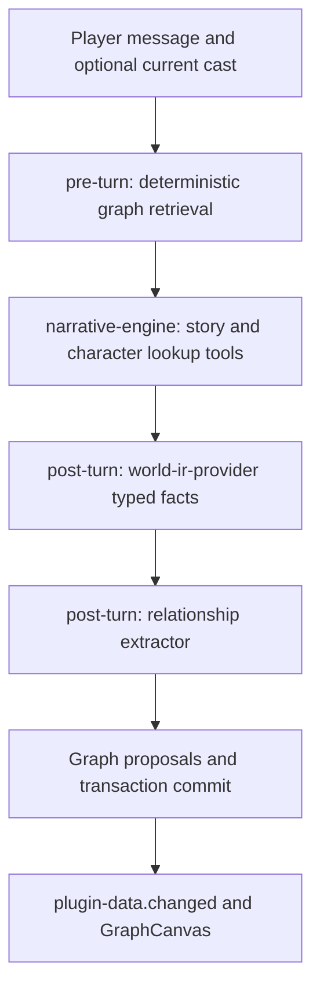

# NPC relationship graph

This page explains how the built-in plugin `npc-graph` (Relationship Graph) works. It covers how it records characters and relationships from the story, how it reminds the narrative plugin of the relevant relationships in later turns, and how the relationship graph on the right panel is drawn. Read this page if you want to change this plugin, or if you want to build a plugin that follows the same pattern: "extract data from the story, then feed it back into the prompt".

It is an example of an ordinary plugin, not part of the framework. The framework has no "graph" type.

## Why

The design is inspired by [MiroFish](https://github.com/666ghj/MiroFish), but it does not depend on any external graph service (no Zep, no Neo4j). The goal is a self-contained knowledge graph that **belongs to only one session**:

1. Record the NPCs, groups, and factions the model mentions in the story, and the relationships between them.
2. Keep them across turns, and put the relevant relationship facts back into the narrative plugin's prompt, so characters behave consistently.
3. Draw them on the right panel as a live force-directed relationship graph.
4. Keep it optional. Retrieval uses only name matching and graph traversal. It needs no embedding model and no vector capability, and it works on all three storage backends (Memory / SQLite / PostgreSQL).

## Component Map

The plugin has two runtimes: a retriever that runs before the turn starts (`npc-graph/rag-retriever`, a function), and an extractor that runs after the story text is written (`npc-graph/extractor`, a prompt for the model).



### Retriever: find the relevant relationships before the turn

It does not call a model or an embedding service. The steps are fixed:

1. **Find the starting points.** First, match the names and aliases of nodes in the player's message.
2. **If nothing matches, look at the characters present.** Use the optional same-turn input `currentCast` (from the contract `scene-cast@1`). A name or alias counts only if it matches one `individual` node completely and without ambiguity. Character IDs and graph node IDs are two numbering systems that do not map to each other.
3. **Look only at relationships that are currently valid.** For each `(source, target, relation)` group, keep only the newest edge that has not been invalidated. Invalidated edges are not traversed.
4. **Walk outward, at most two steps.** Starting from the starting points, follow adjacent edges for at most two hops.
5. **Sort and cut.** Sort the edges reached by `validAt`, newest first, and then by the absolute value of `strength`, largest first. Keep at most 20.
6. **Output.** The result is `npcContext` (a Markdown list), which is passed to the narrative plugin through the contract `graph-rag@1`. When the graph is empty or no node matches, the output is `npcContext: ""`.

The retriever reads all the nodes and edges before it traverses, and adjacency is worked out on the spot from the edges it read. This is not a vector query, and it is not a retrieval with a fixed cost.

### Extractor: update the graph after the story text is written

- **What it reads.** The required input `worldIR`, from the contract `world-ir-provider@1`. That is structured facts that another plugin has already organized from this turn's story text, so the extractor does not have to reread the whole story text.
- **What it already knows.** The existing nodes and relationships are placed into its prompt before the model is called (`<existing-npcs>` and `<existing-relations>`, up to 60 each).
- **What counts as finished.** `toolChoice: required` makes the model actually call a tool. The completion condition is `completion.require: explicit`: either one successful `upsert-npc-graph`, or an explicit call to `runtime-done` when nothing changed.
- **What does not count.** Claiming "updated" in text or JSON does not change the graph at all.
- **When it becomes visible.** The actual writes are committed first, together with the turn's transaction. Only after that does the UI receive the data event.

> [!NOTE]
> These inputs make the extraction better grounded, but they do not guarantee that the model's inferences and entity classifications are correct. The narrative plugin also has session-scoped `list-characters` / `get-character` tools, which can look up full character profiles, including characters who are not present. The relationship graph is only supplementary context. It is not the authoritative record of the characters.

## Data Model

The graph is the plugin's own data. The storage shapes below are produced and checked by `plugins/npc-graph/tools/upsert-npc-graph.js`.

```ts
type NpcNodeType = "individual" | "group" | "faction";

interface NpcNode {
  id: string; // opaque persistent ID; preserve existing IDs
  name: string; // canonical, used for LLM joins
  aliases?: readonly string[];
  type: NpcNodeType;
  labels: readonly string[]; // ontology tags, max 5
  summary: string; // 4–400 chars
  firstSeenTurn: number;
  lastSeenTurn: number;
  attributes?: Readonly<Record<string, unknown>>;
}

interface NpcEdge {
  id: string; // opaque persistent edge ID, one per relation version
  source: string; // node ID
  target: string; // node ID
  relation: string; // starts with a letter, max 48 chars; UPPER_SNAKE_CASE preferred
  strength: number; // [-1, 1]
  fact: string; // single sentence, 8–400 chars — RAG unit
  validAt: number; // logical turn that opened this version
  invalidAt?: number; // logical turn that closed it; absent while current
  evidenceTurnIds: readonly string[];
}
```

An edge is a **versioned fact**, not a single row that is unique. The same `(source, target, relation)` group can have many versions in a session, and at most one of them is currently valid (it has no `invalidAt`).

## Storage Layout

Everything is stored in `plugin_data`, with `pluginId = 'npc-graph'`:

| namespace | key        | value     |
| --------- | ---------- | --------- |
| `nodes`   | `{npcId}`  | `NpcNode` |
| `edges`   | `{edgeId}` | `NpcEdge` |

The nodes and edges are the whole graph as stored. There is no separately saved adjacency index. The retriever builds the adjacency table from the edges it reads, on the spot, so the index can never disagree with the edges.

## Plugin Tools

The tool files are in `plugins/npc-graph/tools/`:

- **`upsert-npc-graph.js`**: the main write tool. The model submits nodes and edges by **name**, and the tool does the rest:
  - Finds an existing node by name and alias.
  - Gives a node with a new name a word-based ID (`wordId`, for example `npc-lin-yao`).
  - Merges updates into an existing node: aliases, labels (up to 5), summary, and attributes. The existing name and type do not change.
  - Replaces an edge's `sourceName` / `targetName` with node IDs. An edge where either end has no node is skipped.
  - Versions edges: a relationship with no change does nothing. If `strength` or `fact` changes, it sets `invalidAt` on the old version and opens a new version.
  - When the tool is called several times in one execution, a later call can read the writes buffered by an earlier one. They are committed together at the end of the execution.
- **`list-npc-graph.js`**: a read-only tool for custom runtimes. It returns a summary of the existing nodes and edges (120 by default, at most 200). The built-in extractor does not declare it, because the nodes and edges are already placed into the prompt before the model is called.

Entities of type `character` in the World IR correspond to `individual` nodes in the graph. Places, items, skills, and concepts are not nodes of this graph. The tool ignores them, and edges that point to them are skipped.

**ID rules.**

- The ID of a new node comes from `wordId`. It avoids every saved or buffered key, so a new node never replaces another node. The model can see these IDs in the injected graph, so they are kept short.
- Edge IDs use `shortIdBatch` (a word plus a random part), one for each relation version.
- Existing node IDs, edge endpoints, and the turn of first appearance stay the same after a restart.
- Historical data that has already been overwritten can be recovered only from an intact backup. Installing a new version cannot rebuild it.

Both tools use the approach "the host injects the dependencies, and the file carries none of its own". `server/index.js` registers them with `covel.registerTool(...)`:

```js
export default function ({ tool, z, shortIdBatch }) {
  return tool({ ... });
}
```

## Embedding And Vector Capabilities

The `npc-graph` retriever now uses deterministic name and alias matching, plus a two-hop graph traversal. It does not generate embeddings and does not query a vector store, so this plugin does not need an embedding model slot.

The framework has lower-level capabilities that other features can use:

- `@covel/ai-provider` supports embedding requests through the internal gateway. Example embedding slots in `llm.toml` (taken from `llm.toml.example`):

  ```toml
  [covel.embed-default]
  provider = "ollama"
  model    = "nomic-embed-text-v2-moe"
  baseUrl  = "http://localhost:11434/v1"
  protocol = "openai-chat-v1"
  tag      = "embedding"
  output   = ["embedding"]

  [covel.embed-multimodal]
  provider = "openrouter"
  model    = "nvidia/llama-nemotron-embed-vl-1b-v2:free"
  baseUrl  = "https://openrouter.ai/api/v1"
  protocol = "openai-chat-v1"
  tag      = "embedding"
  output   = ["embedding"]
  input    = ["text", "image"]
  ```

- `@covel/store` provides the optional `VectorStoreCapability`:

  | Backend     | Implementation              |
  | ----------- | --------------------------- |
  | MemoryStore | Compares each row in memory |
  | SqliteStore | `sqlite-vec`                |
  | PgStore     | `pgvector`                  |

  Vector rows are partitioned by session, and they can be filtered by plugin, namespace, and data key.

These capabilities are independent of this plugin's current structured retrieval path. For how to write model slots, see [Model slots](../reference/slots.md).

## Visualization

`apps/web/src/lib/graph-canvas.tsx` registers the `GraphCanvas` component in the shared json-render component catalog.

- The drawing library `react-force-graph-2d` is loaded lazily. It downloads only when the player opens the panel.
- The nodes and edges come from the panel's data source. When the data changes with SSE events, the graph redraws automatically.

The plugin's right-side panel is declared in `plugins/npc-graph/runtimes/extractor/ui/npc-graph-panel.json`. `dataSource.bindings` puts the plugin's own `nodes` and `edges` namespaces into the panel state, and then passes them as props to `GraphCanvas`:

```json
{
  "id": "npc-graph",
  "group": "npc-graph",
  "label": "Relationship Graph",
  "icon": "network",
  "dataSource": {
    "namespace": "nodes",
    "bindings": { "nodes": "nodes", "edges": "edges" }
  },
  "emptyState": {
    "message": "No character or faction relationships yet. They will appear as the story continues."
  },
  "view": {
    "component": "Stack",
    "props": { "gap": "sm" },
    "children": [
      {
        "component": "Text",
        "props": {
          "content": "Relationships among characters, groups, and factions in the current session. Green = positive, red = negative, gray = neutral.",
          "variant": "muted",
          "size": "xs"
        }
      },
      {
        "component": "GraphCanvas",
        "props": {
          "nodes": { "$state": "/sources/nodes" },
          "edges": { "$state": "/sources/edges" },
          "node": {
            "idField": "id",
            "labelField": "name",
            "typeField": "type",
            "summaryField": "summary",
            "labelsField": "labels",
            "colors": {
              "individual": "#60a5fa",
              "group": "#a78bfa",
              "faction": "#f59e0b"
            },
            "defaultColor": "#9ca3af"
          },
          "edge": {
            "idField": "id",
            "sourceField": "source",
            "targetField": "target",
            "relationField": "relation",
            "strengthField": "strength",
            "factField": "fact",
            "inactiveField": "invalidAt",
            "colors": {
              "positive": "#22c55e",
              "negative": "#ef4444",
              "neutral": "#94a3b8"
            }
          },
          "height": 480
        }
      }
    ]
  }
}
```

`inactiveField: "invalidAt"` tells the component which edges are old versions that have already been invalidated.

## Cross-references

- [Plugin reference](../reference/plugins.md): the full plugin manifest, including both runtimes
- [Right panel](../reference/ui-panels.md) and [UI components](../reference/ui-components.md): the description of `GraphCanvas`
- [Tools reference](../reference/tools.md): the current upsert flow and the read-only tool
- [`plugins/npc-graph/tools/upsert-npc-graph.js`](../../../plugins/npc-graph/tools/upsert-npc-graph.js): the input schema and the shape of the saved nodes and edges
- [`plugins/npc-graph/`](../../../plugins/npc-graph/README.md): the plugin itself
- [`apps/web/src/lib/graph-canvas.tsx`](../../../apps/web/src/lib/graph-canvas.tsx): the visualization component
- `plugins/npc-graph/tests/`: the plugin's contract tests and integration tests
