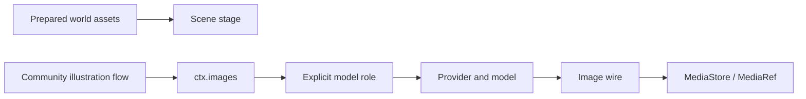

# Image generation

This page explains how an image comes to exist in Covel: who supplies the material, who starts the generation, which model is used, and how the request is sent. It is for people who build world packages, write illustration plugins, or want to find out why no image was generated.

Keep three things in mind:

- Built-in plugins do not generate images. The scene stage only shows background images that were made ahead of time and are included in the world package.
- Installing an image-generation plugin does not set up a model for you.
- You can play without an image model. When a model is missing, generation is skipped, and existing material and the story are not affected.

World material, plugin flows, model roles and the image protocol each handle one job:

| Part                          | Job                                                                                                        | Where it is selected                                                                                                        |
| ----------------------------- | ---------------------------------------------------------------------------------------------------------- | --------------------------------------------------------------------------------------------------------------------------- |
| World package                 | Supplies prepared backgrounds, character images and style notes                                            | Data contracts in `worldData`, such as `stage.scene-assets@1`, `stage.scenes@1` and `character.portrait-assets@1`           |
| `scene-stage`                 | Shows the world's prepared backgrounds. A location with no image falls back to the world's header picture. | No generation settings                                                                                                      |
| Community illustration plugin | Builds prompts from the story, and provides a manual generation entry point and a gallery                  | Enable the plugin in the session and choose its `modelPresetId`. The main repository does not include these business flows. |
| Model role                    | Connects the role a task needs to a provider and a model                                                   | The role assignment in Settings, or the `llm.toml` that is currently in effect                                              |
| Image wire                    | Encodes requests, parses image responses, and handles provider protocol                                    | `providerRequestMetadata.imageWire` of the model role                                                                       |
| `ctx.images`                  | Resolves the model, calls the wire, de-duplicates and saves media                                          | A function runtime calls `ctx.images.generate()`                                                                            |

## Loading and activation

**World and stage**

- A world package's `pluginPolicy` only says which plugins a session selects by default (`preset`, `plus`) and which contracts the world cannot do without (`requires`). The plugins that finally run are decided by the contracts the plugins declare and by the session's authorization.
- The scene stage depends on the `scene-stage@1` contract. It does not depend on having some image-generation plugin installed.
- Prepared material is imported through the data contracts that the enabled plugins expose. Existing images can be shown without a generation model being configured.
- `character-blueprint` saves and displays character media. It does not generate images.

**Community illustration plugins**

- A community plugin can be installed in `~/.covel/plugins`. During development, you can also link a source directory.
- Installing it, allowing it to run server code, and enabling it in a session are three different steps.
- `media.image-flow@1` declares only two things: the entry runtime for manual illustration, and the asset runtime. It is an extension point that can have only one provider, so a session can choose only one such illustration flow. It does not register an image protocol.

**Custom protocols**

- When you need your own protocol, the plugin calls `covel.registerWires` in its entry. The name it registers is `<pluginId>/<wireId>`.
- The plugin's code must already be authorized, and it must have finished its entry registration.
- When a model configuration refers to a wire that does not exist, it fails clearly. It is never switched to another protocol automatically.
- The kernel still provides the general `openai-images` and `dashscope-wan`. Community illustration flows can use them directly.

For details, see [media storage](./media-store.md).

## Choosing the model

**`modelPresetId` stores the role name**

- It does not store the model ID, the address or the key.
- The default is `image`. To set up different illustration flows separately, create several named roles and choose one for each.
- The setting for a function runtime is independent of the agent's `runtimeModelOverrides`.

**How the model is found**

- An image call looks up the role or preset by its exact name, and checks that it can produce images.
- When no name is given, `ctx.images.generate()` and `ctx.gateway.resolveSlot({ fallbackTag: "image" })` both look up `image`.
- When the role is not configured, the name is misspelled, or it is bound to a text model, `CONFIG_ERROR` is returned before any network request is sent. It never falls back to "the first other image role".
- Role bindings submitted from the browser and the model capability limits still apply.

**`tag` and `imageWire` are not the same thing**

- `tag = "image"` describes what the role can do.
- `imageWire` chooses the request format.

Neither can stand in for the other. The names of a plugin or a model do not pick the protocol automatically. The OpenAI-compatible image API uses `openai-images`, and the native DashScope API uses `dashscope-wan`. For a configuration example, see the image generation section of the repository's [`llm.toml.example`](../../../llm.toml.example).

**Fixing parameters on a role**

Fields in a role's `providerRequestMetadata` other than `imageWire` are written as they are into the `openai-images` request body. They override options of the same name that the caller passes.

- If a model accepts only one size or quality, write `size` or `quality` on the role. The plugin does not need to change.
- `model`, `prompt` and `n` belong to a single call. Writing them on the role has no effect.
- The same applies to `openai-speech` for speech: the role can fix `voice` and `response_format`, but `model` and `input` cannot be replaced.

### Usage

| How the model is billed          | `gateway.responded` trace for the call | `/debug` cost panel |
| -------------------------------- | -------------------------------------- | ------------------- |
| By token (such as `gpt-image-1`) | Has `usage`, `model` and `provider`    | Counted in spending |
| Per image, and speech synthesis  | Has only `model` and `provider`        | No amount counted   |

A model billed by token reports its usage in the response, and `openai-images` reads it out. A wire that a plugin registers itself only needs to give a token count in the `usage` of its return value to join the same path.

### Where the configuration file comes from

- An explicitly set `COVEL_LLM_TOML` takes priority.
- When developing from source, the `llm.toml` in the repository root is used first. Only when that file does not exist is the configuration in the user directory used.
- The desktop app has the desktop host specify the path of the user configuration, which is usually `~/.covel/llm.toml`.
- Local role bindings set on the settings page override the file configuration for requests. They are not written back to the TOML.

> [!TIP]
> Having an image role configured in your home directory does not mean the development server is reading it. After you correct the file, reload the TOML in the model settings, and then check which provider and model are actually in effect.

For the full resolution rules, see [model roles](./slots.md).

## Images the story model can read

After an image is submitted, the model that writes the story knows it appeared in later turns:

- In the history, a line describes the image at the place where it appeared. Its content comes from `meta.caption` of that `assetGenerations[]` item. When there is none, `meta.prompt` is used.
- An image-generation plugin should write the prompt given to the image model, or a one-line scene description, in one of these two fields. When neither is written, the model only knows that "an image was shown here".
- The other fields in `meta` do not go into the prompt.
- When the story model's role accepts image input, the latest 2 images themselves are also sent with the request, so the model can look at the picture directly.

For the position, the limit and the cost, see [prompt structure reference: images shown](./prompt-structure.md#images-that-have-been-shown). This step happens at the time of submission. Images generated before that have no description line and are not sent to the model.

## Optional capabilities and skipping

Having an image role in a world package does not mean the player must provide an image model.

`ctx.images.isAvailable(presetId)` only checks whether the current role can be resolved to an image model:

- It does not contact the provider, and it does not retry.
- It does not verify the API key, the balance, or whether the remote model is available. Network, authorization or provider errors after a generation request is sent are still handled as the actual failures they are.

A community illustration flow does the same check before it writes the pending gallery record and starts the image call. When a capability is missing, it returns skipped:

- A task that is already queued may still leave a "skipped" record. But it does not produce a failed image, and it is not retried automatically.
- When a function returns `outcome: "skipped"` on purpose and the submission succeeds, the background task ends as `done`, and the runtime record keeps `skipped`.
- An unmet dependency, an actual execution error and a failed submission still count as failures.
- When the low-level generation interface is called directly, a configuration error is still returned as `CONFIG_ERROR`.

## Caching and failure handling

**DashScope asynchronous tasks**

- The polling deadline covers the wait between checks, the HTTP requests, and reading the response.
- When the deadline passes, the current polling stops, and a late success result is not accepted. A cancellation from the caller is also passed on to the polling requests.
- When a retryable HTTP error occurs, the response body that is not used is cancelled before trying again, so that long retries do not hold a connection.
- The synchronous image endpoint still uses the caller's execution deadline.

**De-duplication (cache)**

- When deciding whether two requests are "the same image", the check includes the provider, model, endpoint, protocol, wire configuration and generation parameters that were actually resolved.
- So if the model or wire of the same role is changed, the same prompt is generated again.
- Keys and authentication headers are not included.
- Existing media is kept. Changing the model does not automatically redraw images that were already generated.

**The `target` field**

The low-level `ctx.gateway.generateImage()` returns a required `target`, which records the identity of the model the request was actually sent to. `ctx.images` uses it to save the cache key. This way, even if the configuration is switched during the asynchronous cache lookup, the result is not written under another model's name.

> [!IMPORTANT]
> When you implement or mock `PluginRuntimeGateway` yourself, you must provide `target`. When you mock `ImagesContext`, you must provide `isAvailable()`.

**Other rules**

- When no image model is configured, skipping generation does not affect existing material and the story. A community illustration plugin is responsible only for its own flow and gallery.
- An image role has no same-tag fallback. The role name must be written correctly, and a misspelled name is never "conveniently" resolved to a different image role.
- After the model or wire changes, the next generation may not hit the old cache. Old media is not migrated or deleted.

**Generating several images at once**

The shared image-generation handler numbers the results like this:

- The first image uses the `imageId` of the pending record that was written in advance.
- Later images use keys such as `<imageId>-2` and `<imageId>-3`.
- After the batch of effects is submitted, the base record is replaced by the first image's done result. So no card is left pending forever.
- The number of records equals the number of images actually returned.
