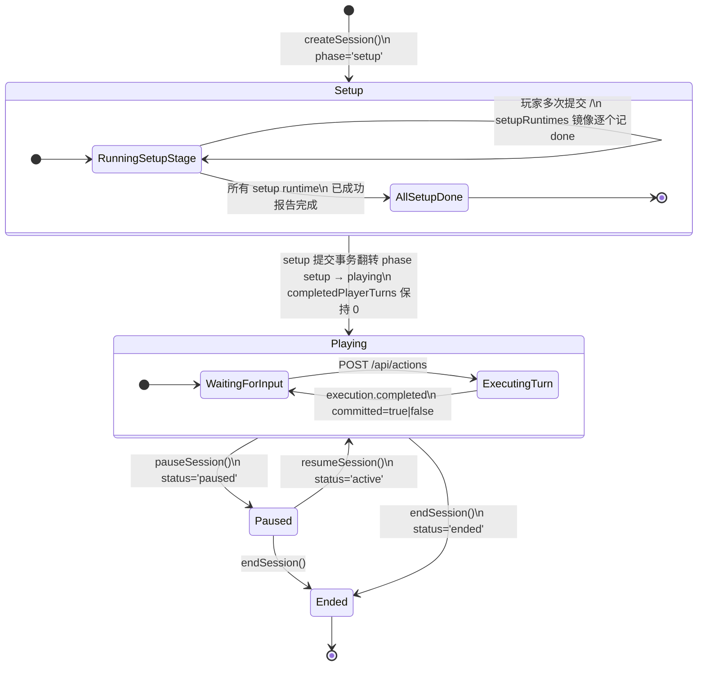
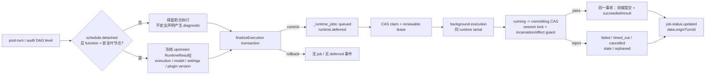
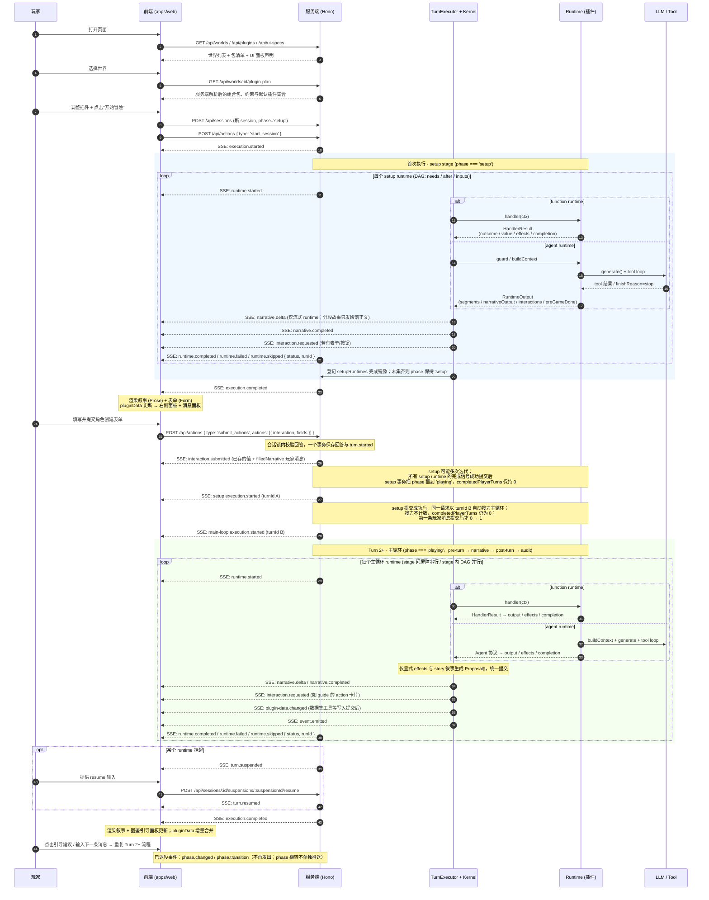

# 回合管线：架构与执行流程

这一页讲 Covel 怎样把玩家的一句话变成一段故事：一个回合从头到尾经过哪些步骤，数据写到哪里，画面怎样更新。想改框架本身，或者想弄清一个问题出在哪一层，先读这一页。只是做世界或写插件，不需要读它。

前面是一段不带术语的走读，后面各节是细节。字段的完整契约在[参考](../reference/index.md)里，这里只讲各部分怎样连起来。

## 先看一遍：玩家按下发送之后

先认识四个词，后面一直用：

- **插件**：一个文件夹，里面写着玩法。讲故事的、记笔记的、掷骰子的，都是插件。
- **runtime**：插件里一段可以运行的东西。它要么是一段写给模型的提示词（`agent`），要么是一个 JS 函数（`function`）。一个插件可以有零个、一个或几个 runtime。
- **内核（Kernel）**：框架里负责安排的部分。它决定这一回合运行哪些 runtime、按什么顺序、给它们看什么、结果怎样保存。它不懂任何具体玩法。
- **提案（Proposal）**：runtime 想保存的一条内容，例如“追加这段正文”“把这个角色的生命值改成 12”。runtime 只能提出，由内核检查后统一写入。

玩家输入“我去探索沼泽”并按下发送，接下来发生这些事：

1. **前端发出请求。** 浏览器把这句话作为一个 `say` 行动发到 `POST /api/actions`。这个连接不会马上关掉，服务端沿着它一条一条地推送事件（这种方式叫 SSE），前端收到一条就更新一点画面。
2. **服务端排队。** 前台执行和提交按会话排队。服务端先在预算内等上一回合要求等待的后台作业，再取得会话锁；后台计算可以在锁外继续，提交时仍要排队。
3. **定住本回合用的插件。** 回合开始时用的是哪一版插件、哪些工具，到回合结束都不变。中途热更新了插件，也要等下一回合才生效。
4. **挑出这一回合要运行的 runtime。** 每个 runtime 都写了自己什么时候运行：每回合、每隔几回合、某个事件发生时，或者只在被点名时。内核照着这些声明挑。
5. **按四个阶段依次运行。** `pre-turn`（准备材料）→ `narrative`（写正文）→ `post-turn`（整理这一回合发生了什么）→ `audit`（检查）。前一个阶段全部结束，后一个才开始。同一个阶段里互不依赖的 runtime 同时运行。
6. **运行一个 runtime。** 内核先检查它需要的东西齐不齐，再准备它能看到的内容：世界设定、历史对话、上游 runtime 的结果、玩家这句话。`agent` 把这些交给模型，模型可以调用工具，直到给出最终结果；`function` 直接运行函数。
7. **领域写入先暂存。** 正文、表单和插件数据的写入先变成提案，尚未生效。执行结果、诊断和已确认的玩家输入可能已经单独保存；它们不等于领域写入已提交。
8. **提交存档。** 内核在同一个事务里写入被接受的提案、执行日志和会话时钟。有有效故事时，可选 runtime 的写入可以单独丢弃；故事或 setup 单元被拒、基础设施出错时，整次事务回滚。已单独保存的玩家输入保留。
9. **确认画面。** 正文可以在提交前流式显示。提交后的事件给出最终正文、待填表单和面板数据；前端据此确认内容，或撤下未提交的结果。
10. **收尾。** 最后一条事件是 `execution.completed`，其中的 `committed` 说明这一回合有没有真正保存。耗时的收尾工作（例如整理记忆）可以转到后台去做，玩家不用等。

开局稍有不同。新会话先处在“准备阶段”（`setup`）：只运行准备用的 runtime，例如生成角色表单。全部准备完成后，会话才进入“游玩阶段”（`playing`），开始上面这种四阶段的回合。

下面各节把每一步展开。

## 一、系统全景

三个部分：前端（`apps/web`）、服务端（`apps/server`，基于 Hono）、存储（`DataStore`）。插件和世界包是服务端启动时加载的文件。

```
┌─────────────────────────────────────────────────────────────────────────────┐
│                              Covel 全景架构                                 │
│                                                                             │
│  ┌──────────────┐    SSE/HTTP     ┌──────────────────────────────────────┐  │
│  │   Frontend    │ ◄─────────────► │            Server (Hono)             │  │
│  │  (apps/web)   │                │                                      │  │
│  │              │                │  ┌────────────────────────────────┐   │  │
│  │ json-render  │                │  │       Turn Executor            │   │  │
│  │ catalog      │                │  │  ┌──────────────────────────┐  │   │  │
│  │ pluginData   │                │  │  │    Stage Scheduler       │  │   │  │
│  │ SSE client   │                │  │  │ setup→pre-turn→narrative │  │   │  │
│  └──────────────┘                │  │  │ →post-turn→audit + DAG   │  │   │  │
│                                  │  │  │                         │  │   │  │
│  ┌──────────────┐                │  │  └──────────────────────────┘  │   │  │
│  │   Plugins     │                │  │           │                    │   │  │
│  │  PLUGIN.md    │────加载────────►│  │     ┌─────▼──────┐            │   │  │
│  │  tools/*.js   │                │  │     │ LLM Gateway │            │   │  │
│  │  ui/*.json    │                │  │     └─────┬──────┘            │   │  │
│  └──────────────┘                │  │           │                    │   │  │
│                                  │  │     ┌─────▼──────┐            │   │  │
│  ┌──────────────┐                │  │     │ Tool Loop   │            │   │  │
│  │   Worlds      │                │  │     └─────┬──────┘            │   │  │
│  │  world.yaml   │────加载────────►│  │           │                    │   │  │
│  │  WORLD.md     │                │  │     ┌─────▼──────┐            │   │  │
│  └──────────────┘                │  │     │Session Kernel│            │   │  │
│                                  │  │     │ (Proposal →  │            │   │  │
│                                  │  │     │  Commit)     │            │   │  │
│                                  │  │     └─────┬──────┘            │   │  │
│                                  │  └───────────┼────────────────────┘   │  │
│                                  │              │                        │  │
│                                  │  ┌───────────▼────────────────────┐   │  │
│                                  │  │        DataStore               │   │  │
│                                  │  │  sessions │ messages │ plugin  │   │  │
│                                  │  │  results  │ characters│ data   │   │  │
│                                  │  └────────────────────────────────┘   │  │
│                                  └──────────────────────────────────────┘  │
└─────────────────────────────────────────────────────────────────────────────┘
```

图里的几个名字：

| 名字            | 做什么                                                   |
| --------------- | -------------------------------------------------------- |
| Turn Executor   | 执行一个回合：挑 runtime、排顺序、逐个运行               |
| Stage Scheduler | 按阶段排顺序。DAG 指“谁依赖谁”的关系图                   |
| LLM Gateway     | 调用模型的统一出口                                       |
| Tool Loop       | 模型调用工具、读结果、再决定下一步的循环                 |
| Session Kernel  | 把结果变成提案，检查后写入                               |
| DataStore       | 存储接口，后端可以是内存、SQLite 或 PostgreSQL           |
| json-render     | 前端用 JSON 描述界面的渲染方式，插件的面板和表单都由它画 |

## 二、生命周期状态机

### 2.1 会话生命周期

一个会话当前处在什么状态，由四个字段说明。客户端和存档直接读它们，没有别的来源：

| 字段                   | 取值                          | 含义                                             |
| ---------------------- | ----------------------------- | ------------------------------------------------ |
| `status`               | `active` / `paused` / `ended` | 会话是否在进行                                   |
| `phase`                | `setup` / `playing`           | 准备阶段还是游玩阶段，决定运行哪些阶段的 runtime |
| `completedPlayerTurns` | 整数                          | 已经保存的玩家回合数                             |
| `setupRuntimes`        | 每个准备 runtime 一条状态     | `pending` / `done` / `blocked`                   |

这四个字段只有当前这一种形式，不接受也不回填旧的时钟字段。



**业务真值** = `(status, phase, completedPlayerTurns, setupRuntimes)`。下面按状态分别说明。

#### 准备阶段（Setup）

条件：`status === 'active' && phase === 'setup'`。调度器只运行 `stage: setup` 的 runtime。

一个准备 runtime 用明确的信号报告“我做完了”，三种之一：

- function 返回 `outcome: "success"` 加 `completion: "done"`；
- agent 输出 `preGameDone: true`；
- guard（runtime 运行前的检查函数）返回 `{ skip: true }`。

内核把结果记进 `setupRuntimes`。玩家可以多次提交表单或消息来推进，例如 `char-creator` 的表单作为 `submit_actions` 里的行动提交。

失败时的规则：

- 失败但还有重试次数：保持 `pending`，记下 `lastError`。再发一次 `start_session` 只重跑没完成的 runtime，不新建会话，也不记录玩家消息。
- 重试次数（`maxTriggerCount`）用完不算完成：该 runtime 变成 `blocked`，会话停在准备阶段，等玩家重试或豁免。框架不会跳过坏掉的准备步骤继续往下走。`blocked` 的 runtime 要先经 `retry` 端点解封。
- 读取已保存表单的准备 runtime，不能因为同一份提交每次都失败。提交无法使用时，要把它作废并重新发出表单（带 `notice` 和上次的值），否则会话会永远停在准备阶段。
- 挂起的准备 runtime 在恢复（resume）后给出完成信号时，`done` 状态和 `phase` 的切换随恢复的那次提交一起写入。
- 准备 runtime 挂起等玩家时不消耗重试次数。挂起项被放弃、过期或作废时，这次尝试记为失败，runtime 回到 `pending`，次数用完时进入 `blocked`。

准备 runtime 之间可以用 `needs(scope: session)` 声明依赖，它读的是已经保存的 `done` 状态：

- 目标已完成：依赖直接满足。
- 目标是 `blocked` 或不在本会话启用的插件里：留给玩家处理。
- 契约依赖是 `cardinality: one`（默认）时：只要有一个提供者已完成、被阻塞或能先完成，就不算成环。是 `all` 时：等每个待完成的提供者。
- 只有任何顺序都无法放行的成员，才在执行前标为 `blocked`，原因是 `setup-session-cycle`。

#### 从准备进入游玩

- **切换时机。** 所有准备 runtime 都报告完成后，内核在准备阶段的提交事务里把 `phase` 从 `'setup'` 改成 `'playing'`。这个事务里 `completedPlayerTurns` 仍是 0。提交失败时，`phase` 的切换和 `setupRuntimes` 一起回滚。
- **没有单独的通知。** `phase` 切换不推送独立的 SSE 事件，也没有对应的提案类型。客户端从会话响应或快照读出当前的 `phase`、`completedPlayerTurns` 和 `setupRuntimes`。
- **紧接着写开场（Setup completion followup）。** 最后一个准备输入（例如角色表单）提交后，`/api/actions` 的同一个请求先提交准备阶段，再用新的 `turnId` 和独立的事务马上运行一次主循环。玩家因此直接看到第一段正式叙事。同一条 SSE 流、trace 和快照覆盖这两次执行。
- **开场不计回合数。** 这次接力执行的 `origin` 是 `continuation`，不计入 `completedPlayerTurns`。它保持 0，直到第一条主循环玩家消息提交后才变成 1。所以开场叙事和第一回合共用 `logicalTurn = 1`，`startTurn` 和 `every` 都按这个数计算。

#### 逻辑回合数

`logicalTurn` 在执行开始时定住，原样传给 function handler 和它的 `ctx.tools.call` 调用，两处是同一个值，工具那一侧不重新计算。

- 已完成 7 个玩家回合时，它是 8。
- 初始准备阶段和开场接力都是 1。
- 不提供执行时钟的独立薄宿主，可以省略工具上下文里的这个可选字段。

#### 游玩阶段（Playing）

条件：`status === 'active' && phase === 'playing'`。每次 `POST /api/actions` 触发一轮完整的回合，按 `pre-turn → narrative → post-turn → audit` 四个阶段依次运行，阶段之间有严格的屏障。

`completedPlayerTurns` 只统计已提交的玩家回合。每次执行都在 `turn_results` 里有自己的一行，`origin` 是下面之一：

| `origin`       | 是什么                      | 计入回合数 |
| -------------- | --------------------------- | ---------- |
| `player`       | 玩家发消息触发的回合        | 是         |
| `continuation` | 准备完成后的开场接力        | 否         |
| `manual`       | 插件 RPC 点名运行的 runtime | 否         |
| `background`   | 后台执行                    | 否         |
| `recursive`    | 嵌套的 `recursiveCall`      | 否         |
| `resume`       | 挂起后的恢复                | 否         |

多次执行共用一个逻辑回合时，只计一次。

#### 暂停与结束（Paused / Ended）

`status === 'paused' | 'ended'` 时，调度器直接返回空，`/api/actions` 被服务端拒绝。暂停的会话可以用 `resumeSession()` 恢复，结束是终态。

#### 提交的原子边界

同一个会话的这些事情由同一把会话锁（session lock）排成一队，不会交叉：玩家输入、runtime 执行、提案提交、对话执行日志（玩家和 runtime 的 `TurnMessage`）、会话时钟写入（`phase` / `completedPlayerTurns` / `setupRuntimes`）、挂起记录（suspension artifact）和自动快照。

其中这些在同一个 `finalizeExecution` 事务里一起提交或一起回滚：执行日志、提案、会话时钟、挂起记录。

写服务的操作也在这个事务里提交。它挂在调用方 run 的结果上，跟着调用方的提交单元，排在单元自己的写入之后：故事所在单元的操作各自一个 savepoint，失败只丢它自己，故事照常提交；辅助单元里一个操作被拒，整个单元丢弃；没有故事的执行里一个操作被拒，整次执行回滚。各操作的最终状态在同一个事务里写回 `turn_results`。规则见[事务 · 写服务的操作](../reference/transactions.md#写服务的操作)。

要记住的细节：

- 持锁期间派生出去的后台工作，例如被唤醒的作业 worker，不继承这把锁。它自己排队取锁，不会被当成锁的主人。
- 一次要拿几把锁时（例如删除会话时锁住它的全部 runtime），锁的实现先按键排序再依次取，调用方给什么顺序都不会互相卡死。
- 插件 action 的 handler 在会话锁内运行，时限 30 秒。超时后这次动作失败，锁放开；handler 之后再交上来的存储调用一律被拒，已在进行的存储调用先完成再放锁。超时前写入的数据保留。
- 有几处写入在这个事务之外，它们都不切换 `phase`：
  - 准备 runtime 的尝试次数。它在事务之后更新 `setupRuntimes` 里的计数，回滚的尝试也消耗次数。
  - `needs(scope: session)` 成环的准备 runtime。执行器在执行之前就把它们标为 `blocked`。
  - 玩家在界面上重试或放弃一个准备 runtime。
  - 执行记录。`turn_results` 和各 runtime 的输出在提交之前写入，`turn_results` 先记为 `pending`，提交之后再结算成 `committed` 或 `failed`。
- `turn.suspended` 只在提交之后发出。
- 保存挂起记录时，同一个 runtime 还在等待的旧挂起项在同一个事务里作废。恢复的提交事务先核对挂起时记下的记录内容，有变化就什么都不写。
- 恢复的 runtime 可以再次挂起。这次提交先把旧挂起项标为已处理，再保存新的；新挂起项接着同一次执行，不算放弃旧的。规则见[再次挂起](../reference/api.md#再次挂起)。
- 自动快照在全部提案提交后才拍，保证对话位置、角色、状态和插件数据属于同一个已提交的回合。
- `execution.completed.committed` 是客户端的终态信号：前端据此确认或撤回它先显示出来的内容。
- 提交之后的事件发布逐个独立进行，任何一个失败都不回滚已经写入的数据。失败时宿主记一条 `commit.fanout.failed` trace，让该会话的订阅流收到 `system.reset`（`reason: "publish-failed"`）后完整重读，并在 `execution.completed` 上带 `resync: true`。

#### 把事件送到客户端不拖住回合

向客户端投递事件，不负责“业务是否完成”：

- `onFinalized` 确认结果已经持久保存后，把事件放进一个有上限的队列。runtime 的增量和生命周期事件同样只入队。这些回调不等 SSE 的网络写入。
- 提案、日志、时钟的事务和自动快照仍在原来的会话锁内完成。事件信封的身份和 `seq` 在这次执行持有锁的时候取得。
- 最后把队列发完这一步在锁外进行。连接慢到超时或断开，不改变已提交的内容，不重跑模型，也不会让只读恢复把成功的执行当成可重试的失败。

#### 后台运行的 RPC / event runtime

声明 `schedule.background: true` 的 runtime，不占着会话锁运行。这类 runtime 通常是几分钟的外部调用，例如出图或手动 TTS。持锁运行会让玩家的下一条消息一直排队；PostgreSQL 部署下还会撞上获取锁的 30 秒上限。

它的运行方式：

- 它包括两种：被一次执行带起、延后运行的 follower，以及后台模式的 manual 触发。
- 作为持久的作业排进 `_runtime_jobs`，`origin.activation` 是 `manual` 或 `event`。follower 在触发它的那次执行的提交事务里入队。
- 作业 worker 认领后，把 handler 跑在会话锁**外**。只有 `processTurnResults`（finalize 事务加自动快照）进锁。作业的终态和它写入的数据在同一个事务里提交。
- 它不能挂起等玩家：没有玩家在等它。runtime 真的挂起了，作业记为 `failed`，什么也不提交。

为什么这样是安全的：

- 这条路径不写会话时钟：不传 `sessionClock`，并且 `completedPlayerTurns` 只数 `origin: "player"`。
- 写入先进缓冲区（writeBuffer），最后汇入同一个提交事务，不在执行中零散落库。缓冲区只装本 runtime 自己的写入；同插件排在后面的 runtime 读插件数据时能看到它，但不会把它装进自己的缓冲区。
- 它不追加对话消息。
- 同一个 runtime 的并发执行由 `<sessionId>::<runtimeId>` 作业锁排成一队。handler 里“是否已经生成过”这类先查后做的逻辑因此不会重复执行，否则会重复计费。
- 提交前在锁内重新读会话状态。玩家中途暂停或结束了会话，结果就被丢弃，不写入。

#### 回合里转到后台的 runtime（staged detached）

`schedule.detached` 是另一件事，和上面的 `schedule.background` 互不影响。它只对通过安全检查的 `post-turn` / `audit` function 叶节点（没有别的 runtime 等它结果的 runtime）生效。完整过程见下面的 2.3 节，要点是：

- 调度器在原来那一层开始时冻结上游结果。只有该 runtime 声明依赖的上游保留输出，其余只留身份和状态。
- 作业描述随原始回合的提案、日志、会话时钟一起原子写入 `_runtime_jobs`。提交后立刻发 `runtime.deferred`，玩家的回合就此结束。
- worker 用 CAS（“值没被别人改过才写入”的原子操作）抢租约（lease）认领作业。执行时不持主会话锁，同一个 runtime 一次只跑一个。
- 进入提交前，作业必须从 `running` 用 CAS 改到 `committing`，并在会话锁内重新核对会话和插件是否还是原来那一份、版本，以及实际产生的 effects。
- 取消、超时、过期（stale）或租约失效，都会让迟到的结果无法提交。

### 2.2 单轮 Turn Pipeline

下图是一次执行的全过程。走读里的第 2 到第 10 步对应图里从上到下的方框。

```mermaid
flowchart TB
    In(["POST /api/actions<br/>玩家输入 / 开始游戏"]) --> Settle["等待要求 settle 的作业<br/>锁外等待，锁内重查"]
    Settle --> Capture["冻结 registry / extension generation<br/>加载 canonical 历史并投影"]
    Capture --> Exec[executeTurn]
    Exec --> StartEvt["SSE: execution.started"]
    StartEvt --> Hook1[TurnStart hook]
    Hook1 --> Filter["selectTriggeredRuntimes<br/>manual: 按名字匹配（绕过 shouldTrigger）<br/>setup runtime: 按 setupRuntimes 镜像取 pending<br/>其余: shouldTrigger（auto + every / event<br/>+ startTurn / maxTriggerCount / cooldownTurns）"]
    Filter --> PreSched["PreSchedule hook<br/>(可收窄本回合 runtime 集)"]
    PreSched --> Band{"phase?"}
    Band -->|setup| SetupBand["setup stage<br/>DAG（needs / after / inputs）"]
    Band -->|playing| MainBand["主循环<br/>pre-turn → narrative → post-turn → audit<br/>stage 间严格屏障，stage 内 DAG"]

    SetupBand --> Group
    MainBand --> Group

    subgraph Group["每个 DAG 层级组（同组并行，跨组串行；name 做并列 tiebreak）"]
      direction TB
      Gate["框架依赖 / 输入 / 权限检查"] --> G3["PreRuntime hook"]
      G3 --> G1["guard? (agent runtime)"]
      G1 --> G2["SSE: runtime.started"]
      G2 --> RT{"runtimeType"}
      RT -->|function| F1["handler(ctx) → HandlerResult<br/>校验 outcome，分别保存 output / effects / completion"]
      F1 --> G6
      RT -->|agent| G4["buildContext<br/>runtime 正文 + prompt.segment 扩展段<br/>+ typed inputs + 投影历史<br/>→ 首个 agent 按真实 system prompt 压缩并重建<br/>→ PostContextAssembly hook 后再次预算"]
      G4 --> G5["LLM + ToolExecutor loop（每步）<br/>PreStep → PreLLMCall → LLM → PostLLMResponse 审查<br/>接受后才执行工具；拒绝时限次纠正<br/>PreToolUse → execute → PostToolUse<br/>结束时记下结束原因（StopReason）"]
      G5 -->|拆分 agent 协议| G6["RuntimeResult: output / effects / completion"]
      G6 --> G7["PostRuntime hook"]
      G7 --> Final["校验故事输出 / 超时 / 父级取消"]
      Final --> G8["唯一终态 + turnId / runId<br/>runtime.completed / runtime.failed / runtime.skipped"]
    end

    Group --> Commit["effects + story 输出 → Proposal[] → CommitPipeline.commitAll<br/>PreStateCommit → handler → PostStateCommit"]
    Commit --> SSE["发 SessionEvent<br/>narrative.delta / narrative.completed<br/>interaction.requested<br/>plugin-data.changed / event.emitted"]
    SSE --> PreGameTick{"phase === 'setup' 且<br/>所有 setup runtime<br/>都已报告完成?"}
    PreGameTick -->|是| Advance["setup 提交: phase setup → playing<br/>completedPlayerTurns 保持 0"]
    PreGameTick -->|否| Keep["保持 phase 不变"]
    Advance --> End["SSE: execution.completed"]
    Keep --> End
```



图里带 hook 字样的方框（`TurnStart`、`PreRuntime`、`PreLLMCall` 等）是插件可以挂上处理函数的时机，完整清单见 [Hook 参考](../reference/hooks.md)。

**Stage 分带**（`packages/runtime/src/turn-executor/scheduling.ts` + `packages/runtime/src/schedule/` 硬性约束）：

| phase       | 可调度 stage                               | 语义                                                                                                                                                                                      |
| ----------- | ------------------------------------------ | ----------------------------------------------------------------------------------------------------------------------------------------------------------------------------------------- |
| `'setup'`   | `setup`                                    | 游戏初始化，例如 `pregame`、`world-init/schema-gen`、`char-creator/player-init`。顺序完全由声明的边决定：`schema-gen` 用 `schedule.after: [pregame]` 保证 `pregame → schema-gen` 先后运行 |
| `'playing'` | `pre-turn → narrative → post-turn → audit` | 每回合依次运行四个阶段，见下面的规则                                                                                                                                                      |

主循环的排序规则：

- 阶段之间有严格的屏障：上一个阶段全部有了结果（成功、失败或跳过），才进入下一个。
- 同一个阶段里，顺序由 `needs`、`after` 和 `inputs` 绑定推导出的依赖图决定。
- 互不依赖的 runtime 并行；并列时用 `name` 做稳定的先后。
- 依赖成环的 runtime 和它的下游，本回合记为 `skipped: dependency-cycle`，不会退回成任意顺序执行。

**Proposal 类型**（全部过 commit chain，源自 `packages/shared/src/types/proposal.ts` 的 `ProposalPayloadMap`）：`narrative.append`、`interaction.request`、`event.emit`、`ui.render`、`asset.generate`、`plugin.data` / `plugin.data.batch` / `plugin.data.delete` / `plugin.data.update`、`character.schema.set`、`character.upsert`、`dimension.initialize`、`dimension.update`、`lorebook.upsert`。

**插件依赖与提供者选择**：一个会话启用哪些插件，由四样东西算出来：玩家明确的 `requested` / `excluded`、授权状态、core 声明、带版本的 `provides` / `requires`。

- 明确排除对 core 插件也有效。
- 缺少依赖时，先选唯一的普通提供者，再考虑唯一的默认提供者。
- 玩家明确换掉默认提供者，这一步在冲突检测之前处理。
- `conflicts` 冲突，或两个插件争同一个只允许一个提供者的扩展点（single），这个组合会被拒绝。
- 普通的输出契约可以有多个提供者，消费者用 `cardinality: one | all` 说明自己要一个还是全部。
- 启用和停用之后的明确选择保存在 `session.metadata.pluginSelection`。推荐列表本身不会自动启用插件。

进入触发和排序之前，`resolveRuntimeProviders` 按编译后的 `outputContract` / `defaultProvider` 去掉已经被替代的默认 runtime。社区插件的服务端代码和 runtime 授权仍然单独校验，批准状态不由依赖声明授予。框架不按具体的插件 ID 分支。

**失败任务恢复**：

- 单项和批量重试都创建新的执行 ID，并把原来的故事回合保留为 `sourceTurnId`。
- 可以当作上游“种子”的只有两种：来源回合和已提交的重试里成功的非目标结果；guard 明确返回 `skip: true` 的输出。
- 因为依赖失败而产生的 skipped 不满足依赖。
- 种子不会重复提交。重试不重写已完成的正文，不增加玩家回合数。
- 插件消息在提交时关联原来的故事锚点。舞台的快捷回复和刷新后的恢复使用同一条归属规则。

### 2.3 Staged Runtime 后台流水线

有些收尾工作不该让玩家等，例如回合结束后整理记忆。runtime 声明 `schedule.detached: true` 后，回合照常提交并结束，这个 runtime 变成一个后台作业稍后运行。



**哪些 runtime 可以转后台。** 它必须声明 effects。框架允许的是互相隔离的写入：assets/media、本插件非保留的 plugin-data、UI 和 HTTP effects。提交前会再次核对实际产生的提案。出现下面任何一种情况，调度器把它留在前台运行，并发出 diagnostic：

- 有前台的消费者在等它的结果；
- 用 `recordAs` 导出结果；
- 能发出事件：它的 `tools.builtin` 列了 `emit-event`，或者声明了 `advertiseEvents: true`；
- 直接修改角色、状态或交互。

**回合里有挂起时。** 回合里有 runtime 挂起时，这些作业先不入队，随挂起项一起保存，回合也先不计数。结束这个回合的那个出口把作业入队、给回合计数：最后一个挂起项恢复成功，或者它被放弃、过期、因过时而作废。恢复后又挂起时，作业转给新的挂起项，回合仍不计数；整条挂起链只在结束时计一次。规则见[挂起与回合计数](../reference/api.md#挂起与回合计数)。

**挂起之后的写入。** 挂起期间，后台作业和手动运行照常提交。挂起项记下了它保存的写入要改的每条记录当时的内容。其中一条之后被改过，恢复就被拒绝，挂起项作废，旧的写入不会盖掉新的。规则见[过时的挂起项](../reference/api.md#过时的挂起项)。

**时间限制。**

| 字段             | 从什么时候算起       | 限制什么                |
| ---------------- | -------------------- | ----------------------- |
| `maxQueueMs`     | `enqueuedAt`（入队） | 等待被认领的时间        |
| `maxExecutionMs` | 进入 `running`       | 到 runtime 执行返回为止 |

- 执行返回之后，等会话锁来提交的时间不计入 `maxExecutionMs`。一个因为等待超时而放行的玩家回合，可能持锁几分钟。
- 等锁期间租约照常续期。已经被取消或超时的作业，仍然过不了 `running → committing` 的 CAS。
- 这两个字段不代替 runtime 自己的 `timeoutMs`。

**worker 怎样取作业。**

- 默认最多同时运行 4 个不同的 runtime，按会话轮流取队列。同一个 `(session, plugin, runtime)` 只允许有一个进行中的作业。
- 入队、重试、恢复、等待屏障和作业结束，都按会话唤醒 worker。平时它只认领被唤醒的会话的队列。
- 启动时、不带会话的唤醒，以及每 30 秒一次的维护轮，会扫描全部会话。其他进程排入的作业也由此接走。

**重启之后。**

| 作业的状态             | 结果                         |
| ---------------------- | ---------------------------- |
| `queued`，没过排队期限 | 继续执行                     |
| 排队超时               | 变为 `timed_out`，不自动重放 |
| 执行中，租约已过期     | 变为 `orphaned`，不自动重放  |

玩家明确重试时，创建新的 jobId。

**正常关闭时。**

- 还没进入 `committing` 的作业先被叫停。这次执行返回后，作业放回 `queued`，jobId 不变，下次认领时 `attempt` 加 1。
- 它什么也没提交，但停下前对外做过的事（比如调用服务商）会在重跑时再做一次。所以后台作业要能安全地重跑。
- 已经进入 `committing` 的作业照常提交完。
- 进程在执行返回之前就退出了，作业保留租约，重启后按“租约已过期”处理。
- 排队期限仍从最初入队时算起。

**提交时的保证。**

- worker 进入提交屏障前，先停掉自己的续租。`extraInTx` 在领域提交事务内完成作业的“成功”CAS。
- 业务失败、完成 CAS 失败、事务末尾失败，都会回滚领域写入和作业的成功状态。
- 成功事件在事务外发布。事件丢了，可以从已持久化的终态补齐，不重跑任务。
- worker 首次唤醒时和之后每 30 秒扫描一次过期的租约，扫描失败 1 秒后重试。维护不受执行槽位已满的影响。
- `committing` 状态的作业必须先不阻塞地拿到同一把提交锁，锁忙时留到下一轮。
- 关闭时停止后续调度，并等待进行中的扫描和锁回调。

### 2.4 下一次执行前的 settle 屏障

有的后台工作必须在下一回合开始前做完，因为下一回合要读它的结果。这类 `post-turn` / `audit` function 可以声明 `schedule.detached: { settle: true, maxSettleWaitMs: … }`。

- 这类任务可以读取自己的 plugin-data，由 worker 按来源任务的顺序一个一个处理。
- 输入里的 `turn-digest@1` 是内核冻结的来源回合摘要，不需要绑定某个叙事插件。
- `memory/extract` 用这个机制更新自己的记忆块。

等待的过程：

1. 玩家动作、RPC、恢复和修改会话的入口，先查询还没做完的持久作业，在主会话锁**外**唤醒 worker 并等待。
2. 拿到锁之后再查一次，避免在“检查”和“上锁”之间新排入的任务被漏掉。
3. worker 提交时始终使用原来的会话锁，不进入自己的等待屏障。
4. 到了最早的等待期限仍未结束，记录 `execution.settle-timeout`，然后允许新的执行继续。
5. worker 眼下开不了工的任务不等。例如任务要用的模型没有可用凭据（本次请求交出的和服务端自己的都不行），它会一直排队；同一个 runtime 排在它后面的任务也一样。新的执行不为它们等待，只记录一条 `execution.settle-skipped`，列出这些任务。

> [!IMPORTANT]
> 等待超时不代表后台任务已经成功，也不代表它被取消。新的执行持有会话锁期间，已经执行完的后台任务排在它后面提交，这段等待不计入 `maxExecutionMs`。

通过屏障之后，才定住本次执行使用的版本：registry、工具、服务、hook 和扩展的注册。

- 热重载发布了新版本，不改变已经开始的执行。
- 授权被撤销是例外，它仍然按实时状态检查。
- 嵌套调用沿用已经准入的执行，不在持锁时重复等待。

## 三、消息翻译层（玩家 ↔ LLM Agent）

这是框架最核心的部分。玩家发来的是一句自然语言，模型收到的是一份有结构的提示词；模型返回的是有结构的输出，玩家看到的是渲染好的界面。中间的转换由框架完成。

### 3.1 输入方向：玩家 → LLM

负责组装提示词的部分叫 Context Builder。它把固定不变的内容放在前面，把每回合变化的内容放在后面。

```
玩家输入                      框架翻译层                         LLM 收到的
─────────                    ────────                         ──────────

"我去探索沼泽"     ──►    Context Builder     ──►    System Prompt（逐回合不变）:
                          │                          │  你是主叙事生成器...
                          │ 1. 加载 PLUGIN.md         │  <world-lore>九州・云梦泽...</world-lore>
                          │    (agent 指令)           │
                          │                          │  History:
                          │ 2. 注入世界观              │  ...此前的回合...
                          │    {{ world.lore }}       │
                          │                          │  回合上下文（每回合重发）:
                          │ 3. 注入消息历史            │  <runtime-inputs>...</runtime-inputs>
                          │    (append-only store)    │  <world-dimensions>...</world-dimensions>
                          │                          │  <player-character>
                          │ 4. 注入本回合数据          │    名字: 陆青云, 灵根: 水灵根...
                          │    上游输出、角色卡、      │  </player-character>
                          │    回合级提示段            │
                          │                          │  [user] 我去探索沼泽
                          │ 5. 语言约束               │
                          │    "用中文回复"            │  Tools available:
                          │                          │  (根据 manifest.tools 注入)
```

提示词各段的精确顺序见 [Prompt 结构](../reference/prompt-structure.md)。

**玩家的输入先是一组行动。** 前端发的是 `submit_actions`：一句话是一个 `say` 行动，斜杠命令是 `command`，表单和选项的回答是带 `interaction` 的行动。服务端按下面的顺序处理：

1. **校验。** 按座位身份检查每个行动：座位存在并且由人控制，这局有这个行动类型，座位身份能用它，行动的角色绑定在座位上，文字和 `fields` 合规。有一个不合格就拒绝整次提交，什么都不保存。
2. **补全。** 省略的座位取主座位，省略的角色取座位的当前角色，`source` 设为 `player`。回答交互的行动经交互提交流程，填好叙事文字。
3. **渲染。** `renderActions`（`@covel/context`）把行动写成给模型看的文字。单人玩家的普通输入保持原文；多个角色、主持人或插件类型的行动会标出角色名和类型名，例如 `【阿雅·说】……`。
4. **进入回合。** 渲染结果是 `TurnInput.playerMessage`，解析后的行动是 `TurnInput.actions`。函数 runtime 从 `ctx.playerActions` 读行动，`TurnStart` hook 的载荷带 `actions`。prompt 历史保存渲染后的文字，聊天消息保存原文和 `metadata.actions`。

字段和错误码见 [api.md § submit_actions](../reference/api.md#submit_actions)。

### 3.2 输出方向：LLM → 玩家

模型的输出先变成提案，提交后变成事件，前端按事件渲染。

```
LLM 返回                     框架翻译层                        玩家看到的
────────                    ────────                         ──────────

segments:           ──►    Session Kernel      ──►    ┌─────────────────┐
[{narration,"沼泽…"}]       │                         │  叙事文本         │
                            │ normalizeOutput()        │  (Prose 组件)    │
interactions:       ──►     │ → Proposal[]      ──►    ├─────────────────┤
create-form / form          │                         │  角色创建表单    │
                            │ commitAll()              │  (Form 组件)     │
plugin.data:        ──►     │ → SessionEvent[]  ──►    ├─────────────────┤
plugin_data 写入      ──►    │ SSE emit()               │  插件消息面 /    │
                            │                         │  右侧面板         │
                            │                  ──►    ├─────────────────┤
                            │                         │  状态更新        │
                                                      └─────────────────┘

                            每个 SessionEvent 通过 SSE 推送到前端
                            MessageList 渲染 turn messages
                            MessagePluginSurface / RightPanel 渲染 plugin surfaces
```

故事 runtime 返回分段的故事（`segments`，见[故事输出](../reference/plugins.md#故事输出)）。内核把它规整后推出 `narrativeOutput`（各段正文用空行连接），提交时把说话人解析成角色，并在故事消息上记下段落和在场记录。玩家看到的正文、对话日志和下游输入都是这段文字；舞台按段落显示说话人。

### 3.3 翻译细节：Tool 调用链

模型想做一件确定的事（例如保存图鉴条目）时，它调用一个工具。框架找到工具、检查权限、执行，再把结果交还给模型。

工具参数修复和历史回写遵循[工具参数规则](../reference/tools.md#模型写错的参数-json)。工具执行器先等待回调和读取结束、快照结果，再检查取消；接受结果后才记录调用并发 `tool.completed`。此后的取消仍会中止 runtime，但不会把已接受的工具调用再记成失败。记录或遥测失败只告警，不改变工具结果或待提交的 proposal。

```
LLM 决定调用工具                框架处理                        结果
──────────────               ────────                       ──────

LLM: "调用 sync-           ToolExecutor:
      codex-entries"       1. findTool(name, context)
      { entries: [...] }      ├─ builtin? → 直接访问
                              └─ local? → 检查 pluginToolAccess
                                          (声明了才能用)
                           2. approval.check()
                              ├─ builtin → auto-allow
                              └─ local → allow (或需审批)
                           3. tool.execute(params, context)
                              ├─ 工具逻辑执行
                              ├─ 生成领域 proposal / execution-local 写入
                              ├─ commit 成功后发布数据事件 ──► SSE → surface 更新
                              └─ 返回正文及可选的模型视图
                           4. 结果序列化为 tool message
                              → LLM 读取统一的 summary / data / staged 或 error JSON
                              → 结构化结果保留给 trace / commit / 调试
                           5. LLM 看到结果，决定是否继续调用

                           Tool Loop 按完成契约、预算和取消条件收敛
```

**怎样才算做完。** 模型说“我说完了”（`finishReason: stop`）本身不能证明一个有结构的任务成功。runtime 用下面的声明说明什么才算完成：

| 声明                        | 含义                                                                         |
| --------------------------- | ---------------------------------------------------------------------------- |
| `requireToolUse`            | 声明 `completeAfterTools` 时，只认列出的成功调用；否则任意成功的业务工具都算 |
| `completeAfterTools`        | 指定的终结工具成功，并且这一批里没有未解决的工具错误，就可以结束             |
| `requireExplicitCompletion` | 用于允许“没有变化”的任务：必须有真实的写入，或明确调用 `runtime-done`        |

- 只写正文，或者把工具调用写成一段 JSON 文本，都不算写入。
- 错误的结果不能变成有结构的成功。
- function runtime 可以通过声明过的 `ctx.tools.call()` 走同样的工具、权限、参数校验和事务边界。
- 社区 handler 使用 `ctx.pluginData`，拿不到完整的可写 store。

**输出审查在执行工具之前。** 插件可以在 `PostLLMResponse` 里拒绝草稿并给出纠正要求；`PreLLMCall` 也可以用 `replace.stream: false` 关掉这次调用的流式输出，审查通过前什么都不显示。

- 纠正次数由 `agent.loop.corrections.review` 配置，默认两次；预算用尽后再次退回草稿，runtime 以 `invalid-output` 失败。纠正仍受步数和时限限制，配置见[循环 profile](../reference/plugins.md#循环-profileagentloopprofile)。
- 两个内置叙事插件用它检查 `perspective`（视角）：默认以角色为中心的第二人称，也可选第一、第三人称、全知旁白或主持人视角；对白保留各自的视角。分段的草稿按各段正文检查。
- 它们不缓冲：草稿边写边流式显示。草稿被退回时，循环发出 `reset`，客户端清掉已显示的文字，再显示改写后的草稿；提交后 `narrative.completed` 的最终正文替换流式显示的内容。
- 这是有限的文本检查，不保证所有剧情推断都正确。

**工具循环的阶段与结束原因。** agent 的工具循环（`packages/runtime/src/agent-loop/turn-agent-tool-loop.ts`）按固定的阶段走，阶段和合法的转换写在 `agent-loop/loop-state.ts` 里，非法的转换直接抛错（这是循环自身的缺陷，模型和插件触发不了）：

```
preparing → awaiting-pre-step → requesting-model → reviewing → running-tools → deciding
              ↑                                       │                          │
              └───────────── 下一步 ←──────────────────┴──────────────────────────┘
deciding → finalizing → stopped        running-tools → suspended
```

循环的行为来自 runtime 的循环 profile（`agent-loop/loop-profile.ts` 的 `resolveLoopProfile`），不看 `outputKind`：文字是否流式显示给玩家、是否并入玩家插话、截断的正文是否保留、工具调用打转时关掉工具还是失败（`fallback`）、步数上限和时限预留处是否收尾（`finalizer`）。没写 `agent.loop.profile` 时，故事 runtime 用 `story`，其他用 `system`；字段和取值见 [插件参考的循环 profile](../reference/plugins.md#循环-profileagentloopprofile)。回合层判断还有没有 runtime 读插话队列时用同一个解析函数。

循环每次运行创建一个纠正策略（`agent-loop/correction-policy.ts`），从 profile 的 `corrections` 分别读取工具使用、回复审查、循环扰动和输出修复的预算。循环及收尾步骤之后、进入 `stopped` 之前，用与 `settleAgentLoop` 相同的无副作用输出检查决定是否需要修复。默认在预算和剩余时间允许时关闭工具再请求一次，把校验错误发给模型，完整替换无效答案；仍不符合 schema 或故事正文仍为空时以 `invalid-output` 失败。修复步骤不触发 `PreStep`，但照常经过 `PreLLMCall` 和 `PostLLMResponse`。条件和取值见[循环 profile](../reference/plugins.md#循环-profileagentloopprofile)。

每一步的先后：

1. 检查取消；profile 开了 `steering` 时，把玩家插话并入对话。
2. `PreStep` Hook：可以收窄这一步的工具、改工具选择、减少剩余步数，或结束循环（见 [Hook 参考](../reference/hooks.md#prestep)）。
3. 发 `step.started`。
4. `PreLLMCall` → 移除目标不支持的图片 → 重放本次运行的上下文账本 → 省略旧工具数据 → 把旧的完整工具步骤变成确定性摘要 → `applyBudget` 历史裁剪 → 首尾截断 → 模型调用（`llm.calling` / `llm.responded`）。策略只改请求副本；原始对话、trace、工具记录和挂起状态保留完整内容。详见[提示词预算](../reference/prompt-structure.md#预算)。
5. `PostLLMResponse` 审查；接受后按模型顺序将连续的安全只读工具组成并行池，其他调用作为单独的屏障执行（`tool.*`），每一步全部结束后才开始下一步。具体条件和 Hook 顺序见[工具参考](../reference/tools.md#同一批调用的执行)和 [Hook 参考](../reference/hooks.md#pretooluse)。
6. 判断是否结束：完成工具、`runtime-done`、Hook 的 `terminate`、没有工具调用的最终回复，否则进入下一步。
7. 这一步的 `step.completed` 在下一步开始或循环结束时发出，每个开始了的步骤恰好一次。

每一种结束方式对应一个结束原因（`StopReason`），写进 `RuntimeResult.stop` 和 runtime 生命周期事件的 `stopReason`，完整的表见 [协议参考的结束原因](../reference/protocol.md#stop-reasons)。正常的出口（`completed`、`tool-finished`、`max-steps`、`deadline`、`context-overflow`、PreStep 的 `cancelled`）由循环自己记下，`settleAgentLoop` 按它定结果。抛出的出口保留原来的错误对象，原因挂在错误上（`agent-loop/stop-reason.ts`）：调用点给模型错误、输出无效、无效上下文限制和循环检测打标，循环外层的 catch 再把玩家停止、自己的超时和上级取消分出来，`finalizeRuntimeResult` 从错误上读出原因，放进失败的结果。标记属于打标的那次运行（`runId`）：上级超时取消正在等待的子 agent 时，两者共用同一个错误对象，子 agent 的“上级取消”不会变成上级自己的结束原因。

**步数上限不算成功。** 用完步数时，模型在工具调用旁边写的文字只是草稿。只要输出不是由完成工具交出、`requireToolUse` 和 `requireExplicitCompletion` 已满足或没开、离截止时间还有至少 3 秒，内核再发一次关掉工具的收尾请求，要求直接给出最终答案。故事的输出 schema 要求 `segments` 时，收尾、仅读取工具后的续写以及循环检测后的续写都要求按 JSON 对象输出，将段落放入 `segments` 数组，标明 narration、dialogue 或 action，且对话带 speaker。收尾写出文字时 runtime 成功，结果标明 `stop.finalizer: true`；否则以 `max-steps` 失败，暂存的写入不提交。profile 的 `finalizer.maxSteps: false` 关掉这次收尾。超时是失败，不尝试收尾；例外是 profile 写了 `finalizer.deadlineReserveMs`：剩余时间不足预留、而且上面的收尾条件满足时，循环不再开始新的一步，先并入排队的玩家插话（profile 开了 `steering` 时），再发收尾请求，写出答案时以 `{ reason: "deadline", finalizer: true }` 成功。

**上下文超限也可收尾。** `finalizer.maxSteps` 开启时，已有完整工具步骤、且通常的收尾条件满足，超限出口会尝试一次关闭工具的请求。该请求压缩所有工具步骤。救回的答案以 `{ reason: "context-overflow", finalizer: true }` 成功，仍可修复输出；否则结算保留最初的超限失败文字。账本不持久保存：恢复挂起时确定性地重新计算决定，因此请求前缀可能变化一次。

## 四、插件设计

### 4.1 插件结构

```text
plugins/my-plugin/
  PLUGIN.md                  包身份、contracts、contributes；可内联一个 runtime
  PLUGIN.zh.md               正文与固定提示段的中文变体（canonical 为 English）
  runtimes/extract/
    RUNTIME.md               独立 runtime 配置与正文
    RUNTIME.zh.md            runtime 正文的中文变体
  server/index.js            声明过的 tools/actions/services/extensions 等注册
  server/extract.js          function handler
  schemas/                   输入、输出和 namespace JSON Schema
  ui/                        json-render specs
  package.json
```

**根清单 `PLUGIN.md`** 描述整个包：

| 字段                                  | 作用                                                   |
| ------------------------------------- | ------------------------------------------------------ |
| `id`、`kind`                          | 包是谁（不写时是目录名和 `plugin`）                    |
| `provides` / `requires` / `conflicts` | 它提供（含 runtime 输出的）、需要、不能共存的契约      |
| `contracts`                           | 契约的 schema                                          |
| `contributes`                         | 它带来的工具、RPC actions、服务、扩展、设置、数据和 UI |

- `contributes.commands` 是斜杠命令的元数据，它的 action 必须同时声明在 `contributes.actions` 里。
- `entry` 模块里实际注册的东西，必须和根清单一致。

**runtime 的写法**固定分成几组：`schedule`、`io`、`agent` 或 `function`，另有 `guard`、`effects`、`permissions`。

- 正文属于这个 runtime。
- 两种组织方式只能选一种：在根文件里内联一个 runtime，或者用 `runtimes/*/RUNTIME.md`。
- `agent.tools` 和 `function.tools` 都是工具白名单。
- `io.output.contract` 必须是所属的包提供的契约。同一个包里，不能有两个 runtime 声明同一个输出契约。

**包级字段只写在根文件里**，不从子 runtime 合并。

- 不接受的写法：平铺的 frontmatter、子目录里的 `PLUGIN.md`、专用的记忆或提示字段。
- 跨 runtime 的固定指令写在根的 `contributes.prompt`；动态内容通过 `prompt.segment@1` 提供。
- 用不接受的写法做出的开发数据需要重新创建。

完整字段见[插件参考](../reference/plugins.md)。

### 4.2 插件间通信

插件之间通过带版本的契约和宿主提供的能力协作。一个插件不能读取另一个插件的私有 namespace。

| 需求             | 接口                                                  | 边界                                                                      |
| ---------------- | ----------------------------------------------------- | ------------------------------------------------------------------------- |
| 本轮上游输出     | `io.inputs`，`from: { contract: narrative-engine@2 }` | agent 获得 typed input 数据块，function 使用 `ctx.inputs`；保留来源信息。 |
| 强依赖与顺序     | `schedule.needs` / `schedule.after`                   | needs 排序并门控；after 只排序。turn 输入绑定也形成 DAG 边。              |
| 已提交导出       | `io.inputs` 的 `scope: committed`                     | 读取显式导出，不扫描其他插件存储。                                        |
| 查询业务能力     | `ctx.services.discover/call`                          | 使用 service contract 与 provider 身份，不绑定私有表。                    |
| 提示词、历史、UI | 声明并注册 extension point                            | collect、pipeline 或 single 决定组合方式和竞争规则。                      |
| 世界角色         | 只读 `ctx.world` 与领域 proposal                      | schema 和角色由内核验证、提交；插件没有角色镜像。                         |

例子：一个 `post-turn` 的 runtime 想读本回合的正文。

```yaml
io:
  inputs:
    narrative:
      from: { contract: narrative-engine@2 }
      select: /narrativeOutput
```

- 阶段屏障保证 `narrative` 阶段结束后才运行 `post-turn`。
- 同一个阶段里，互不依赖的 runtime 并行，输入和声明的依赖决定先后。
- 输入默认是必需的（`required` 默认 `true`，`scope` 默认 `turn`）：缺了它，消费者不运行。
- 可选输入要明确写 `required: false`，这样一个暂时缺席的提供者不会变成必需的依赖。

**runtime 读到的数据是哪一刻的。**

- 领域读视图包含三部分：已提交的 CharacterSchema 和 Characters、已校验的上游提案、本 runtime 待提交的写入。所以工具写完之后马上读，读到的是刚写的内容。
- 插件数据也是这样：runtime 读自己插件的数据时，读到已提交的值，加上同插件已完成的上游 runtime 会提交的写入（按提交顺序），再加上自己的缓冲。可见的写入在 runtime 开始时取定，同一层的兄弟互相看不到；重试和后台作业带来的上游结果不算。读到上游写入的 runtime 依赖它：上游在提交时被丢弃，辅助 runtime 一起丢弃，story 和 setup 照常提交并记 trace。规则见[执行内的插件数据可见性](../reference/plugins.md#执行内的插件数据可见性)。
- 扩展提供者看到的 world 和 plugin-data，在这次执行创建时冻结。这样同一个扩展在并行的 runtime 里不会看到不同的内容。服务的读取边界不同：它可以看到提供方插件已完成、可提交的上游写入，见[服务上下文](../reference/plugin-extensions.md#服务能拿到什么不能拿到什么)。

### 4.3 插件触发决策树

内核怎样决定一个 runtime 这一回合运行不运行：

```
        selectTriggeredRuntimes（packages/runtime/src/turn-executor/scheduling.ts）
                              │
                    ┌─────────┴──────────┐
                    │ manual 触发？       │ ← plugin-rpc 显式点名 = 触发决策本身，
                    │ → 按 name 匹配入选  │    绕过 shouldTrigger 及其全部门控
                    └─────────┬──────────┘
                              │ 非 manual
                    ┌─────────┴──────────┐
                    │ setup runtime？     │ ← 按 setupRuntimes 镜像取 pending，
                    │ → done/blocked 不跑 │    同样绕过 shouldTrigger
                    └─────────┬──────────┘
                              │ 主循环 runtime
                shouldTrigger(manifest, context)
              （packages/runtime/src/trigger/trigger.ts，
                回合内事件 fan-out 复用同一函数）
                              │
                    ┌─────────┴──────────┐
                    │ startTurn?         │ ← 逻辑回合数 < startTurn？
                    │ maxTriggerCount?   │ ← 超过 session 最大次数？（trigger 台账）
                    │ cooldownTurns?     │ ← 冷却中？（trigger 台账）
                    └─────────┬──────────┘
                              │ 通过
                    ┌─────────┴──────────┐
                    │   trigger.type     │
                    ├────────────────────┤
                    │ auto    → 逻辑回合 % every == 0（every 默认 1）│
                    │ event   → topic in pendingEvents  │
                    └────────────────────┘

  trigger 枚举就是 auto / manual / event 三种，不写时是 auto，
  其余取值的 manifest 在加载时被 loader 拒绝，不进入触发决策。
```

用一句话说每种触发方式：

| `trigger.type` | 什么时候运行                                                 |
| -------------- | ------------------------------------------------------------ |
| `auto`         | 每回合；写了 `schedule.every` 时，逻辑回合数能被它整除的回合 |
| `event`        | 它订阅的事件在待处理事件里                                   |
| `manual`       | 只在被 plugin-rpc 点名时，不看上面的任何门槛                 |

`schedule.subagentOnly` 的 runtime 不在这棵树里：自动、手动点名、批量重跑和 `recursiveCall` 都不选中它。

### 4.4 子 agent

子 agent 由另一个 runtime 在自己的执行里运行：函数用 `ctx.agents.run`，agent 用 `delegate` 工具。

- **同一次执行**：子 agent 没有自己的调度、执行或提交。它用的是调用方这次执行的 trace、取消信号和会话快照；trace 事件带 `parentCallId`，调试页能看出调用树。
- **不形成提交单位**：它只交回输出、结束原因和用量。工具只剩只读的，没有 proposal 和事件；万一出现也被丢弃，并记一条 `subagent.writes-dropped`。调用方的提交单位只含调用方自己的写入。
- **上限**：每次顶层执行一个 runner（`executeTurn` / `resumeSuspendedRuntime` 在入口冻结激活和暂停的提供方集合并创建，`runTurnPipeline` 只提供缺省 runner，嵌套执行共用），同时最多 8 个子 agent，深度 1。满了立刻拒绝，不排队，所以调用方不会等自己的名额。
- **取消**：调用方的 `executionSignal`、运行时限和收尾时的撤销都传到子 agent；玩家的中止也一样。
- **循环**：子 agent 走同一个 `runAgentToolLoop` 和收尾步骤，`allowSuspend: false`，默认 `actor` profile，没有会话历史。`PreRuntime` / `PostRuntime` 不触发，循环内的 Hook 照常触发。

规则和错误码见[插件参考 · 子 agent](../reference/plugins.md#子-agent)。

## 五、前端交互设计

### 5.1 渲染管线

前端收到 SSE 事件后，先把它变成消息或数据，再交给渲染层。渲染层是 json-render：界面用 JSON 描述，由一组固定的组件（catalog）画出来。

```
┌──────────────────────────────────────────────────────────────────┐
│                       前端渲染管线                                │
│                                                                  │
│  SSE 事件                  消息转换层                 渲染层       │
│  ──────────               ────────                 ──────        │
│                                                                  │
│  narrative.delta    ──►  appendDelta()      ──►  Prose           │
│  narrative.completed ──► addMessage(story)  ──►  组件            │
│                                                                  │
│  interaction.requested ──► addMessage(block) ──► messageToSpec() │
│                                                  │               │
│                                                  ▼               │
│                                            nestedToFlat()        │
│                                                  │               │
│                                                  ▼               │
│                                            ┌─────────────┐      │
│                                            │  Renderer    │      │
│                                            │ (json-render)│      │
│                                            │              │      │
│                                            │ catalog:     │      │
│                                            │  Prose       │      │
│                                            │  Form        │      │
│                                            │  Button      │      │
│                                            │  EntryCard   │      │
│                                            │  Alert       │      │
│                                            │  ...50个组件  │      │
│                                            └─────────────┘      │
│                                                                  │
│  plugin-data.changed ──► pluginData store  ──► MessagePluginSurface │
│                          更新 namespace         + RightPanel         │
│                                                  json-render        │
│                                                  Renderer           │
│                                                                  │
│  execution.started  ──►  executionSteps[]  ──►  进度条           │
│  runtime.completed  ──►                                          │
│  (无 phase.changed 事件) ── 状态标签由前端基于会话字段            │
│           (status + phase + completedPlayerTurns) 计算，无服务端推送 │
│                                                                  │
└──────────────────────────────────────────────────────────────────┘
```

组件清单见 [UI 组件](../reference/ui-components.md)。

> [!IMPORTANT]
> `narrative.delta` 只有启用了流式输出的 runtime 才发。插件可以在 `PreLLMCall` 里用 `replace.stream: false` 关掉流式，所以客户端不能指望每回合都收到 delta。内置叙事插件边写边流式输出，草稿被退回时先发 `reset`。
>
> 只有 `execution.completed.committed` 或已提交的记录，才能确认本回合已经保存。单个 runtime 的成功事件不是整个回合的提交凭据。

### 5.2 插件面板数据流

一个工具写入插件数据之后，右侧面板怎样自动更新。下面以图鉴插件 `codex` 为例。

```
  插件工具执行                     服务端                      前端
  ────────────                   ──────                     ──────

  sync-codex-entries
  params: { entries: [...] }
        │
        ▼
  withPendingProposals()       ──► execution write buffer
        │                          (plugin.data / plugin.data.batch)
        ▼
  turn finalizer transaction  ──► 原子写入 plugin_data 表
        │                          (sessionId, pluginId,
        │                           namespace, key, value)
        │
        ▼
  eventBus.emit({              ──► SSE /events/stream
    topic: "plugin",                或 /actions 流
    _subType: "plugin-data.changed",
    payload: {
      pluginId: "codex",
      changes: [{
        namespace: "entries",
        key: "codex-fire-magic",
        value: { title: "火焰魔法", ... },
        operation: "set"
      }]
    }
  })
        │
        ▼                          ──► 前端 SSE handler
                                       │
                                       ▼
                                  applyChanges(pluginId, changes)
                                       │
                                       ▼
                                  pluginData["codex"]["entries"]["codex-fire-magic"]
                                  = { title: "火焰魔法", ... }
                                       │
                                       ▼
                                  useSyncExternalStore → notify listeners
                                       │
                                       ▼
                                  PluginPanel re-render
                                       │
                                       ▼
                                  JSONUIProvider state={pluginData}
                                  Renderer spec={codex-panel.json}
                                       │
                                       ▼
                                  SearchInput + FilterBar + CardList
                                  (自动显示新的图鉴条目)
```

三个要点：工具只是把写入放进缓冲区；数据在回合的提交事务里才真正写入；事件在写入之后才发出，前端收到后面板自动重画。

### 5.3 表单交互完整流程

以开局的角色创建表单为例，从发出表单到玩家提交、再到进入第一段叙事。

```
  ┌─────────────────────────────────────────────────────────────────┐
  │                    角色创建表单流程                               │
  │                                                                 │
  │  首次执行 (phase === 'setup'，只运行 setup stage):              │
  │  ┌────────────────────────────────────────────────────────────┐ │
  │  │ pregame               → 初始化会话级元数据             │ │
  │  │ world-init/schema-gen → 初始化角色 schema/维度声明        │ │
  │  │   (schema-gen 的 after: [pregame] 保证两者串行；           │ │
  │  │    narrative / post-turn stage 的 runtime 在 setup 阶段    │ │
  │  │    不会被调度——后续 setup 子轮继续派发剩余 runtime)         │ │
  │  └────────────────────────────────────────────────────────────┘ │
  │  ┌────────────────────────────────────────────────────────────┐ │
  │  │ 随后的 setup 子轮：char-creator/player-init →          │ │
  │  │   开场引导 + create-form 表单                          │ │
  │  │   (同为 stage: setup，turn-scoped needs 依赖            │ │
  │  │    pregame + world-init/schema-gen)                    │ │
  │  └────────────────────────────────────────────────────────────┘ │
  │                          │                                      │
  │                          ▼ SSE: interaction.requested           │
  │                                                                 │
  │  前端:                                                          │
  │  ┌────────────────────────────────────────────────────────────┐ │
  │  │ messageToSpec(block) → formToSpec(data)                    │ │
  │  │   → FormHeader + FormField[] + SubmitButton                │ │
  │  │   → json-render Renderer 渲染为交互表单                    │ │
  │  │                                                            │ │
  │  │ 玩家填写：陆青云 / 水灵根 / 渔民之子 / 灵识敏锐            │ │
  │  │                                                            │ │
  │  │ 点击提交 → submitInteraction():                            │ │
  │  │   POST /api/actions                                        │ │
  │  │     { type: "submit_actions",                              │ │
  │  │       payload: { actions: [{ interaction, fields }] } }     │ │
  │  │                                                            │ │
  │  │   服务端在会话锁内一次完成:                                │ │
  │  │   ├─ 定位已提交交互、来源插件、字段与跨字段校验             │ │
  │  │   ├─ 填充 {{characterName}} → "陆青云"                      │ │
  │  │   ├─ 生成叙事文本（自然语言，非 JSON）                      │ │
  │  │   ├─ 一个事务保存 player_inputs 与后续回合的 turn.started   │ │
  │  │   └─ SSE: interaction.submitted，随后运行后续回合           │ │
  │  │                                                            │ │
  │  │   后续回合由 char-creator 的 guard 运行：                   │ │
  │  │   生成 character.upsert + plugin.data proposals            │ │
  │  │   （guard 用 `preGameDone: true` 登记完成；集齐后           │ │
  │  │    Kernel 在提交事务内把 phase 翻到 'playing'，             │ │
  │  │    无 phase.changed SSE 推送）                             │ │
  │  │                                                            │ │
  │  │   同一请求完成 setup 并补跑 main-loop followup              │ │
  │  │      → narrator + guide + codex                            │ │
  │  └────────────────────────────────────────────────────────────┘ │
  └─────────────────────────────────────────────────────────────────┘
```

服务端对提交的检查：

- `number` / `integer` 字段保持数值类型。`min` / `max` / `step` 和插件注册的纯表单校验器，在服务端再检查一次。
- 一个批次全部通过才写入。失败时表单保留，玩家可以继续改。
- 社区插件的校验器在服务端重启后，需要重新授权来源插件；批准之后重发原来的提交。
- `tabletop-rules` 是使用这些公共接口的可选配点插件，不是内核里的特殊路径。

## 六、数据存储设计

### 6.1 存储层次

所有服务端的读写都经过 `DataStore` 接口。下面是它管理的表，按用途分组。

```
┌─────────────────────────────────────────────────────────────────┐
│                        DataStore 接口                            │
│                                                                 │
│  会话级                                                         │
│  ├── sessions          会话记录 (id, worldId, status, phase,    │
│  │                                 completedPlayerTurns,        │
│  │                                 setupRuntimes, plugins)      │
│  ├── turn_results      每次执行的产物（含全部 runtime 结果）     │
│  ├── tool_calls        工具调用审计日志                          │
│  ├── trace_events      追踪事件（调试用）                        │
│  │                                                              │
│  消息级                                                         │
│  ├── turn_messages     追加式消息历史 (system/user/assistant/tool)│
│  ├── player_inputs     玩家表单/选择提交记录                     │
│  │                                                              │
│  游戏数据                                                       │
│  ├── character_schemas  会话角色类型与属性定义、version          │
│  ├── characters        角色记录 (name, type, fields)             │
│  ├── lorebook_entries  世界 / 玩家 / 插件 owner 的世界书条目     │
│  ├── events            业务事件（append-only）                   │
│  │                                                              │
│  插件数据                                                       │
│  └── plugin_data       插件持久化 KV (sessionId+pluginId+ns+key) │
│      └── _runtime_jobs staged detached 作业真值（不进 snapshot）│
│  │                                                              │
│  世界级                                                         │
│  ├── worlds            世界包记录 (name, lore, dimensions)       │
│                                                                 │
│  后端实现:                                                      │
│  ├── MemoryStore      → 内存（开发/测试）                        │
│  ├── PgStore          → PostgreSQL（生产）                       │
│  └── SqliteStore      → SQLite（轻量部署）                       │
└─────────────────────────────────────────────────────────────────┘

浏览器私有模式不实现 DataStore：Dexie BrowserVault 保存完整版本化
checkpoint，服务端 MemoryStore 只作为单次执行的临时工作区。
```

后端由 `STORE_BACKEND=memory|sqlite|pg` 选择，默认是 `sqlite`。三种后端的差别和浏览器存档见[存储](./storage.md)。

### 6.2 数据所有权与导入

**插件数据。** `plugin_data` 的内部主键是 `(sessionId, pluginId, namespace, key)`。

- 插件拿到的读写接口已经绑定了会话和它自己的身份：读用 `getPluginData(namespace, key)` / `listPluginData(namespace)`，写只能写本插件的记录。
- UI 绑定和 action 的目标同样不能指定别的插件的身份。

**角色。** 角色模型是内核管理的一等数据。

- `CharacterSchema` 保存开放的角色类型和属性定义，角色记录按这份 schema 校验。会话可以有多个 `type: player` 的角色；主座位的当前角色决定叙事跟随谁，见[座位](../reference/world-model.md#座位)。
- `character.schema.set` 由内核增加版本，并校验已有的角色。`character.upsert` 使用同一个校验器。
- 插件不在自己的私有数据里保存世界 schema 或角色的副本。

**世界书（Lorebook）。** 条目用 `(sessionId, owner, id)` 标识。

- owner 是 world、player 或某个 plugin，所以相同的 id 可以属于不同的所有者。
- 普通的 HTTP 世界书编辑只写 player owner。
- 快照和 checkpoint 带着角色 schema 和带 owner 的世界书。不带这些内容的旧开发存档需要重建。

**世界包带来的数据。** 世界包声明每份数据属于哪个带版本的 contract；插件用 `contributes.data.<namespace>.accepts` 声明自己接收哪种。

- 框架校验 contract 和 namespace 的 schema，把数据分发给匹配的、已启用的消费者。
- 框架不认识蓝图、立绘或规则插件的具体 ID，也不写某个插件的私有包装。
- 世界级的 characterSchema、lore 和 metadata 是领域导入；业务数据由接收的插件自己解释。
- 例如：`memory.blocks@1` 承载 `{ id: "world", blocks: [...] }` 定义。`character.blueprints@1` 的记录写在世界角色文件的每条角色记录里（接收插件声明的字段），内核按角色 ID 分发。

**动态维度。** 世界包声明一张开放的维度定义表，每个会话由唯一的提供者管理当前值。捆绑的 `world-init` 是这样做的：

- 在 `pre-turn` 发布 `world.dimensions@1` 冻结快照，通过只允许一个提供者的扩展点 `session.world-context@1` 提供公共读取。
- 在 `post-turn` 绑定叙事来源做结算。值和回执用批量 CAS 在同一个事务里提交。
- 它不合并 `entries`，不退回到 metadata 的初值，不向 constant lorebook 双写。
- 待处理（pending）的义务要在下一次叙事前解决。

参见[世界数据参考](../reference/world-data.md#动态世界维度dimensions)与 [World Model](../reference/world-model.md#动态维度快照)。

### 6.3 消息历史模型

对话历史存在 `turn_messages` 里。它只追加，不修改，是历史的权威来源。发给模型的历史是从它“投影”出来的：经过过滤、摘要替换和长度预算，原表不变。

```
turn_messages (canonical 追加式执行日志):

  ┌────────┬──────────┬────────────┬──────────────────────────────┐
  │ turnId │ source   │ role       │ content                      │
  ├────────┼──────────┼────────────┼──────────────────────────────┤
  │ turn-1 │ system   │ system     │ [世界观摘要]                  │
  │ turn-1 │ player   │ user       │ (空 - 首轮无输入)             │
  │ turn-1 │ runtime  │ assistant  │ 午后的坊市弥漫着灵植的甜香... │
  │ turn-1 │ runtime  │ assistant  │ [角色创建叙事]                │
  │ turn-1 │ player-input│ user    │ [narrativeTemplate 填充结果]  │
  │ turn-2 │ player   │ user       │ 我决定跟师姐去探查灵脉       │
  │ turn-2 │ runtime  │ assistant  │ 清晨，你在老槐树下等到了...   │
  │ turn-2 │ tool     │ tool       │ {"entries":[...]}             │
  └────────┴──────────┴────────────┴──────────────────────────────┘

  runtime 行只把 narrativeOutput / content 文本写入 content（分段故事写
  推出的正文，不写 JSON），并携带表单
  （pendingInput）与 UI 附件。结构化输出保留在 turn_results；既无文本也
  无附件的运行（如 codex 只写结构化条目）不写 runtime 行。

  回合中的插话（steer）是 source `player-interjection`、role `user` 的行，
  随回合的 finalize 事务写入，排在这一回合的 player 行之后；回合没有提交
  就不写。它不算玩家回合：玩家消息计数只数 `player` 行。

  trigger 台账（kernel 所有的 plugin data，owner `__kernel:triggers`）
  按 runtime 记录已提交的运行次数和最后一次运行时的
  completedPlayerTurns，随 finalize 事务写入，回滚的执行不计数。
  maxTriggerCount / cooldownTurns 读它，不数 runtime 行，也不受压缩影响。
  从未运行过的 runtime 不受 cooldownTurns 阻止，首次提交后才开始计算冷却；
  冷却值超过 999 也遵循此规则。

  canonical 未压缩后缀
    → prompt.history-transform@1 投影
    → runtime 历史过滤与 summary substitution
    → prompt.segment@1 + 世界书 + 当前玩家输入
    → token budget → LLM messages[]

  玩家消息计数读取 canonical 日志，trigger 历史读取台账；prompt 投影不改写它们。
  history.compact@2 生成摘要，框架原子保存摘要与压缩标记。

  注意：玩家输入只以 `user` 角色追加一行（叙事模板填充结果），
  框架不为 player-input 生成合成的 `assistant` 镜像消息。
```

### 6.4 Observability — TurnEmitter

一个回合里发生了什么，通过一个很小的抽象 `TurnEmitter`（`packages/runtime/src/trace/turn-emitter.ts`）发出去。调用一次 `emit(type, payload)` 会做两件事：

- 往 `trace_events` 表写一行；
- 通过全局的 `EventBus` 广播，`/actions` 的 SSE 路由再把它转发给连着的客户端。

它发的事件包括：

- `tool.calling` / `tool.completed` / `tool.failed`
- `llm.calling` / `llm.responded`
- `message.completed`
- `block.emitted`
- `hook.fired` / `hook.rewrote` / `hook.aborted`

runtime 的生命周期事件（`turn.started`、`turn.completed`、`runtime.started`、`runtime.completed`、`runtime.failed`）仍由 `TraceRecorder` 写入，两套机制并存。

流式的叙事增量不保存。每个 runtime 只保存最终的那条 `message.completed`，这样表不会膨胀。

事件的完整 payload 见[协议参考](../reference/protocol.md)的“转发的运行时内部事件”一节。

## 七、完整游戏流程时序图

从打开页面到进入主循环的完整过程。图里的 Turn 2+ 指进入游玩阶段之后的每一个回合。



## 八、Package 职责与依赖

每个包负责什么、谁依赖谁、宿主怎样把它们组合起来，见 [packages.md](./packages.md)。和一个回合直接相关的是这五个：

| 包                     | 在一个回合里做什么                   |
| ---------------------- | ------------------------------------ |
| `@covel/plugin-loader` | 启动时发现并加载插件                 |
| `@covel/runtime`       | 执行回合：触发、排序、工具循环、提交 |
| `@covel/context`       | 组装提示词                           |
| `@covel/store`         | 保存提交的结果                       |
| `@covel/events`        | 把提交后的事件推给 SSE               |

## 九、设计约束与原则

为什么这样设计，见[设计原则](./design-principles.md)。下面是三张速查表。

### 框架-插件隔离

```
  ✅ 框架代码中禁止出现具体插件 ID
  ✅ 插件通过版本化 contracts 和 extension points 被发现
  ✅ 工具通过注入获得依赖（不是 import）
  ✅ UI 通过 json-render spec 声明（不是 React 组件）
  ✅ 数据通过 pluginData namespace 隔离（不是共享 state key）
  ✅ 删除任何插件不会导致框架报错
```

### 数据所有权

```
  框架拥有:  session, character schema, characters, messages, state, lorebook ownership
  插件拥有:  plugin_data (按 pluginId 隔离)
  世界拥有:  worlds, lore, dimensions
  玩家拥有:  player inputs, form submissions
```

### 通信协议

```
  前端 → 服务端:  HTTP POST (JSON)
  服务端 → 前端:  SSE (ProtocolEvent)
  服务端 → LLM:   LLM Provider Protocol (OpenAI/Anthropic/etc.)
  插件 → 框架:    Tool return values + Proposal pattern
  框架 → 插件:    Context injection (template variables)
  插件 → 前端:    plugin-data.changed SSE events
  前端 → 插件:    UI Actions → plugin-rpc (invokeRuntime / invokePluginAction / invokeCommand / emitEvent)
```

## 插件故障熔断

宿主共享的 `recordExecutionFaults` 负责归因和发布熔断事件。`commitExecution` 在玩家、手动、恢复和后台提交之后调用它；恢复的 runtime 失败、尚未进入提交时，恢复路由也在返回错误前调用它，不提交缓冲写入或解决挂起项。子 agent 的已结算结果通过提交计划的 `subagentRuns` 交给 `recordExecutionFaults`，与顶层结果一起归因；runner 结算时不修改 latch。Hook 管线在 handler 完成时单独报告所属插件的故障。内存里的 latch 按会话和插件计数，以 `logicalTurnId ?? turnId` 合并同一输入。详细计数、豁免和事件见[协议](../reference/protocol.md#插件故障熔断)。

`executeTurn` 在执行入口过滤已暂停插件的 runtime 和 Hook 启用集合，恢复入口和服务准入也检查暂停状态。注册表快照不在运行中修改；服务捕获同一执行的暂停集合。重启、会话结束和删除只清内存，不写入领域数据或快照。
