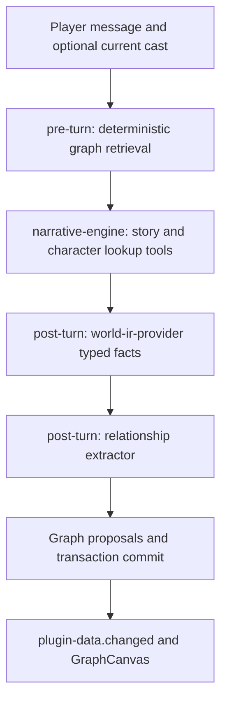

# NPC 关系图

这一页讲内置插件 `npc-graph`（关系图谱）怎样工作：它怎样从故事里记下人物和关系，怎样在后面的回合把相关的关系提醒给叙事插件，以及右侧面板的关系图是怎么画出来的。想改这个插件，或者想照着它做一个“从故事里提取数据、再喂回提示词”的插件，读这一页。

它是一个普通插件的例子，不是框架的一部分。框架里没有任何“图”的类型。

## Why

设计受 [MiroFish](https://github.com/666ghj/MiroFish) 启发，但不依赖任何外部的图服务（不用 Zep，不用 Neo4j）。目标是一张自成一体的、**只属于一个会话的知识图谱**：

1. 记下模型在故事里提到的 NPC、团体、势力，以及它们之间的关系。
2. 跨回合保留下来，并把相关的关系事实重新放进叙事插件的提示词，让角色的行为前后一致。
3. 在右侧面板里画成一张实时的力导向关系图。
4. 保持可选。检索只用名字匹配和图遍历，不需要 embedding 模型，也不需要向量能力，三种存储后端（Memory / SQLite / PostgreSQL）都能用。

## Component Map

插件有两个 runtime：回合开始前运行的检索器（`npc-graph/rag-retriever`，一个函数），和正文写完后运行的提取器（`npc-graph/extractor`，一段给模型的提示词）。



### 检索器：回合开始前找出相关的关系

它不调用模型，也不调用 embedding 服务。步骤是固定的：

1. **找起点。** 先在玩家这句话里匹配节点的名字和别名。
2. **没匹配到时看在场角色。** 使用可选的同回合输入 `currentCast`（来自契约 `scene-cast@1`）。只有某个名字或别名完整地、无歧义地对上一个 `individual` 节点时才算数。角色 ID 和图节点 ID 是两套互不相通的编号。
3. **只看当前有效的关系。** 每组 `(source, target, relation)` 只保留最新的一条未失效的边。已失效的边不参与遍历。
4. **向外走最多两步。** 从起点出发，沿相邻的边最多走两跳。
5. **排序并截断。** 走到的边按 `validAt` 从新到旧排，再按 `strength` 的绝对值从大到小排，最多取 20 条。
6. **输出。** 结果是 `npcContext`（一段 Markdown 列表），通过契约 `graph-rag@1` 交给叙事插件。图是空的或没有匹配到节点时，输出 `npcContext: ""`。

检索器在遍历前把节点和边全部读进来，相邻关系是从读到的边现场算出来的。这不是向量查询，也不是固定耗时的检索。

### 提取器：正文写完后更新图

- **它读什么。** 必需的输入 `worldIR`，来自契约 `world-ir-provider@1`。那是另一个插件已经从本回合正文里整理好的结构化事实，所以提取器不用自己重读整段正文。
- **它已经知道什么。** 已有的节点和关系在调用模型之前就放进了它的提示词（`<existing-npcs>` 和 `<existing-relations>`，各最多 60 条）。
- **怎样才算完成。** `toolChoice: required` 要求模型真的调用工具。完成条件是 `completion.require: explicit`：一次成功的 `upsert-npc-graph`，或者在没有变化时明确调用 `runtime-done`。
- **什么不算。** 只用文字或 JSON 声称“已更新”，不会让图发生任何变化。
- **什么时候看得到。** 实际的写入先随回合的事务提交，之后界面才收到数据事件。

> [!NOTE]
> 这些输入让提取更有依据，但不保证模型的推断和实体分类一定正确。叙事插件另有会话范围的 `list-characters` / `get-character` 工具，可以查到完整的角色档案，包括不在场的角色。关系图只是补充的上下文，不是角色的权威记录。

## Data Model

图是插件自己的数据。下面的存储形状由 `plugins/npc-graph/tools/upsert-npc-graph.js` 产生和校验。

```ts
type NpcNodeType = "individual" | "group" | "faction";

interface NpcNode {
  id: string; // opaque persistent ID; preserve existing IDs
  name: string; // canonical, used for LLM joins
  aliases?: readonly string[];
  type: NpcNodeType;
  labels: readonly string[]; // ontology tags, max 5
  summary: string; // 4–400 chars
  firstSeenTurn: number;
  lastSeenTurn: number;
  attributes?: Readonly<Record<string, unknown>>;
}

interface NpcEdge {
  id: string; // opaque persistent edge ID, one per relation version
  source: string; // node ID
  target: string; // node ID
  relation: string; // starts with a letter, max 48 chars; UPPER_SNAKE_CASE preferred
  strength: number; // [-1, 1]
  fact: string; // single sentence, 8–400 chars — RAG unit
  validAt: number; // logical turn that opened this version
  invalidAt?: number; // logical turn that closed it; absent while current
  evidenceTurnIds: readonly string[];
}
```

一条边是一条**带版本的事实**，不是唯一的一行。同一组 `(source, target, relation)` 在一个会话里可以有很多个版本，其中最多一个是当前有效的（没有 `invalidAt`）。

## Storage Layout

全部保存在 `plugin_data` 里，`pluginId = 'npc-graph'`：

| namespace | key        | value     |
| --------- | ---------- | --------- |
| `nodes`   | `{npcId}`  | `NpcNode` |
| `edges`   | `{edgeId}` | `NpcEdge` |

节点和边就是存下来的整张图。没有单独保存的邻接索引：检索器从它读到的边现场建立邻接表，所以索引不会和边不一致。

## Plugin Tools

工具文件在 `plugins/npc-graph/tools/`：

- **`upsert-npc-graph.js`**：主要的写入工具。模型按**名字**提交节点和边，工具负责其余的事：
  - 按名字和别名找到已有的节点。
  - 给新名字的节点分配一个由单词组成的 ID（`wordId`，例如 `npc-lin-yao`）。
  - 把更新合并进已有节点：别名、labels（最多 5 个）、summary、attributes。已有的名字和类型不变。
  - 把边的 `sourceName` / `targetName` 换成节点 ID。任一端找不到节点的边被跳过。
  - 给边做版本管理：没有变化的关系什么也不做；`strength` 或 `fact` 变了，就给旧版本写上 `invalidAt`，再新开一个版本。
  - 同一次执行里多次调用，后一次能读到前一次缓冲的写入；它们在执行结束时一起提交。

World IR 里类型是 `character` 的实体对应图里的 `individual` 节点。地点、物品、技能和概念不是这张图的节点，工具会忽略它们，连向它们的边也被跳过。

**ID 的规则。**

- 新节点的 ID 来自 `wordId`。它会避开所有已保存或已缓冲的 key，所以新节点不会顶替另一个节点。模型在注入的图里读得到这些 ID，所以它们保持简短。
- 边的 ID 用 `shortIdBatch`（单词加一段随机部分），每个关系版本一个。
- 已有的节点 ID、边的两端和首次出现的回合，在重启后保持不变。
- 已经被覆盖的历史数据只能靠完好的备份找回，安装新版本无法重建它。

工具采用“依赖由宿主注入、文件自身不带依赖”的写法，由 `server/index.js` 用 `covel.registerTool(...)` 注册：

```js
export default function ({ tool, z, shortIdBatch }) {
  return tool({ ... });
}
```

## Embedding And Vector Capabilities

`npc-graph` 的检索器现在用的是确定的名字和别名匹配，加上两跳的图遍历。它不生成 embedding，也不查询向量存储，所以这个插件不需要 embedding 模型槽位。

框架有更底层的能力，别的功能可以使用：

- `@covel/ai-provider` 通过内部的 gateway 支持 embedding 请求。`llm.toml` 里的 embedding 槽位示例（取自 `llm.toml.example`）：

  ```toml
  [covel.embed-default]
  provider = "ollama"
  model    = "nomic-embed-text-v2-moe"
  baseUrl  = "http://localhost:11434/v1"
  protocol = "openai-chat-v1"
  tag      = "embedding"
  output   = ["embedding"]

  [covel.embed-multimodal]
  provider = "openrouter"
  model    = "nvidia/llama-nemotron-embed-vl-1b-v2:free"
  baseUrl  = "https://openrouter.ai/api/v1"
  protocol = "openai-chat-v1"
  tag      = "embedding"
  output   = ["embedding"]
  input    = ["text", "image"]
  ```

- `@covel/store` 提供可选的 `VectorStoreCapability`：

  | 后端        | 实现           |
  | ----------- | -------------- |
  | MemoryStore | 内存里逐条比较 |
  | SqliteStore | `sqlite-vec`   |
  | PgStore     | `pgvector`     |

  向量行按会话分区，可以按插件、namespace 和数据 key 过滤。

这些能力和本插件当前的结构化检索路径互不相干。模型槽位的写法见[模型槽位](../reference/slots.md)。

## Visualization

`apps/web/src/lib/graph-canvas.tsx` 把 `GraphCanvas` 组件注册进共享的 json-render 组件目录。

- 画图用的库 `react-force-graph-2d` 是懒加载的，玩家打开面板时才下载。
- 节点和边由面板的数据源提供。数据随 SSE 事件变化时，图自动重画。

插件的右侧面板声明在 `plugins/npc-graph/runtimes/extractor/ui/npc-graph-panel.json`。`dataSource.bindings` 把插件自己的 `nodes` 和 `edges` 两个 namespace 放进面板状态，再作为 props 传给 `GraphCanvas`：

```json
{
  "id": "npc-graph",
  "group": "npc-graph",
  "label": "Relationship Graph",
  "icon": "network",
  "dataSource": {
    "namespace": "nodes",
    "bindings": { "nodes": "nodes", "edges": "edges" }
  },
  "emptyState": {
    "message": "No character or faction relationships yet. They will appear as the story continues."
  },
  "view": {
    "component": "Stack",
    "props": { "gap": "sm" },
    "children": [
      {
        "component": "Text",
        "props": {
          "content": "Relationships among characters, groups, and factions in the current session. Green = positive, red = negative, gray = neutral.",
          "variant": "muted",
          "size": "xs"
        }
      },
      {
        "component": "GraphCanvas",
        "props": {
          "nodes": { "$state": "/sources/nodes" },
          "edges": { "$state": "/sources/edges" },
          "node": {
            "idField": "id",
            "labelField": "name",
            "typeField": "type",
            "summaryField": "summary",
            "labelsField": "labels",
            "colors": {
              "individual": "#60a5fa",
              "group": "#a78bfa",
              "faction": "#f59e0b"
            },
            "defaultColor": "#9ca3af"
          },
          "edge": {
            "idField": "id",
            "sourceField": "source",
            "targetField": "target",
            "relationField": "relation",
            "strengthField": "strength",
            "factField": "fact",
            "inactiveField": "invalidAt",
            "colors": {
              "positive": "#22c55e",
              "negative": "#ef4444",
              "neutral": "#94a3b8"
            }
          },
          "height": 480
        }
      }
    ]
  }
}
```

`inactiveField: "invalidAt"` 告诉组件哪些边是已经失效的旧版本。

## Cross-references

- [插件参考](../reference/plugins.md)：完整的插件清单，包含这两个 runtime
- [右侧面板](../reference/ui-panels.md) 和 [UI 组件](../reference/ui-components.md)：`GraphCanvas` 的说明
- [工具参考](../reference/tools.md)：当前的 upsert 流程和只读工具
- [`plugins/npc-graph/tools/upsert-npc-graph.js`](../../plugins/npc-graph/tools/upsert-npc-graph.js)：输入 schema 和保存的节点、边的形状
- [`plugins/npc-graph/`](../../plugins/npc-graph/README.md)：插件本身
- [`apps/web/src/lib/graph-canvas.tsx`](../../apps/web/src/lib/graph-canvas.tsx)：可视化组件
- `plugins/npc-graph/tests/`：插件的契约测试和集成测试
