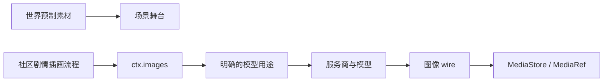

# 图像生成

这一页讲 Covel 里一张图片是怎么来的：谁提供素材、谁发起生成、用哪个模型、请求按什么格式发出。它适合做世界包、写插画插件，或者排查“为什么没出图”的人。

先记住三件事：

- 内置插件不生成图片。场景舞台只显示世界包里预先做好的背景。
- 安装一个生图插件，不会替你配置模型。
- 没有图像模型也能正常玩。缺少模型时，生成被跳过，已有的素材和剧情不受影响。

世界素材、插件流程、模型用途和图像协议各管一件事：

| 部分          | 职责                                     | 选择入口                                                                                            |
| ------------- | ---------------------------------------- | --------------------------------------------------------------------------------------------------- |
| 世界包        | 提供预制背景、角色图和画风描述           | `worldData` 中的 `stage.scene-assets@1`、`stage.scenes@1`、`character.portrait-assets@1` 等数据契约 |
| `scene-stage` | 展示世界预制背景，缺图的地点回退世界头图 | 无生成设置                                                                                          |
| 社区插画插件  | 从剧情生成提示词，提供手动生成入口和画廊 | 会话启用插件，选择其 `modelPresetId`；主仓不内置这些业务流程                                        |
| 模型用途      | 把任务需要的角色绑定到服务商与模型       | 设置中的用途分配，或当前生效的 `llm.toml`                                                           |
| 图像 wire     | 编码请求、解析图片响应、处理供应商协议   | 模型用途的 `providerRequestMetadata.imageWire`                                                      |
| `ctx.images`  | 解析模型、调用 wire、去重并保存媒体      | function runtime 调用 `ctx.images.generate()`                                                       |

## 加载与激活

**世界和舞台**

- 世界包的 `pluginPolicy` 只说明开局默认选哪些插件（`preset`、`plus`）和离不开哪些契约（`requires`）。最后启用哪些插件，由插件声明的契约和会话的授权决定。
- 舞台叙事依赖的是 `scene-stage@1` 这个契约，不依赖“装了某个生图插件”。
- 预制素材通过已启用插件公开的数据契约导入。没有配置生成模型，也能显示已有的图片。
- `character-blueprint` 负责保存和显示角色媒体，不负责生图。

**社区插画插件**

- 社区插件可以安装在 `~/.covel/plugins`，开发时也可以链接源码目录。
- 安装、允许它运行服务端代码、在会话里启用，是三个不同的步骤。
- `media.image-flow@1` 只声明两件事：手动插画的入口 runtime 和资产 runtime。它是一个只能有一个提供者的扩展点，同一个会话只能选一个这样的插画流程。它不注册图像协议。

**自定义协议**

- 需要自己的协议时，插件在 entry 里调用 `covel.registerWires`，注册名是 `<pluginId>/<wireId>`。
- 这个插件的代码必须已经获得授权，并且完成了 entry 注册。
- 模型配置引用了不存在的 wire 时明确失败，不会自动换成另一种协议。
- 内核仍然提供通用的 `openai-images` 和 `dashscope-wan`，社区插画流程可以直接用。

详见[媒体存储](./media-store.md)。

## 模型选择

**`modelPresetId` 保存的是用途名**

- 它不保存模型 ID、地址或密钥。
- 默认使用 `image`。想给不同的插画流程分开配置，就创建多个有名字的用途，再分别选择。
- function runtime 的这个设置，和 agent 的 `runtimeModelOverrides` 互不相干。

**怎样找到模型**

- 图片调用按名字精确查找用途或预设，并检查它能产出图片。
- 没给名字时，`ctx.images.generate()` 和 `ctx.gateway.resolveSlot({ fallbackTag: "image" })` 都查找 `image`。
- 没有配置、名字拼错，或者绑定到了文本模型时，在发出网络请求之前返回 `CONFIG_ERROR`。不会改用“第一个别的图片用途”。
- 浏览器提交的用途绑定和模型能力限制仍然生效。

**`tag` 和 `imageWire` 不是一回事**

- `tag = "image"` 说的是这个用途的能力。
- `imageWire` 选的是请求的格式。

两者不能互相代替，插件名称和模型名称也不会自动选出协议。OpenAI 兼容的图像接口用 `openai-images`，DashScope 原生接口用 `dashscope-wan`。配置示例见仓库 [`llm.toml.example`](../../llm.toml.example) 的 image generation 部分。

**在用途上固定参数**

用途的 `providerRequestMetadata` 里除了 `imageWire` 之外的字段，会原样写进 `openai-images` 的请求体，并且盖过调用方给的同名选项。

- 模型只接受某个尺寸或画质时，在用途上写 `size`、`quality` 就行，插件不用改。
- `model`、`prompt` 和 `n` 属于这一次调用，写在用途里也不会生效。
- 语音的 `openai-speech` 同理：用途可以固定 `voice` 和 `response_format`，`model` 和 `input` 不能被替换。

### 用量

| 模型的计费方式                    | 这次调用的 `gateway.responded` 轨迹 | `/debug` 成本面板 |
| --------------------------------- | ----------------------------------- | ----------------- |
| 按 token 计费（如 `gpt-image-1`） | 带 `usage`、`model` 和 `provider`   | 计入花费          |
| 按张计费，以及语音合成            | 只带 `model` 和 `provider`          | 不计金额          |

按 token 计费的模型在回答里报告用量，`openai-images` 把它读出来。插件自己注册的 wire 只要在返回值的 `usage` 里给出 token 数，就进入同一条路径。

### 配置文件来源

- 明确设置的 `COVEL_LLM_TOML` 优先。
- 从源码开发时，优先使用仓库根目录的 `llm.toml`；没有这个文件时才使用用户目录的配置。
- 桌面版由桌面宿主指定用户配置的路径，通常是 `~/.covel/llm.toml`。
- 设置页里本地的用途绑定随请求覆盖文件配置，不回写 TOML。

> [!TIP]
> 家目录里配了图像用途，不代表开发服务正在读它。改对文件之后，在模型设置里重新加载 TOML，再检查实际生效的服务商和模型。

完整的解析规则见[模型用途](./slots.md)。

## 故事模型读到的图片

图片提交之后，写故事的模型在之后的回合里知道它出现过：

- 历史里，在图片出现的位置有一句说明。内容来自这次 `assetGenerations[]` 项的 `meta.caption`，没有时用 `meta.prompt`。
- 生图插件应该把给画图模型的提示词，或者一句画面描述，写进这两个字段之一。两个都不写时，模型只知道“这里展示过一张图片”。
- `meta` 的其他字段不进提示词。
- 故事模型的用途接受图片输入时，最新的 2 张图片本身也随请求发出，模型可以直接看画面。

位置、上限和成本见 [Prompt 结构参考：展示过的图片](./prompt-structure.md#展示过的图片)。这一步发生在提交的时候。在此之前生成的图片没有说明行，也不会发给模型。

## 可选能力与跳过

世界包里有图片用途，不等于要求玩家提供图像模型。

`ctx.images.isAvailable(presetId)` 只检查当前用途能不能解析成一个图像模型：

- 它不请求服务商，也不重试。
- 它不验证 API Key、余额或远端模型是否可用。发出生成请求之后的网络、授权或服务商错误，仍然按实际的失败处理。

社区插画流程在写入 pending 的画廊记录和发起图像调用之前，做同样的检查。缺少能力时返回 skipped：

- 已经排队的任务可能仍然留下一条“跳过”记录，但不会产生失败的图片，也不会自动重试。
- function 主动返回 `outcome: "skipped"` 并且提交成功时，后台任务以 `done` 结束，runtime 记录保留 `skipped`。
- 依赖没满足、实际执行出错和提交失败，仍然算失败。
- 直接调用底层的生成接口时，配置错误仍然以 `CONFIG_ERROR` 返回。

## 缓存与失败处理

**DashScope 的异步任务**

- 轮询的期限覆盖等待间隔、HTTP 请求和读取回答的时间。
- 到期就中止当前的轮询，不接受迟到的成功结果。调用方取消，同样会传到轮询请求。
- 遇到可以重试的 HTTP 错误时，先取消没用到的响应体再继续，避免长时间重试占着连接。
- 同步的图像端点仍然使用调用方的执行期限。

**去重（缓存）**

- 判断“是不是同一张图”时，会算上实际解析出的服务商、模型、端点、协议、wire 配置和生成参数。
- 所以给同一个用途换了模型或 wire 之后，同样的提示词会重新生成。
- 密钥和认证头不算在内。
- 已有的媒体保留。换模型不会自动重画已经生成的图片。

**`target` 字段**

底层的 `ctx.gateway.generateImage()` 返回必填的 `target`，记录实际发出请求时的模型身份。`ctx.images` 用它保存缓存键。这样即使配置在异步查缓存期间被切换，结果也不会写到另一个模型名下。

> [!IMPORTANT]
> 自己实现或模拟 `PluginRuntimeGateway` 时必须提供 `target`。模拟 `ImagesContext` 时必须提供 `isAvailable()`。

**其他规则**

- 没有配置图像模型时，跳过生成不影响已有的素材和剧情。社区插画插件只对它自己的流程和画廊负责。
- 图片用途没有同标签回退。用途名必须写对，拼错的名字不会被“顺便”解析到别的图片用途。
- 模型或 wire 变了之后，下一次生成可能不命中旧缓存。旧媒体不会被迁移或删除。

**一次生成多张**

共享的 image-generation handler 这样给结果编号：

- 第一张沿用预先写好的 pending 记录的 `imageId`。
- 后面的图片使用 `<imageId>-2`、`<imageId>-3` 这样的键。
- 批量的 effects 提交之后，基础记录被第一张 done 结果替换，不会留下一张永远 pending 的卡片。
- 实际返回几张图，就有几条记录。
